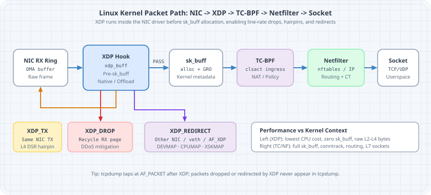

# Linux eBPF, XDP, and TC Programmable Dataplanes

Traditional Linux networking processes every packet through a general-purpose kernel stack: allocating an `sk_buff`, running GRO/LRO, traversing Netfilter/conntrack, performing route lookups, and finally waking a userspace socket. At 10–100+ Gbps and millions of packets per second (Mpps), that per-packet overhead becomes the primary CPU bottleneck. **eBPF (extended Berkeley Packet Filter)** lets you run sandboxed, JIT-compiled bytecode directly inside kernel network hooks—most notably **XDP (eXpress Data Path)** and **TC-BPF (Traffic Control)**—without writing kernel modules or bypassing Linux altogether.

## Learning goals

By the end of this chapter you can:

- Trace the Linux ingress packet pipeline from NIC RX ring through XDP, `sk_buff`, TC-BPF, Netfilter, and Socket
- Compare XDP attachment modes (offloaded, native/driver, generic) and return codes (`XDP_DROP`, `XDP_TX`, `XDP_REDIRECT`, `XDP_PASS`)
- Choose between XDP, TC-BPF, and `AF_XDP` for DDoS mitigation, L4 load balancing, and container dataplanes
- Inspect attached eBPF programs and trace dropped packets live with `bpftool` and `pwru`
- Decide when XDP is preferable to DPDK and vice versa

## The Linux kernel packet path

Every programmable hook sits at a specific trade-off point between **raw packet rate** (left) and **rich kernel context** (right):



1. **NIC RX ring (DMA)**: The network card DMAs raw Ethernet frames into pre-allocated memory pages and raises a NAPI poll interrupt.
2. **XDP hook (`xdp_buff`)**: Runs *inside the NIC driver* before the kernel allocates an `sk_buff` structure. The program sees raw packet bytes (`data` to `data_end`) and can drop, bounce, or redirect frames in tens of nanoseconds.
3. **`sk_buff` allocation & GRO**: If XDP returns `XDP_PASS`, the kernel allocates an `sk_buff` metadata descriptor and may coalesce adjacent TCP segments via Generic Receive Offload (GRO).
4. **TC-BPF (`clsact` ingress / egress)**: Runs on a full `sk_buff` both on ingress *and* egress. Ideal for container CNIs (Cilium), NAT, encapsulation, and QoS where both directions matter.
5. **Netfilter / `nftables` & IP routing**: Evaluates stateful `conntrack`, `PREROUTING`/`FORWARD`/`INPUT` hooks, and FIB route lookups.
6. **Socket / Userspace**: Delivers payload bytes to TCP/UDP socket buffers read by applications.

> [!IMPORTANT]
> **`tcpdump` blind spot:** `tcpdump` captures packets via `AF_PACKET` *after* XDP has already executed. If an XDP program returns `XDP_DROP`, `XDP_TX`, or `XDP_REDIRECT`, those packets will **never appear in `tcpdump`**. Use `xdpdump` or eBPF ring-buffer/perf telemetry when debugging XDP.

## XDP modes and return codes

### Attachment modes

| Mode | Where it executes | Hardware requirement | Typical performance |
|------|-------------------|----------------------|---------------------|
| **Offloaded (`xdpoffload`)** | Directly on SmartNIC / DPU hardware | SmartNIC with BPF offload (e.g., Netronome/Agilio) | Line rate with zero host CPU |
| **Native / Driver (`xdpdrv`)** | Inside the NIC driver's NAPI RX loop | Supported driver (`mlx5`, `ixgbe`, `i40e`, `ice`, `virtio_net`, `ena`, `veth`) | 10–25+ Mpps per CPU core |
| **Generic / SKB (`xdpgeneric`)** | Inside core kernel *after* `sk_buff` alloc | Any Linux interface | Testing/fallback only; loses pre-`sk_buff` speed |

### XDP verdicts (return codes)

| Verdict | Action | Primary use case |
|---------|--------|------------------|
| **`XDP_DROP`** | Immediately recycle the RX DMA page | DDoS / SYN-flood / malformed-packet scrubbing at 20+ Mpps/core |
| **`XDP_TX`** | Transmit the (modified) frame back out the **same NIC** | One-arm L4 DSR load balancers (Katran, Cilium XDP LB) |
| **`XDP_REDIRECT`** | Forward frame to another NIC (`DEVMAP`), another CPU (`CPUMAP`), or userspace (`XSKMAP` / `AF_XDP`) | High-speed L3 routers, veth switching, zero-copy userspace IDS/capture |
| **`XDP_PASS`** | Hand frame up to normal Linux stack (`sk_buff`) | Control-plane traffic (SSH, BGP, health checks) or non-matching flows |
| **`XDP_ABORTED`** | Drop and emit `xdp:xdp_exception` tracepoint | Program error / unrecoverable state (debugging signal) |

### Minimal XDP drop program in C (libbpf)

```c
#include <linux/bpf.h>
#include <linux/if_ether.h>
#include <linux/ip.h>
#include <linux/in.h>
#include <bpf/bpf_helpers.h>

SEC("xdp")
int drop_icmp(struct xdp_md *ctx) {
    void *data     = (void *)(long)ctx->data;
    void *data_end = (void *)(long)ctx->data_end;

    struct ethhdr *eth = data;
    if ((void *)(eth + 1) > data_end)
        return XDP_PASS;

    if (eth->h_proto != __constant_htons(ETH_P_IP))
        return XDP_PASS;

    struct iphdr *ip = (void *)(eth + 1);
    if ((void *)(ip + 1) > data_end)
        return XDP_PASS;

    // Bounds-verified by the eBPF verifier: drop all IPv4 ICMP at the NIC driver
    if (ip->protocol == IPPROTO_ICMP)
        return XDP_DROP;

    return XDP_PASS;
}

char _license[] SEC("license") = "GPL";
```

Every pointer dereference (`eth + 1`, `ip + 1`) is checked against `data_end`. The Linux **eBPF verifier** statically proves memory safety, bounded loops, and valid helper calls before the JIT compiler turns the bytecode into native x86-64/ARM64 instructions.

## TC-BPF and `AF_XDP`

### TC-BPF (`clsact` qdisc)

XDP only exists on **ingress** and operates before `sk_buff` exists. When you need to inspect or rewrite **egress** packets (for example, container Pod egress `NetworkPolicy`, NAT, or VXLAN encapsulation) or leverage `sk_buff` helpers (checksum offload, `bpf_redirect_peer`, `bpf_fib_lookup`), attach eBPF programs to the `clsact` Traffic Control qdisc (`TC_ACT_OK`, `TC_ACT_SHOT`, `TC_ACT_REDIRECT`).

```bash
# Modern Linux 6.6+ TCX attachment or classic tc clsact inspection
tc qdisc show dev eth0
tc filter show dev eth0 ingress
tc filter show dev eth0 egress
```

### `AF_XDP` (XSK)

`AF_XDP` is a Linux address family that uses `XDP_REDIRECT` into an `XSKMAP` to hand raw frames directly from the NIC RX ring into a shared userspace memory ring (**UMEM**) with **zero packet copies** in zero-copy driver mode. This lets userspace applications (Suricata IDS, packet brokers, high-frequency trading gateways, or QUIC servers) process millions of packets per second while keeping the NIC owned by the Linux kernel.

## Live inspection and tracing with `bpftool` and `pwru`

Because eBPF programs run invisibly inside kernel hooks, operational tooling is essential.

### Inspecting attached programs and maps with `bpftool`

```bash
# List all loaded eBPF programs (XDP, TC, cgroup, kprobe) with IDs and tags
sudo bpftool prog list

# Show which XDP and TC programs are attached to network interfaces
sudo bpftool net list

# Inspect a BPF map's contents (e.g., blocked IPs or service backends)
sudo bpftool map list
sudo bpftool map dump id 42
```

### Tracing silent kernel drops with `pwru` ("Packet, where are you?")

When a packet enters a Linux host and vanishes without a trace (Netfilter drop, `rp_filter` reverse-path check, XDP/TC drop, or missing route), **`pwru`** attaches eBPF kprobes/fentry probes across kernel `sk_buff` functions and prints the exact kernel function and `kfree_skb` drop reason:

```bash
# Trace all TCP port 443 packets matching a source IP through the Linux kernel
sudo pwru --output-tuple --output-meta --filter-src-ip 198.51.100.10 --filter-dst-port 443
```

```text
SKB                CPU PROCESS      IFACE   PROTO  SRC -> DST                       FUNC
0xffff9c1a24b10e00   2 <empty>      eth0    TCP    198.51.100.10:51244 -> 10.0.1.5:443  ip_rcv
0xffff9c1a24b10e00   2 <empty>      eth0    TCP    198.51.100.10:51244 -> 10.0.1.5:443  fib_validate_source
0xffff9c1a24b10e00   2 <empty>      eth0    TCP    198.51.100.10:51244 -> 10.0.1.5:443  kfree_skb_reason(SKB_DROP_REASON_IP_RPFILTER)
```

Seeing `SKB_DROP_REASON_IP_RPFILTER` immediately tells you asymmetric routing triggered Linux strict reverse-path filtering (`net.ipv4.conf.*.rp_filter=1`)—saving hours of guesswork.

## Choosing XDP vs DPDK

**DPDK (Data Plane Development Kit)** achieves extreme packet rates by unbinding the NIC from the Linux kernel completely and polling it from userspace in a busy loop (100% CPU core utilization). XDP takes a **cooperative** approach.

| Dimension | XDP / `AF_XDP` | DPDK |
|-----------|----------------|------|
| **NIC ownership** | Remains in Linux kernel (`ip`, `ethtool`, `FRR`, SSH keep working) | Unbound from kernel (VFIO/UIO); requires separate control-plane stack |
| **CPU usage at idle** | Event-driven NAPI (low power when idle) | Dedicated 100% busy-poll cores |
| **Fallback to kernel TCP/IP** | Seamless (`return XDP_PASS`) | Must inject via KNI/TAP or implement full userspace TCP/IP |
| **Peak single-core Mpps** | ~20–25 Mpps (native XDP) | ~30–40+ Mpps (pure poll-mode userspace) |
| **Best fit** | DDoS scrubbing, cloud/K8s L4 LB (Katran, Cilium), hybrid host dataplanes | Dedicated telecom VNFs, hardware-appliance replacements, line-rate packet generators |

## Summary

eBPF turns the Linux kernel into a programmable dataplane without sacrificing OS integration. Use **XDP** when you need pre-`sk_buff` speed for ingress drops, DSR hairpins, or zero-copy `AF_XDP` redirects; use **TC-BPF** when you need bidirectional ingress/egress hooks with full `sk_buff` context; and keep `bpftool` and `pwru` ready whenever packets disappear inside the kernel. Next, we see how XDP and IPVS power production L4/L7 load balancers in [L4/L7 Load Balancing, DSR, and Reverse Proxies](02-l4-l7-load-balancing-dsr-and-proxies.md).
