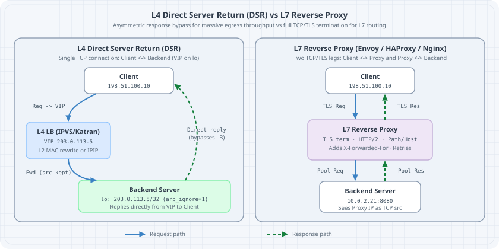

# L4/L7 Load Balancing, DSR, and Reverse Proxies

High-availability internet services almost always combine **two tiers** of load balancing: a horizontally scaled **Layer 4 (L4)** tier announced via BGP ECMP that absorbs huge packet rates and distributes TCP/UDP flows across a fleet of **Layer 7 (L7)** reverse proxies (Envoy, HAProxy, Nginx), which terminate TLS, inspect HTTP/gRPC requests, and route to application backends.

## Learning goals

By the end of this chapter you can:

- Contrast L4 NAT, L4 Direct Server Return (L2 DSR and L3 IPIP/GRE DSR), and L7 reverse proxies
- Configure a backend loopback VIP safely with `arp_ignore` and `arp_announce` for DSR
- Explain how IPVS and Meta's XDP-based Katran scale L4 load balancing
- Design active vs passive health checks, graceful connection draining, and circuit breaking
- Use consistent hashing (Maglev / Ring Hash) to minimize connection disruption during backend churn

## L4 Direct Server Return (DSR) vs L7 Reverse Proxy

In most web and media workloads, **responses are 5× to 50× larger than requests** (an HTTP GET is ~400 bytes; a video chunk or JSON payload is tens of kilobytes to megabytes). If every response byte must flow back through the load balancer, the load balancer's egress bandwidth becomes the bottleneck.



| Mode | TCP connections | Sees real client IP? | Response traverses LB? | Typical throughput & use case |
|------|-----------------|----------------------|------------------------|-------------------------------|
| **L4 Full-NAT (SNAT + DNAT)** | 1 (translated) | No (unless Proxy Protocol) | Yes | Simple topology; no backend loopback config required |
| **L4 DSR (L2 or L3 IPIP/GRE)** | 1 (Client <-> Backend) | **Yes** (native IP header) | **No** (bypasses LB) | Massive egress scale (edge PoPs, video, L4 tier in front of L7 proxies) |
| **L7 Reverse Proxy** | 2 (Client <-> Proxy, Proxy <-> Backend) | Via `X-Forwarded-For` or Proxy Protocol | Yes | TLS termination, HTTP/2-3 multiplexing, path/header routing, WAF, retries |

## How L4 Direct Server Return works

In DSR, the client initiates a TCP connection to the Virtual IP (`203.0.113.5:443`). The L4 load balancer picks a healthy backend and forwards the packet **without rewriting the source IP or destination VIP**. The backend accepts the packet because it holds `203.0.113.5/32` on its loopback interface (`lo`), and replies directly to the client's IP using `203.0.113.5` as its source IP.

### L2 DSR (MAC rewrite)

- **Mechanism**: The LB replaces only the Ethernet destination MAC address with the backend's MAC and sends the frame out on the same L2 subnet.
- **Constraint**: LB and backends **must share the same L2 broadcast domain / VLAN**.
- **Overhead**: Zero MTU reduction.

### L3 DSR (IPIP / GRE / GUE encapsulation)

- **Mechanism**: The LB wraps the original client IP packet inside an outer IP-in-IP (IPIP), GRE, or Generic UDP Encapsulation (GUE) header addressed to the backend's unicast IP. The backend decapsulates the outer header, delivers the inner packet to its local `lo` VIP, and replies directly over L3 to the client.
- **Benefit**: Works across **routed L3 Clos fabrics** and multiple racks without stretching L2 VLANs (used by Meta's **Katran**, Cloudflare's **Unimog**, and Google's **Maglev**).
- **Caveat**: Adds 20–28 bytes of outer header overhead; ensure underlay MTU supports it (e.g., 1528+ or 9000 jumbo frames) or lower advertised TCP MSS.

### Backend loopback VIP configuration (avoiding ARP conflicts)

If every backend configures `203.0.113.5/32` on `lo`, Linux's weak host model would normally answer ARP requests for `203.0.113.5` on `eth0`, hijacking traffic from the load balancer! Suppress ARP advertisements on the backend first:

```bash
# Prevent the backend from answering ARP for the VIP on eth0
sudo sysctl -w net.ipv4.conf.all.arp_ignore=1
sudo sysctl -w net.ipv4.conf.all.arp_announce=2
sudo sysctl -w net.ipv4.conf.lo.arp_ignore=1
sudo sysctl -w net.ipv4.conf.lo.arp_announce=2

# Bind the VIP to loopback
sudo ip addr add 203.0.113.5/32 dev lo

# For L3 IPIP DSR, also enable the ipip receive interface and disable strict rp_filter
sudo ip link set tunl0 up
sudo sysctl -w net.ipv4.conf.tunl0.rp_filter=0
sudo sysctl -w net.ipv4.conf.all.rp_filter=0
```

> [!WARNING]
> **Stateful firewall trap with DSR:** Never place a stateful firewall between the client and the L4 LB/backend pair in a way that sees only the outbound reply (`SYN-ACK`) without seeing the inbound `SYN`. Because DSR is intentionally asymmetric at the LB tier, stateful middleboxes must sit *outside* the DSR triangle (north of the edge router).

## Production L4 engines: IPVS and Katran

- **Linux IPVS (`ipvsadm`)**: Built into the Linux kernel. Supports NAT (`-m`), L2 Direct Routing / DSR (`-g`), and IPIP Tunneling (`-i`). Pairs naturally with `keepalived` or BGP (`ExaBGP`/`FRR`) for VIP advertisement.
- **Katran (XDP L4 LB)**: Open-sourced by Meta. Runs in **native XDP** (`XDP_TX` one-arm hairpin), encapsulating packets in IPIP/GUE to backends at 10+ Mpps per core while maintaining a local per-CPU LRU connection table and **Maglev consistent hashing** so any LB in an ECMP pool picks the same backend for a given 5-tuple.

```bash
# Example: Configuring an IPVS L2 DSR virtual service for HTTPS
sudo ipvsadm -A -t 203.0.113.5:443 -s mh
sudo ipvsadm -a -t 203.0.113.5:443 -r 10.0.2.21:443 -g -w 100
sudo ipvsadm -a -t 203.0.113.5:443 -r 10.0.2.22:443 -g -w 100
sudo ipvsadm -Ln --stats
```

Here `-s mh` selects IPVS's **Maglev Hashing** scheduler and `-g` selects Direct Routing (L2 DSR).

## L7 reverse proxies: HAProxy, Envoy, and Nginx

L7 proxies terminate TCP and TLS from the client and maintain a separate connection pool to upstream backends. This unlocks capabilities impossible at L4:

- **Protocol translation**: Speak HTTP/3 (QUIC) and HTTP/2 to browsers while speaking HTTP/1.1 or gRPC to internal microservices.
- **Content-based routing**: Route by `Host` header, URL prefix, gRPC method, cookies, or JWT claims.
- **Connection pooling & multiplexing**: Amortize expensive TLS handshakes and reuse warm TCP connections to backends.
- **Observability**: Emit per-route latency histograms (`p50`, `p95`, `p99`), status code rates, and distributed trace headers (`traceparent`).

### Active vs passive health checks

| Type | Mechanism | Pros | Cons |
|------|-----------|------|------|
| **Active health checks** | Proxy periodically probes `/healthz` every $N$ seconds | Detects dead backends even with zero user traffic; verifies recovery | Can lag by $N \times \text{threshold}$ seconds; probe storms at large fleet scale |
| **Passive health checks (outlier detection)** | Tracks real user request failures (e.g., 5 consecutive `5xx` or connect timeouts) and temporarily ejects the backend | Sub-second reaction to gray failures (bad disk, broken DB pool) | Requires live traffic to trigger; needs jittered ejection recovery |

> [!TIP]
> **Combine both:** Use active health checks to gate initial admission and recovery, and enable passive outlier detection (e.g., Envoy `outlier_detection` or HAProxy `observe layer7`) to eject degraded backends immediately before thousands of users fail.

## Resilience patterns: Draining, circuit breaking, and consistent hashing

### Graceful connection draining

Never remove a backend from service abruptly during a deploy. A clean drain sequence:

1. **Stop new requests**: Return `503` on the `/readyz` health endpoint (or set backend weight to `0` / `MAINT` via admin API) while keeping existing listeners open.
2. **Wait for LB convergence**: Allow at least `health_check_interval × unhealthy_threshold + propagation_buffer` (typically 5–15 seconds) so every upstream LB stops sending new flows.
3. **Drain in-flight requests**: Let active HTTP requests complete (send `Connection: close` for HTTP/1.1 or HTTP/2 `GOAWAY` frame) up to a bounded grace period (`terminationGracePeriodSeconds`), then shut down.

### Circuit breaking and load shedding

When a downstream database slows down, unbounded retries and queued connections cause **cascading failures** across every upstream caller. Configure explicit L7 circuit breakers (for example, in Envoy):

- `max_connections` and `max_pending_requests`: Fail fast locally (`503 Service Unavailable`) instead of exhausting proxy memory.
- `max_retries` + **retry budgets** (e.g., cap retries at 20% of active requests): Prevent retry storms from multiplying traffic 3× during an incident.

### Consistent hashing (Maglev / Ring Hash)

Simple `hash(5-tuple) % N` breaks almost every active TCP flow whenever $N$ changes (a backend crashes or scales out). **Consistent hashing** (Ring Hash or Google's **Maglev** lookup table):

- Remaps only $\approx \frac{1}{N}$ of flows when one backend joins or leaves an $N$-node pool.
- Allows **stateless ECMP L4 load balancers** to agree on the exact same backend without synchronizing connection tables across LBs.
- Improves L7 cache hit ratios when routing requests by URL or tenant key to stateful backend caches.

## Summary

Pair **L4 DSR** (IPVS or XDP/Katran with BGP ECMP and Maglev hashing) at the edge for massive throughput and client-IP preservation, with **L7 reverse proxies** (Envoy, HAProxy, Nginx) behind them for TLS termination, HTTP/2-3 multiplexing, active+passive health checks, circuit breaking, and graceful draining. Next, we scale this delivery model globally across hundreds of edge locations in [CDN Architecture and Edge Traffic Delivery](03-cdn-architecture-and-edge-delivery.md).
