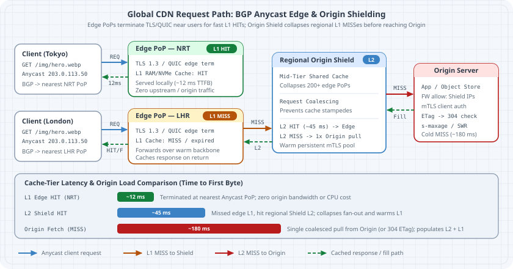

# CDN Architecture and Edge Traffic Delivery

Latency is bounded by the speed of light in fiber (~200,000 km/s, or roughly 10 ms round-trip per 1,000 km). A TLS 1.3 + TCP handshake to an origin server halfway around the world costs 250–400 ms before a single byte of HTML arrives. **Content Delivery Networks (CDNs)** terminate TCP, TLS, and QUIC at Points of Presence (PoPs) milliseconds away from end users, serving cached responses locally and shielding origins from traffic spikes.

## Learning goals

By the end of this chapter you can:

- Compare BGP Anycast PoP routing and GeoDNS / EDNS Client Subnet (ECS) steering
- Design tiered caching and origin shielding to collapse origin fan-out
- Control edge caching accurately with `Cache-Control`, `Vary`, `ETag`, and `stale-while-revalidate`
- Explain how edge TLS/QUIC termination and connection reuse reduce Time to First Byte (TTFB)
- Mitigate cache stampedes with request coalescing and debug edge misses with `curl` and `Server-Timing`

## Steering users to the nearest PoP: Anycast vs GeoDNS

A CDN must direct each user to an optimal, healthy edge PoP. Two complementary routing strategies dominate:

### 1. BGP Anycast

Every PoP announces the **exact same IP prefix** (e.g., `/24` IPv4, `/48` IPv6) via BGP to its local transit providers and Internet Exchange Points (IXPs). Internet routers naturally forward packets to the topologically nearest PoP (see [Anycast Services and DNS](../04-network-services/19-anycast-services-and-dns.md)).

- **Pros**: Instant automatic failover (withdraw BGP route and traffic shifts in seconds without waiting for DNS TTLs); absorbs volumetric DDoS across all PoPs simultaneously; single IP works even with broken/caching DNS resolvers.
- **Cons**: BGP optimizes for shortest AS-path, not always lowest RTT (can occasionally send a user to a farther PoP if transit peering is suboptimal); mid-stream BGP route flaps can reset long-lived TCP connections unless mitigated by QUIC Connection IDs or inter-PoP tunneling.

### 2. GeoDNS (with EDNS Client Subnet)

Authoritative DNS servers inspect the requester's IP (or the **EDNS0 Client Subnet / ECS** `/24` hint forwarded by public resolvers like `8.8.8.8`) and return a PoP-specific unicast IP address.

- **Pros**: Fine-grained traffic engineering (drain a congested PoP by 20%, steer by real-user RUM latency measurements, or enforce regional compliance).
- **Cons**: Slow failover bounded by DNS TTLs (and resolvers that ignore low TTLs); breaks when users query a distant recursive resolver that strips ECS (such as `1.1.1.1`).

| Dimension | BGP Anycast | GeoDNS / ECS |
|-----------|-------------|--------------|
| **Failover speed** | Seconds (BGP withdrawal) | Minutes (DNS TTL expiration) |
| **Capacity-aware steering** | Coarse (BGP prepending / communities) | Fine-grained (weighted percentages) |
| **DDoS absorption** | Distributed across global PoPs | Can concentrate on a single unicast PoP IP |
| **Common production pattern** | DNS + edge HTTP/3 PoPs (Cloudflare, Fastly) | Large media/video CDNs and multi-CDN steering (Akamai, CloudFront) |

## Tiered caching and origin shielding

If a global CDN has 200 edge PoPs and a popular object's cache TTL expires, all 200 PoPs could simultaneously fetch the object from your origin—a 200× amplification.

**Tiered caching (Origin Shielding)** introduces an intermediate **mid-tier / shield PoP** (or regional shield cluster) close to the origin:



```text
User -> Edge PoP (L1 cache miss) -> Shield PoP (L2 cache hit/coalesce) -> Origin
```

- **Higher global cache hit ratio**: Long-tail content requested in Tokyo and then in London misses Tokyo's L1 edge, populates the Shield L2 cache, and then hits the Shield when London requests it—never touching the origin twice.
- **Collapsed origin connections**: The origin only sees persistent, warmed TLS connections from a handful of Shield PoPs rather than thousands of edge servers worldwide.
- **Stronger origin security**: Origin firewall rules only need to allowlist the Shield PoP IP ranges (or authenticate via mTLS client certificates from the CDN).

## HTTP cache keys and freshness headers

A CDN cache is a distributed key-value store. By default, the **cache key** is `(scheme, host, path, query string)`. Two headers govern how objects are stored, revalidated, and split:

### Essential `Cache-Control` directives

| Directive | Meaning |
|-----------|---------|
| `public, max-age=60` | Browsers and CDNs may cache the response for 60 seconds |
| `s-maxage=3600` | Overrides `max-age` **only for shared caches (CDNs)**; browsers still obey `max-age` |
| `CDN-Cache-Control: max-age=3600` | Standardized RFC 9213 header targeting CDNs explicitly without affecting downstream proxies or browsers |
| `private, no-store` | Never store in a shared CDN cache (mandatory for personalized/authenticated responses) |
| `immutable` | Tells browsers not to revalidate versioned static assets (`/app.8f3a1c.js`) during page reload |
| `stale-while-revalidate=300` | Serve a slightly expired object immediately (zero user latency) while refreshing from origin asynchronously in the background |
| `stale-if-error=86400` | Serve stale content for up to 24 hours if the origin returns `5xx` or times out |

### Conditional revalidation (`ETag` / `If-None-Match`)

When a cached object expires, the CDN sends `If-None-Match: "<etag>"` to the origin. If the content has not changed, the origin replies **`304 Not Modified`** with an empty body—saving origin egress bandwidth and resetting the edge TTL.

### The `Vary` cache-fragmentation trap

The `Vary` header tells the CDN to include additional request headers in the cache key:

- **Safe**: `Vary: Accept-Encoding` (splits cleanly into 2–3 variants: `br`, `gzip`, `zstd`).
- **Dangerous**: `Vary: User-Agent` or `Vary: Cookie`! Because thousands of unique `User-Agent` strings exist, `Vary: User-Agent` destroys your cache hit ratio (often dropping it below 5%). Normalize headers at the edge (e.g., map `User-Agent` to a coarse `X-Device: mobile|desktop` key) instead of varying on raw client headers.

> [!CAUTION]
> **Query-string cache busting:** Marketing parameters like `?utm_source=newsletter&fbclid=xyz` create unique cache keys by default and can collapse hit ratios during campaigns. Strip non-functional tracking query parameters from the CDN cache key while still logging them for analytics.

## Edge TLS/QUIC termination and cache stampede protection

### Why edge termination speeds up even *uncacheable* dynamic APIs

Even when a response is `Cache-Control: private, no-store` (such as `/api/checkout`), routing it through a CDN edge accelerates TTFB:

1. **Short client handshake**: TCP + TLS 1.3 (or HTTP/3 QUIC 1-RTT / 0-RTT) terminates 15 ms from the user instead of 200 ms away.
2. **Pre-warmed origin connections**: The edge PoP maintains persistent, congestion-window-warmed HTTP/2 or HTTP/1.1 connection pools to the origin over optimized private backbones, eliminating slow-start penalties on every user request.

### Request coalescing (collapsed forwarding)

When a hot cached object expires (or a flash crowd requests a brand-new URL simultaneously), 500 concurrent requests hitting the same edge PoP would normally trigger 500 identical origin fetches—a **cache stampede (thundering herd)**.

With **request coalescing** enabled:

- The first cache-miss request is sent to the origin.
- The other 499 concurrent requests for the exact same cache key **wait in memory** on the edge node.
- As soon as the origin response headers arrive, the edge streams the single response to all 500 clients simultaneously and populates the cache.

> [!NOTE]
> Request coalescing only collapses requests for **cacheable** objects. If the origin responds with `Cache-Control: private` or `Set-Cookie`, modern CDNs mark the URL as uncacheable (a "hit-for-pass" record) so subsequent requests are not serialized behind one another.

## Debugging edge hits, misses, and latency with `curl`

Use `curl` timing variables and response headers (`Age`, `Cache-Status` per RFC 9211, `X-Cache`, `Server-Timing`) to pinpoint whether latency happened at DNS, TLS, edge, or origin:

```bash
curl -sS -o /dev/null -D - \
  -w '\n--- Timing ---\ndns: %{time_namelookup}s\ntcp: %{time_connect}s\ntls: %{time_appconnect}s\nttfb: %{time_starttransfer}s\ntotal: %{time_total}s\n' \
  https://static.example.com/assets/app.js
```

```text
HTTP/2 200
age: 142
cache-control: public, max-age=300, stale-while-revalidate=600
cache-status: "CDN"; hit; ttl=158
etag: "65f1a2-4c00"
server-timing: edge;dur=1.4, origin;dur=0.0
vary: Accept-Encoding

--- Timing ---
dns: 0.008s
tcp: 0.019s
tls: 0.036s
ttfb: 0.041s
total: 0.045s
```

### Quick cache-miss diagnostic checklist

1. **`age: 0` and `cache-status: miss` on repeated requests**: Check for `Set-Cookie` on the response, `Cache-Control: private` / `no-store`, or an `Authorization` request header (many CDNs refuse to cache responses when `Set-Cookie` is present).
2. **Alternating hits and misses**: You are landing on different edge nodes inside a PoP without consistent hashing, or `Vary` includes a high-cardinality header.
3. **High `ttfb` despite `hit`**: Rare—usually indicates edge CPU saturation, a slow edge worker script, or large TLS certificate chain validation.

## Summary

CDNs combine Anycast/GeoDNS steering, tiered origin shielding, strict HTTP cache-key hygiene (`CDN-Cache-Control`, `stale-while-revalidate`, safe `Vary`), edge TLS/QUIC termination, and request coalescing to deliver sub-50 ms global responses while protecting origins. Next, we examine how identity-driven encryption and policy extend from east-west microservices to enterprise wide-area networks in [Service Mesh, mTLS Identity, and SD-WAN / ZTNA](04-service-mesh-mtls-and-sdwan.md).
