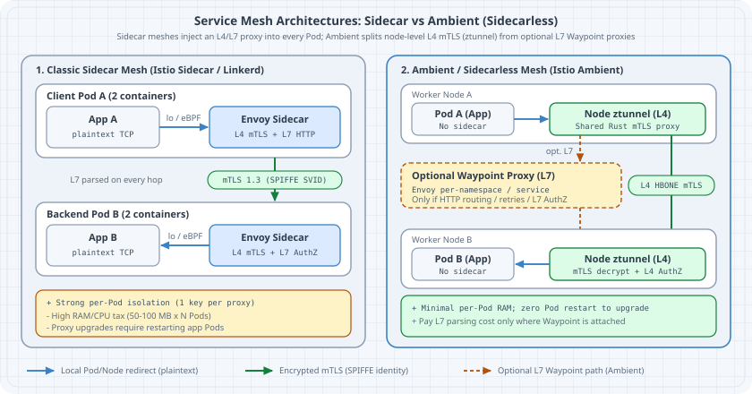

# Service Mesh, mTLS Identity, and SD-WAN / ZTNA

Traditional perimeter security trusted everything inside a corporate VLAN or cloud VPC ("castle-and-moat") and authenticated endpoints by IP address. In ephemeral Kubernetes clusters and hybrid remote-work enterprises, IP addresses change every minute and lateral movement inside the perimeter is the primary breach vector. Modern architectures replace IP-based trust with **cryptographic workload and user identity**: **Service Mesh** for east-west microservice traffic, and **SD-WAN / ZTNA (SASE)** for branch-to-cloud and user-to-app connectivity.

## Learning goals

By the end of this chapter you can:

- Compare sidecar-based service meshes (Envoy) with sidecarless / ambient / eBPF architectures
- Explain SPIFFE/SPIRE cryptographic workload identity and automatic short-lived mTLS certificate rotation
- Apply service mesh L7 controls (traffic splitting, retries, timeouts, fault injection) safely
- Describe enterprise SD-WAN overlay path selection, BFD/SLA probing, and application-aware routing
- Contrast legacy castle-and-moat VPNs with ZTNA and SASE zero-trust access models

## Service mesh architectures: Sidecar vs Sidecarless / Ambient

A **service mesh** decouples cross-cutting network concerns—mutual TLS (mTLS), L7 telemetry, retries, circuit breaking, and traffic splitting—from application code.



### 1. Classic Sidecar Mesh (Istio Sidecar, Linkerd)

Every application Pod gets an injected proxy container (typically **Envoy** or **linkerd2-proxy**). An init container configures `iptables` or eBPF socket redirection so all inbound and outbound TCP traffic from the app container transparently passes through the local sidecar.

- **Pros**: Strong per-Pod isolation (one compromised proxy only holds one workload's keys); uniform L4+L7 capabilities everywhere.
- **Cons**: Memory and CPU tax multiplied by every Pod (e.g., 50–100 MB RAM × 2,000 Pods); sidecar lifecycle race conditions (Jobs/CronJobs hanging until sidecar exits); extra TCP loopback hops per call.

### 2. Sidecarless / Ambient & eBPF Mesh (Istio Ambient, Cilium Service Mesh)

Splits L4 security from L7 processing so workloads only pay for L7 proxies when they actually need L7 features:

- **L4 layer (per-node)**: A shared node-level daemon (Istio **ztunnel**, or Cilium's **WireGuard / IPsec** kernel encryption) handles transparent mTLS/encryption, workload identity, and L4 authorization with minimal memory footprint and zero Pod restarts.
- **L7 layer (optional per-namespace/service)**: Waypoint proxies (Envoy) are deployed only for services that require HTTP header routing, retries, or L7 authorization policies.

| Dimension | Sidecar Mesh | Sidecarless / Ambient / eBPF |
|-----------|--------------|------------------------------|
| **Per-Pod RAM overhead** | High (proxy per Pod) | Minimal (shared node agent; optional L7 waypoint) |
| **Rollout / upgrade friction** | Requires Pod restart to upgrade proxy | Transparent node-agent upgrade; no app Pod restart |
| **Blast radius** | Per-Pod proxy isolation | Shared node-level L4 proxy (mitigated by per-identity keys & kernel isolation) |
| **L7 parsing cost** | Paid on every hop | Paid only when L7 policy/routing is configured |

## Cryptographic workload identity: SPIFFE, SPIRE, and mTLS

IP addresses cannot prove identity in a dynamic cluster where `10.244.2.9` might belong to `payments-api` at 09:00 and `analytics-job` at 09:05.

**SPIFFE (Secure Production Identity Framework for Everyone)** standardizes cryptographic workload identities as URIs embedded in the **Subject Alternative Name (SAN)** of short-lived X.509 certificates (**SVIDs**):

```text
spiffe://prod.example.com/ns/payments/sa/payments-api
```

**SPIRE** (or a mesh CA like `istiod`) automates the entire lifecycle:

1. **Node & workload attestation**: Verifies the Pod's Kubernetes ServiceAccount token, UID, and node identity via the kubelet/kernel.
2. **Short-lived X.509 SVID issuance**: Mints a leaf certificate valid for 1–24 hours and delivers it over an in-memory Unix domain socket (never written to disk).
3. **Automatic rotation**: Rotates keys and certificates seamlessly before expiry with zero dropped connections.
4. **Mutual TLS (mTLS) + Authorization**: During the TLS 1.3 handshake, *both* client and server validate each other's SPIFFE SVID against the shared trust bundle. Authorization policies then match cryptographic identities rather than IP ranges:

```yaml
apiVersion: security.istio.io/v1
kind: AuthorizationPolicy
metadata:
  name: allow-checkout-to-payments
  namespace: payments
spec:
  selector:
    matchLabels:
      app: payments-api
  action: ALLOW
  rules:
    - from:
        - source:
            principals:
              - "cluster.local/ns/checkout/sa/checkout-svc"
      to:
        - operation:
            methods: ["POST"]
            paths: ["/v2/charge"]
```

## Service mesh L7 traffic controls and pitfalls

- **Canary traffic splitting**: Shift 1% -> 10% -> 50% -> 100% of live traffic to a new version independent of ReplicaSet pod counts (often configured via Gateway API `HTTPRoute` for mesh/GAMMA).
- **Timeouts and retries**: Always set an explicit end-to-end request timeout and bound retries to **idempotent** operations (`GET`, `PUT`, or `POST` with an `Idempotency-Key` header).
- **Avoid retry amplification**: If Service A retries 3× to Service B, and Service B retries 3× to Service C, a single failing request turns into $3 \times 3 = 9\times$ load on a struggling database. Enforce retry budgets and prefer retrying only at the outermost safe tier.

## Enterprise SD-WAN: Overlay path selection and SLA probing

Shifting from the data center to the wide-area network (WAN): traditional branch offices backhauled all traffic over expensive private **MPLS** circuits to a central headquarters before reaching the internet or cloud SaaS. **SD-WAN (Software-Defined WAN)** decouples the logical WAN overlay from physical underlays (broadband internet, 5G/LTE, and MPLS):

### Core SD-WAN mechanics

1. **Zero-Touch Provisioning (ZTP) & centralized controller**: Branch edge routers authenticate with certificates, download policy from a cloud controller, and automatically build encrypted IPSec/WireGuard tunnels to hubs, cloud gateways, or peer branches.
2. **Continuous SLA probing (BFD / active probes)**: Every tunnel continuously measures **latency (RTT)**, **jitter**, and **packet loss** across each underlay link (e.g., ISP-A fiber, ISP-B cable, 5G).
3. **Application-aware routing (AAR)**: Classifies flows (using DPI, DNS/SNI, or DSCP markings) and steers each class onto the best qualifying path:
   - Real-time voice/video (Zoom, Teams): Require `< 150 ms` RTT, `< 30 ms` jitter, `< 1%` loss; fail over sub-second to the secondary ISP if the primary degrades—even if the primary link is still technically "up" (brownout protection).
   - Bulk backups / SaaS file sync: Pin to cheaper broadband internet; break out directly to the internet (**Local Internet Breakout**) instead of hair-pinning through HQ.
   - Forward Error Correction (FEC) and packet duplication: Optionally send redundant parity packets on lossy broadband links to protect mission-critical voice calls.

```text
Branch SD-WAN Edge
  ├── Tunnel 1 (ISP-A Fiber: 14ms, 0.0% loss)  ---> Voice / ERP / Cloud Hub
  ├── Tunnel 2 (ISP-B Cable: 42ms, 0.2% loss)  ---> Bulk Backup / Failover
  └── Direct Local Breakout (NAT + SWG)        ---> Trusted SaaS (M365, Slack)
```

## ZTNA and SASE: Beyond castle-and-moat VPNs

Traditional remote-access VPNs terminate a user's laptop onto a corporate subnet and hand it a routable internal IP address. Once authenticated, the laptop often has broad L3 reachability to internal servers—making stolen credentials or a compromised endpoint catastrophic.

**ZTNA (Zero Trust Network Access)**—and its broader converged cloud architecture **SASE (Secure Access Service Edge)**, which bundles SD-WAN + ZTNA + Secure Web Gateway (SWG) + CASB + FWaaS at global edge PoPs—inverts that model:

| Dimension | Traditional Remote-Access VPN | ZTNA / SASE |
|-----------|-------------------------------|-------------|
| **Trust boundary** | Network perimeter (IP/subnet) | Per-session user + device posture + application |
| **Access granularity** | Broad L3 subnet/VLAN access | Single named app/port (`grafana.internal:443`) |
| **Inbound firewall holes** | Public VPN concentrator IP exposed | **Dark origin**: outbound-only connector from private network to ZTNA broker |
| **Verification frequency** | Once at login | Continuous (re-evaluates device posture, EDR health, geo-anomalies) |
| **Traffic path** | Hair-pinned through HQ VPN appliance | Terminated at nearest global SASE edge PoP |

### How outbound-only ZTNA connectors work

Instead of exposing `ssh` or internal web apps on public IPs, an internal **ZTNA Connector** (e.g., Cloudflare Tunnel, Tailscale subnet router/app connector, Zscaler App Connector) opens an **outbound** mutually authenticated TLS/WireGuard connection to the cloud broker. Users authenticate via SSO/OIDC + device posture at the edge, and the broker proxies only authorized L4/L7 sessions over that outbound tunnel—eliminating inbound internet attack surfaces entirely.

## Summary

Both east-west **Service Meshes** (SPIFFE/SPIRE mTLS, ambient/sidecar proxies) and north-south/WAN **SD-WAN + ZTNA/SASE** apply the same architectural principle: decouple policy and identity from mutable IP addresses and physical links. Encrypt by default, authenticate cryptographically, measure real-time path health, and grant least-privilege access at the application layer.
