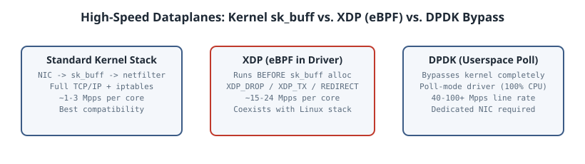

# Intro

**Programmable Dataplanes and Traffic Delivery** — Go deep into high-performance packet processing and modern traffic delivery: Linux eBPF/XDP/TC, L4 Direct Server Return vs L7 reverse proxies, CDN edge architecture, service mesh mTLS, and SD-WAN/ZTNA.

## How to use this part

Start with `01` for the kernel packet path, then move up the delivery stack through L4/L7 load balancing (`02`), CDNs (`03`), and service mesh/SD-WAN (`04`).

## Chapters in this part

| Chapter | File |
|---------|------|
| [Linux eBPF, XDP, and TC Programmable Dataplanes](01-ebpf-xdp-and-tc-dataplane.md) | `01-ebpf-xdp-and-tc-dataplane.md` |
| [L4/L7 Load Balancing, DSR, and Reverse Proxies](02-l4-l7-load-balancing-dsr-and-proxies.md) | `02-l4-l7-load-balancing-dsr-and-proxies.md` |
| [CDN Architecture and Edge Traffic Delivery](03-cdn-architecture-and-edge-delivery.md) | `03-cdn-architecture-and-edge-delivery.md` |
| [Service Mesh, mTLS Identity, and SD-WAN / ZTNA](04-service-mesh-mtls-and-sdwan.md) | `04-service-mesh-mtls-and-sdwan.md` |
## Dataplane Latency Spectrum & NIC Queue Inspection Lab



Inspect active Linux NIC offloads, RX/TX ring sizes, and socket buffer memory limits on a Linux host:

```bash
# Inspect TCP/UDP socket buffer sysctls and active listener queues
sysctl net.core.rmem_max net.core.wmem_max net.ipv4.tcp_congestion_control 2>/dev/null || true
ss -lnt 2>/dev/null | head -n 10 || netstat -an | head -n 10
```
