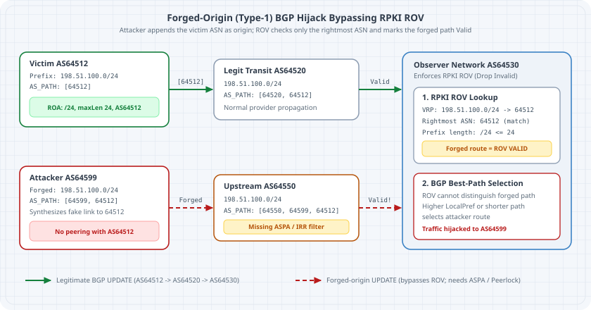

# Advanced and Emerging Routing Threats

As basic origin prefix filtering and RPKI Route Origin Validation (ROV) gain adoption across Tier-1, Tier-2, and major IXP route servers, naive origin hijacks are increasingly dropped at network borders. In response, sophisticated adversaries and state-sponsored operators have shifted toward attacks that remain syntactically valid under ROV, exploit overly permissive cryptographic metadata, abuse routing telemetry, or target the validation infrastructure itself.



## Forged-Origin (Type-1) Hijacks Bypassing RPKI ROV

RPKI ROV inspects only two fields of a BGP `UPDATE`: the announced prefix (and its mask length) and the **rightmost ASN** in the `AS_PATH`. It does not verify whether any intermediate AS-to-AS adjacency actually exists.

In a **forged-origin hijack** (often classified as a Type-1 hijack, one hop away from the origin):

1. Victim `AS64512` legitimately originates `198.51.100.0/24` and publishes a strict ROA: `(198.51.100.0/24, maxLength=24, AS64512)`.
2. Attacker `AS64599` never peers with `AS64512`, yet originates `198.51.100.0/24` with a synthesized path `AS_PATH: [64599, 64512]`.
3. If `AS64599`'s upstream transit provider (`AS64550`) lacks strict IRR customer-cone filters or ASPA validation, it propagates `AS_PATH: [64550, 64599, 64512]` into the Default-Free Zone (DFZ).
4. Any ROV-enforcing observer (`AS64530`) extracts the rightmost ASN (`64512`), matches it against the Validated ROA Payload (VRP) cache, and marks the forged announcement **`Valid`**.

Because the forged path is one hop longer than a direct customer path, the attacker cannot win every router globally by AS-path length alone. Instead, attackers pair forged-origin announcements with:

- **Local Preference elevation**: Advertising the forged route to a peer or IXP where the recipient prefers peer routes (`LOCAL_PREF 150`) over transit routes (`LOCAL_PREF 100`).
- **Strategic upstream placement**: Originating from a Tier-1 or well-connected regional provider whose customers see a shorter `AS_PATH` than the legitimate path.
- **Targeted interception**: Capturing traffic from specific regions without disrupting the victim globally, making detection far harder.

> [!IMPORTANT]
> Forged-origin hijacks cannot be stopped by RPKI ROV alone. Defending against them requires path-plausibility and customer-cone controls such as **ASPA (Autonomous System Provider Authorization)**, strict IRR `as-set` customer filters, and **Peerlock** on Tier-1 transit boundaries.

## Sub-Prefix Hijacks Under Loose ROA `maxLength`

RFC 9319 warns against publishing overly broad `maxLength` values in ROAs. Consider a network that allocates `198.51.100.0/22` and only announces the `/22` aggregate, yet creates a ROA with `maxLength=24` "just in case" it needs to disaggregate later.

An attacker can combine that loose `maxLength` with a forged-origin path:

- Legitimate announcement: `198.51.100.0/22`, `AS_PATH: [64512]`
- Forged sub-prefix announcement: `198.51.100.0/24`, `AS_PATH: [64599, 64512]`

Because `/24 <= maxLength (24)` and the rightmost ASN is `64512`, the forged `/24` evaluates as **ROV Valid**. Longest Prefix Match (LPM) then overrides `LOCAL_PREF` and `AS_PATH` length everywhere on the Internet, steering nearly 100% of traffic for that `/24` to the attacker.

> [!TIP]
> Follow RFC 9319 minimal ROA hygiene: set `maxLength` equal to the exact prefix length actually announced in BGP, or publish explicit ROAs for each active more-specific prefix rather than leaving unused sub-prefix space open.

## AS_PATH Shortening, Poisoning, and Policy Manipulation

Beyond forging origins, adversaries manipulate the `AS_PATH` attribute to steer traffic or evade loop-detection and monitoring heuristics:

- **AS_PATH Poisoning**: The attacker inserts a third-party ASN (`AS_Target`) into the `AS_PATH` (for example, `[64599, 64580, 64512]`). Because BGP's built-in loop prevention drops any route containing the receiver's own ASN, `AS64580` ignores the hijacked route—allowing the attacker to selectively blind a specific Tier-1 network, route collector, or victim's own monitoring ASN while still capturing traffic from the rest of the Internet.
- **AS_PATH Shortening / Prepend Stripping**: A transit or rogue peer strips legitimate `AS_PATH` prepends that a victim used for traffic engineering, making the attacker's path artificially shorter and pulling inbound traffic away from the victim's preferred ingress.
- **Competitive Traffic Dumping**: A rival network manipulates `MED` or selective `AS_PATH` prepending to force a peer to carry heavy bulk traffic across its long-haul backbone (hot-potato abuse) or detour latency-sensitive gaming and trading traffic over transoceanic links.

## Attacks on RPKI Publication Points and Validation Infrastructure

RPKI introduces an external cryptographic control plane that relies on RRDP (HTTPS) and rsync publication points (PPs) fetched periodically by Relying Party (RP) validators such as Routinator, `rpki-client`, or OctoRPKI. This creates new operational and adversarial attack surfaces:

- **Publication Point Denial-of-Service**: Flooding a delegated RPKI CA's RRDP server or poisoning its DNS can prevent RP validators from fetching fresh objects. If an outage exceeds the manifest and CRL `nextUpdate` window, validators mark the stale objects invalid and purge those VRPs from the cache, silently degrading prefixes from `Valid` to `NotFound`.
- **Algorithmic Complexity Attacks**: A malicious delegated CA can publish millions of deeply nested directories, oversized manifests, or slow-loris HTTP streams to exhaust CPU, memory, or fetch timeouts inside RP software. Modern validators mitigate this with strict per-repository file limits, timeout ceilings, and bounded manifest sizes.
- **Stale Manifest / CRL Fallback Risks**: Operators sometimes configure aggressive "fail-open" cache retention or disable strict manifest validation (RFC 9286) to avoid accidental drops during CA outages. While this preserves reachability, overly permissive fallback allows an attacker to replay revoked ROAs or suppress newly published `AS0` ROAs.

> [!WARNING]
> Monitor your RPKI validator's VRP count and RRDP/rsync fetch failure metrics continuously. A sudden drop in total VRP count (for example, >10% in one sync interval) often indicates a broken Trust Anchor Locator (TAL), an RIR repository outage, or a validator DoS condition—and should trigger an immediate alert before stale caches expire.

## Compromised Routers, Micro-Bursts, and Cloud-Specific Threats

Traditional threat models assume router software faithfully executes the BGP finite state machine. Real-world incidents show several ways that assumption breaks down:

- **Router Implant Malware**: State-sponsored actors have deployed memory-resident implants on edge and core router operating systems, allowing silent route injection or packet mirroring without appearing in running configuration files.
- **Micro-Burst Hijacking**: Instead of holding a hijacked prefix for hours, adversaries announce a target prefix for 60 to 180 seconds—just long enough to pass an automated HTTP-01/DNS-01 ACME TLS certificate challenge or intercept cryptocurrency RPC traffic—then withdraw the route before NOCs finish triaging alerts.
- **Low-and-Slow Interception**: By advertising a forged-origin or sub-optimal path that attracts a small regional slice of traffic and forwarding intercepted packets onward to the true destination via a clean transit path, an attacker avoids packet loss and evades naive reachability alarms.
- **Anycast Localization and Cross-Tenant Cloud Leaks**: Announcing a global Anycast prefix (such as a public DNS resolver) from a single rogue regional PoP captures local users without triggering global outage alerts. Inside multi-tenant clouds, misconfigured SDN route-reflector policies on Direct Connect or ExpressRoute interconnects can leak private enterprise prefixes between tenants.

## Telemetry Poisoning and Detection with BMP, RIPE RIS, and BGPalerter

Public route collectors (RIPE RIS, RouteViews) are essential for Internet-wide visibility, but they can be bypassed or poisoned if an attacker selectively withholds hijacked routes from collector peers or floods collectors with bogus announcements. Operators therefore combine **external public feeds** with **internal pre-policy telemetry**:

| Detection Layer | Data Source | What It Catches | Blind Spots |
|:---|:---|:---|:---|
| **BMP (RFC 7854)** | Internal edge routers (`Adj-RIB-In` pre-policy) | Forged-origin routes, micro-bursts, rejected ROV-Invalid updates, peer leaks before local policy drops them | Limited to visibility at your own borders |
| **RIPE RIS Live / RouteViews** | Global collector WebSocket streams | Internet-wide hijacks, sub-prefix announcements, unexpected visibility changes | 10–60s propagation lag; collector peering gaps |
| **BGPalerter / ARTEMIS** | Real-time alerting engines over RIS Live + local BMP | Automated alerts on unauthorized origin, new sub-prefixes, ROA mismatches, and visibility loss | Requires accurate prefix/ASN inventory and tuning |

### Illustrative BGPalerter Prefix Rule

The following illustrative `prefixes.yml` snippet configures BGPalerter to alert on unexpected origin ASNs, unauthorized sub-prefixes, and path anomalies for `198.51.100.0/24`:

```yaml
# Illustrative BGPalerter prefixes.yml (not executed on a live host)
198.51.100.0/24:
  description: Production edge prefix
  asn:
    - 64512
  ignoreMorespecifics: false
  ignore: false
  group: core-ops
  path:
    - match: ".* 64599 64512$"
      notMatch: true
      matchDescription: "Alert if unauthorized transit AS64599 appears adjacent to origin"
```

### Illustrative BMP Telemetry Inspection

Enabling BMP on edge routers streams raw pre-policy `Adj-RIB-In` updates to a collector (such as OpenBMP or GoBMP), allowing security teams to detect forged-origin attempts even when local policy rejects them:

```cfg
! Illustrative FRR BMP configuration snippet
router bgp 64530
 bmp targets sec-collector
  bmp connect 192.0.2.50 port 11019 min-retry 5000 max-retry 60000
  bmp monitor ipv4 unicast pre-policy
  bmp monitor ipv4 unicast post-policy
```

Pairing continuous BMP monitoring with automated BGPalerter rules and strict RPKI + ASPA hygiene reduces mean time to detect (MTTD) from hours to seconds, closing the window for micro-burst hijacks and covert traffic interception.
