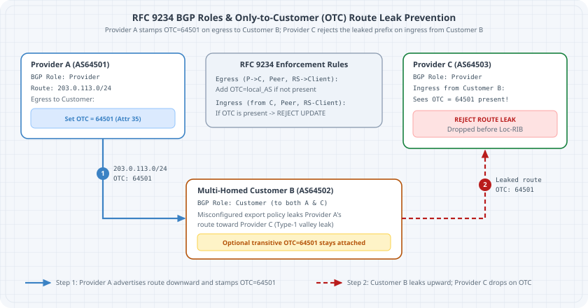

# Route Leak Detection and Prevention Mechanisms

A route leak occurs when a BGP speaker propagates a routing announcement beyond its intended commercial scope—most commonly re-advertising routes learned from one transit provider or lateral peer to another transit provider or peer. Because the leaked route retains its original, legitimate origin ASN, RPKI Route Origin Validation (ROV) evaluates it as `Valid`. Preventing and containing route leaks therefore requires dedicated role-aware signaling, path-valley verification, and strict session hygiene.



## RFC 7908 Route Leak Taxonomy (Types 1–6)

RFC 7908 classifies route leaks into six canonical types based on the commercial relationships (Provider, Customer, Peer) involved. Under the **Gao-Rexford valley-free model**, a valid interdomain path may travel uphill (Customer $\to$ Provider), cross at most one lateral Peer link, and then travel downhill (Provider $\to$ Customer)—never downhill and back uphill again.

| RFC 7908 Type | Name | Propagation Pattern | Typical Root Cause |
|:---:|:---|:---|:---|
| **Type 1** | Hairpin Turn with Full Prefix | Provider A $\to$ Customer B $\to$ Provider C | Missing outbound filter on a multi-homed customer |
| **Type 2** | Lateral ISP-ISP-ISP Leak | Peer A $\to$ AS B $\to$ Peer C | Re-advertising lateral peer routes to another lateral peer |
| **Type 3** | Transit-Provider Route to Peer | Provider A $\to$ AS B $\to$ Peer C | Exporting full transit table over a settlement-free IXP/PNI |
| **Type 4** | Peer Route to Transit Provider | Peer A $\to$ AS B $\to$ Provider C | Exporting IXP/peer-learned routes upstream to a transit provider |
| **Type 5** | Prefix Re-Origination with Data Path to Legitimate Origin | Provider A $\to$ AS B (re-originates) $\to$ Provider C | Redistribution from IGP/static into BGP (also triggers ROV Invalid if ROA exists) |
| **Type 6** | Accidental Leak of Internal Prefixes | Internal router $\to$ External eBGP peer | Missing `no-export` community or broken route-map during maintenance |

> [!NOTE]
> Types 1 through 4 are the hardest to stop with origin-only checks because the `AS_PATH` still ends in the legitimate origin ASN. RFC 9234 and ASPA specifically target these valley violations.

## RFC 9234: BGP Roles and the Only-to-Customer (OTC) Attribute

Proprietary BGP communities (such as `no-export` or ISP-specific tags) fail to stop cross-domain leaks because operators strip or ignore foreign communities. **RFC 9234** solves this at the protocol layer by introducing two interoperable mechanisms:

1. **BGP Role Capability (Capability Code 9)**: During BGP `OPEN` negotiation, each router declares its local commercial role on the session: `Provider`, `Customer`, `Peer`, `RS` (Route Server), or `RS-Client`. If the two sides declare incompatible roles (for example, both claim to be `Customer`), the session refuses to establish with a `NOTIFICATION` (`Role Mismatch`), preventing silent misconfiguration.
2. **Only-to-Customer (OTC) Path Attribute (Attribute Type 35)**: An optional, transitive 4-byte ASN attribute carried inside BGP `UPDATE` messages.

### Egress Marking and Ingress Rejection Rules

RFC 9234 enforces leak prevention with two deterministic rules:

- **Egress Marking**: When a router advertises a route on a session where its local role is `Provider`, `Peer`, or `RS`, it **must** attach `OTC = local_ASN` if the OTC attribute is not already present.
- **Ingress Rejection**:
  - When a router receives a route on a session where its local role is `Provider` (from a Customer) or `RS` (from an RS-Client), and the route **already contains an OTC attribute**, the route is an illegal valley leak and **must be rejected**.
  - When a router receives a route from a `Peer` and the route contains an `OTC` whose value does not equal the peer's ASN, it **must be rejected**.
  - When a router with local role `Customer` receives a route from a `Provider` without an OTC attribute, it adds `OTC = remote_ASN` on ingress so downstream hops remain protected even if the provider did not stamp it.

> [!IMPORTANT]
> Because `OTC` is an **optional transitive** attribute, intermediate routers that do not yet implement RFC 9234 still pass it intact. That means Provider A and Provider C can neutralize a Type-1 leak even if Customer B runs legacy software that ignores OTC.

## ASPA: Cryptographic Valley-Free Verification

While RFC 9234 relies on cooperative signaling (a malicious or misconfigured router could strip OTC), **ASPA (Autonomous System Provider Authorization)** brings cryptographic verification to the RPKI.

- Each participating AS publishes a signed **ASPA object** in the RPKI listing the set of all its authorized **upstream transit providers** (its Customer-to-Provider, or C2P, attestations).
- When a border router receives an `AS_PATH`, it verifies each adjacent ASN pair `(AS_i, AS_{i+1})` against the validated ASPA table to determine whether the path contains an **up-ramp** (Customer $\to$ Provider) followed by a **down-ramp** (Provider $\to$ Customer), or an unauthorized valley.
- If a path received from a customer or peer contains a Provider $\to$ Customer transition (a valley), or if an attacker forges an origin `AS_V` that has published an ASPA not listing the attacker as a provider, ASPA marks the path **`Invalid`** and drops it.

ASPA therefore defends against **both** Types 1–4 route leaks **and** forged-origin (Type-1) hijacks without requiring online cryptographic signing of every BGP `UPDATE` (unlike BGPsec).

## Peerlock and Peerlock-Lite AS-Path Filters

Before RFC 9234 and ASPA matured, major Tier-1 operators developed **Peerlock** to stop large-scale route leaks from smaller networks.

- **Core Principle**: A Tier-1 transit-free network (such as AS174, AS2914, AS3356, AS1299) never purchases transit from a smaller customer. Therefore, if a Tier-1 ASN appears anywhere inside an `AS_PATH` received from a non-Tier-1 customer or peer, that route is guaranteed to be a **route leak**.
- **Peerlock-Lite**: Even non-Tier-1 networks deploy lightweight AS-path regex filters on customer and IXP peer sessions that reject any route containing well-known Tier-1 ASNs in the middle of the `AS_PATH`.

## Concrete Router Configurations (FRR and BIRD 2)

### FRR: RFC 9234 BGP Roles + `maximum-prefix` + Peerlock-Lite

```cfg
! Illustrative FRR configuration for Provider C (AS64503) facing Customer B (AS64502)
bgp as-path access-list TIER1-LEAK-GUARD seq 10 deny _(174|209|286|701|1239|1299|2914|3257|3320|3356|5511|6453|6762|7018)_
bgp as-path access-list TIER1-LEAK-GUARD seq 20 permit .*
!
route-map CUST-IN permit 10
 match as-path TIER1-LEAK-GUARD
 match rpki valid
!
route-map CUST-IN permit 20
 match as-path TIER1-LEAK-GUARD
 match rpki notfound
!
router bgp 64503
 neighbor 198.51.100.2 remote-as 64502
 neighbor 198.51.100.2 local-role provider strict
 !
 address-family ipv4 unicast
  neighbor 198.51.100.2 maximum-prefix 500 80 restart 15
  neighbor 198.51.100.2 route-map CUST-IN in
 exit-address-family
```

> [!TIP]
> The `strict` keyword in FRR's `local-role provider strict` requires the neighbor to negotiate Capability 9 with the matching `customer` role. Omit `strict` during gradual migration if the customer router does not yet support RFC 9234—FRR will still enforce local OTC ingress/egress checks.

### BIRD 2: RFC 9234 Roles and Automatic OTC Enforcement

```cfg
# Illustrative BIRD 2.13+ configuration for Provider C (AS64503)
protocol bgp cust_as64502 {
    local 198.51.100.1 as 64503;
    neighbor 198.51.100.2 as 64502;
    local role provider;
    require roles on;

    ipv4 {
        import limit 500 action block;
        import filter {
            # RFC 9234 OTC drop is handled automatically by BIRD when local role is set
            if roa_check(r4, net, bgp_path.last) = ROA_INVALID then reject;
            accept;
        };
        export all;
    };
}
```

## MANRS Principles and Incident Response

Technical controls work best when backed by operational norms. The **Mutually Agreed Norms for Routing Security (MANRS)** framework defines four baseline actions for network operators:

| MANRS Action | Technical Requirement | Operational Focus |
|:---|:---|:---|
| **1. Filtering** | Drop incorrect announcements at customer edges | IRR prefix-lists (`bgpq4`), RPKI ROV, RFC 9234 OTC, `maximum-prefix` |
| **2. Anti-Spoofing** | Block spoofed source IP packets | Unicast RPF (RFC 3704) on customer access interfaces |
| **3. Coordination** | Enable rapid NOC-to-NOC escalation | Up-to-date 24/7 phone/email contacts in PeeringDB and RIR WHOIS |
| **4. Global Validation** | Publish authoritative routing intent | Valid minimal ROAs, ASPA objects, and maintained IRR `as-set` records |

When a severe leak still slips past filters into the global DFZ:

1. **Detect via Real-Time Monitors**: Use RIPE RIS Live, BGPalerter, or internal BMP collectors to identify the leaking ASN and the exact upstream propagating the valley path.
2. **Isolate the Session**: The upstream provider immediately shuts down or applies an emergency prefix-limit block to the leaking customer's BGP session.
3. **Coordinate Out-of-Band**: Contact the leaking network's NOC via PeeringDB emergency contacts; do not rely solely on email if the leak is disrupting reachability to their own mail servers.
4. **Emergency Disaggregation (Last Resort)**: Only if the leak involves a less-specific aggregate, the victim may temporarily originate matching more-specific `/24` prefixes until the upstream clears the leaked state.
