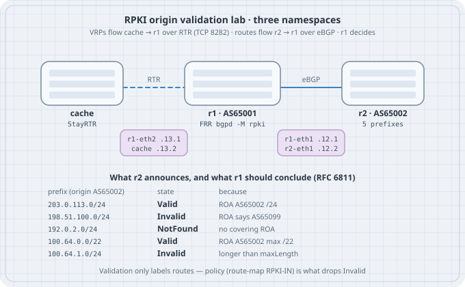

# Hands-On Lab: RPKI Route Origin Validation with Containerlab

Understanding RPKI Route Origin Validation (ROV) on paper is straightforward; seeing a router actually classify five live BGP announcements into `Valid`, `NotFound`, and `Invalid`—and watching what happens when the RTR cache vanishes—makes the mechanics stick. In this lab you will build a self-contained three-node Containerlab topology using FRRouting (FRR) and a lightweight **StayRTR** cache serving a local JSON VRP file, apply a strict `RPKI-IN` drop policy, verify every RFC 6811 validation state, and run an RTR failure drill to observe stale-timer behavior.



## Learning goals

By the end of this lab you can:

- Deploy a local RPKI-to-Router (RTR) cache using StayRTR with a deterministic JSON VRP file
- Enable FRR's `rpki` module (`bgpd -M rpki`) and establish an RTR session on TCP port 8282
- Predict and verify all three RFC 6811 validation states (`Valid`, `Invalid`, `NotFound`), including both wrong-origin and `maxLength` violations
- Enforce a `route-map RPKI-IN` policy that drops `Invalid` prefixes while accepting `Valid` and `NotFound`
- Run an RTR cache outage drill and explain how `rpki expire_interval` governs fail-open behavior

## Lab topology and test matrix

The topology consists of three containers linked point-to-point:

| Node | Role | ASN | Interfaces |
|------|------|-----|------------|
| `cache` | StayRTR server (TCP 8282) | — | `eth1`: `192.0.13.2/24` |
| `r1` | Validating eBGP router (FRR `bgpd -M rpki`) | `65001` | `eth1`: `192.0.12.1/24` (to `r2`), `eth2`: `192.0.13.1/24` (to `cache`) |
| `r2` | Originating eBGP peer (FRR) | `65002` | `eth1`: `192.0.12.2/24` (to `r1`) |

`r2` (AS 65002) advertises five test prefixes to `r1` (AS 65001). Together they exercise every branch of RFC 6811:

| Prefix announced by `r2` (AS 65002) | Covering VRP in `vrps.json` | Expected ROV State | Reason |
|-------------------------------------|-----------------------------|--------------------|--------|
| `203.0.113.0/24` | `203.0.113.0/24`, max `24`, AS `65002` | **Valid** | Exact origin and prefix-length match |
| `198.51.100.0/24` | `198.51.100.0/24`, max `24`, AS `65099` | **Invalid** | Covering VRP authorizes a different origin AS (`65099`) |
| `192.0.2.0/24` | *(none)* | **NotFound** | No VRP covers this prefix |
| `100.64.0.0/22` | `100.64.0.0/22`, max `22`, AS `65002` | **Valid** | Origin matches and `/22 <= maxLength 22` |
| `100.64.1.0/24` | `100.64.0.0/22`, max `22`, AS `65002` | **Invalid** | Origin matches, but `/24 > maxLength 22` (see [RPKI ROAs and the maxLength Trap](30-06-rpki-roa-maxlength.md)) |

## Step 1: Create the lab files

Create a working directory with the following layout:

```text
rpki-rov-lab/
├── rpki.clab.yml
├── vrps.json
└── configs/
    ├── daemons-r1
    ├── daemons-r2
    ├── r1.frr.conf
    └── r2.frr.conf
```

### Local VRP dataset (`vrps.json`)

StayRTR reads a standard Routinator/Cloudflare-style JSON file containing Validated ROA Payloads (VRPs):

```json
{
  "metadata": {
    "counts": 3,
    "generated": 1700000000,
    "valid": 1893456000
  },
  "roas": [
    { "prefix": "203.0.113.0/24",  "maxLength": 24, "asn": "AS65002" },
    { "prefix": "198.51.100.0/24", "maxLength": 24, "asn": "AS65099" },
    { "prefix": "100.64.0.0/22",   "maxLength": 22, "asn": "AS65002" }
  ]
}
```

### FRR daemon configs (`configs/daemons-r1` and `configs/daemons-r2`)

FRR does **not** load the RPKI RTR module unless `bgpd_options` includes `-M rpki`. Enable it on `r1`:

```ini
# configs/daemons-r1
zebra=yes
bgpd=yes
bgpd_options="  -A 127.0.0.1 -M rpki"
vtysh_enable=yes
```

On `r2`, standard `bgpd` is enough:

```ini
# configs/daemons-r2
zebra=yes
bgpd=yes
bgpd_options="  -A 127.0.0.1"
vtysh_enable=yes
```

### Validating router config (`configs/r1.frr.conf`)

Notice the two distinct stages: the `rpki` block downloads VRPs and labels routes, while `route-map RPKI-IN` enforces the drop policy on `Invalid` routes.

```text
frr defaults traditional
hostname r1
service integrated-vtysh-config
!
interface eth1
 ip address 192.0.12.1/24
exit
!
interface eth2
 ip address 192.0.13.1/24
exit
!
rpki
 rpki polling_period 30
 rpki retry_interval 15
 rpki expire_interval 120
 rpki cache tcp 192.0.13.2 8282 preference 1
exit
!
route-map RPKI-IN deny 10
 match rpki invalid
exit
route-map RPKI-IN permit 20
 match rpki valid
 set local-preference 150
exit
route-map RPKI-IN permit 30
 match rpki notfound
 set local-preference 100
exit
!
router bgp 65001
 bgp router-id 10.0.0.1
 no bgp ebgp-requires-policy
 neighbor 192.0.12.2 remote-as 65002
 !
 address-family ipv4 unicast
  neighbor 192.0.12.2 route-map RPKI-IN in
 exit-address-family
exit
!
```

> [!IMPORTANT]
> In production, `rpki expire_interval` is typically 3600–7200 seconds so a brief validator restart does not flush your VRP table. We intentionally shorten it to `120` seconds here so you can observe expiry cleanly during the failure drill.

### Originating router config (`configs/r2.frr.conf`)

```text
frr defaults traditional
hostname r2
service integrated-vtysh-config
!
interface eth1
 ip address 192.0.12.2/24
exit
!
interface lo
 ip address 203.0.113.1/24
 ip address 198.51.100.1/24
 ip address 192.0.2.1/24
 ip address 100.64.0.1/22
 ip address 100.64.1.1/24
exit
!
router bgp 65002
 bgp router-id 10.0.0.2
 no bgp ebgp-requires-policy
 neighbor 192.0.12.1 remote-as 65001
 !
 address-family ipv4 unicast
  network 203.0.113.0/24
  network 198.51.100.0/24
  network 192.0.2.0/24
  network 100.64.0.0/22
  network 100.64.1.0/24
 exit-address-family
exit
!
```

### Containerlab topology (`rpki.clab.yml`)

```yaml
name: rpki-rov
topology:
  nodes:
    cache:
      kind: linux
      image: rpki/stayrtr:v0.6.2
      binds:
        - vrps.json:/vrps.json:ro
      cmd: -bind :8282 -cache /vrps.json -checktime=false -refresh 30
      exec:
        - ip addr add 192.0.13.2/24 dev eth1
        - ip link set eth1 up
    r1:
      kind: linux
      image: quay.io/frrouting/frr:10.3.1
      binds:
        - configs/daemons-r1:/etc/frr/daemons:ro
        - configs/r1.frr.conf:/etc/frr/frr.conf:ro
    r2:
      kind: linux
      image: quay.io/frrouting/frr:10.3.1
      binds:
        - configs/daemons-r2:/etc/frr/daemons:ro
        - configs/r2.frr.conf:/etc/frr/frr.conf:ro
  links:
    - endpoints: ["r1:eth1", "r2:eth1"]
    - endpoints: ["r1:eth2", "cache:eth1"]
```

Deploy the topology:

```bash
sudo containerlab deploy -t rpki.clab.yml
```

## Step 2: Verify the RTR cache and VRP table

Connect to `r1` and confirm that the RTR session to `cache` (`192.0.13.2:8282`) is active and has populated the three VRPs:

```bash
docker exec -it clab-rpki-rov-r1 vtysh -c "show rpki cache-connection"
docker exec -it clab-rpki-rov-r1 vtysh -c "show rpki prefix-table"
```

Expected output:

```text
Connected to group 1
 rpki cache 192.0.13.2 8282 pref 1 (connected)

RPKI/RTR prefix table
Prefix                                   Prefix Length  Origin-AS
100.64.0.0                                22 -  22          65002
198.51.100.0                              24 -  24          65099
203.0.113.0                               24 -  24          65002
Number of IPv4 Prefixes: 3
Number of IPv6 Prefixes: 0
```

## Step 3: Verify BGP route filtering

Now inspect the BGP IPv4 unicast table on `r1`:

```bash
docker exec -it clab-rpki-rov-r1 vtysh -c "show bgp ipv4 unicast"
```

Expected output:

```text
     Network          Next Hop            Metric LocPrf Weight Path
 *>  100.64.0.0/22    192.0.12.2               0    150      0 65002 i
 *>  192.0.2.0/24     192.0.12.2               0    100      0 65002 i
 *>  203.0.113.0/24   192.0.12.2               0    150      0 65002 i
```

Verify each detail:
- **`203.0.113.0/24`** and **`100.64.0.0/22`** are installed with `LocPrf 150` (`Valid`).
- **`192.0.2.0/24`** is installed with `LocPrf 100` (`NotFound`).
- **`198.51.100.0/24`** (wrong origin AS) and **`100.64.1.0/24`** (`maxLength` violation) are **dropped** by `route-map RPKI-IN deny 10` and never enter `r1`'s Loc-RIB or kernel forwarding table.

To confirm that `r2` actually sent all five routes and `r1` dropped the two invalid ones, check the received-routes counter on `r1` (or temporarily remove `route-map RPKI-IN in` and run `show bgp ipv4 unicast rpki invalid`):

```bash
docker exec -it clab-rpki-rov-r1 vtysh -c "show bgp ipv4 unicast neighbors 192.0.12.2" | grep -E "Prefixes|Inbound"
```

## Step 4: Failure drill — RTR cache loss and stale-timer behavior

What happens when your RPKI validator crashes or becomes unreachable? RFC 8210 specifies that routers must **retain cached VRPs** until the `expire_interval` elapses, and then flush the table so routes fail **open** to `NotFound` rather than blackholing the Internet.

Test this directly:

```bash
# 1. Cut the link to the StayRTR cache (or pause the container)
docker pause clab-rpki-rov-cache

# 2. Immediately check cache status and BGP table (T + 10s)
docker exec -it clab-rpki-rov-r1 vtysh -c "show rpki cache-connection"
docker exec -it clab-rpki-rov-r1 vtysh -c "show bgp ipv4 unicast"
```

For the first ~120 seconds (`rpki expire_interval 120`), `r1` keeps the stale VRP table in memory, so `198.51.100.0/24` and `100.64.1.0/24` remain dropped.

Wait 130 seconds and run the checks again:

```bash
# 3. After expire_interval (T + 130s), VRPs expire and routes re-evaluate as NotFound
docker exec -it clab-rpki-rov-r1 vtysh -c "show rpki prefix-table"
docker exec -it clab-rpki-rov-r1 vtysh -c "show bgp ipv4 unicast"
```

You will see `Number of IPv4 Prefixes: 0`, and all **five** prefixes from `r2` now appear in `r1`'s BGP table with `LocPrf 100` (`NotFound`).

Finally, restore the cache and verify automatic recovery:

```bash
# 4. Restore StayRTR and watch r1 reconnect, reload VRPs, and re-drop the two Invalid prefixes
docker unpause clab-rpki-rov-cache
sleep 20
docker exec -it clab-rpki-rov-r1 vtysh -c "show rpki cache-connection"
docker exec -it clab-rpki-rov-r1 vtysh -c "show bgp ipv4 unicast"
```

> [!TIP]
> In production, always deploy at least **two independent RPKI validators** (for example Routinator and `rpki-client` + StayRTR on separate hosts) configured as `preference 1` and `preference 2`, and alert via gNMI/SNMP if the active VRP count drops suddenly or an RTR session disconnects.

## Step 5: Clean up

```bash
sudo containerlab destroy -t rpki.clab.yml --cleanup
```

## Related chapters

- [RPKI-to-Router (RTR) and Route Origin Validation (ROV)](16-rpki-to-router-rtr-and-route-origin-validation-rov.md)
- [Operational Consequences of ROV](17-operational-consequences-of-rov.md)
- [Troubleshooting Routing Security Controls](25-troubleshooting-routing-security-controls.md)
- [RPKI ROAs and the maxLength Trap](30-06-rpki-roa-maxlength.md)
