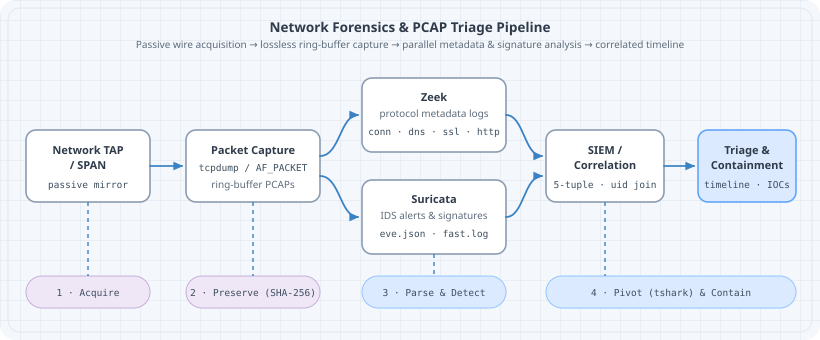

# Hands-On Lab: PCAP Triage with tcpdump, tshark, Zeek, and Suricata

Opening a 2 GB packet capture in Wireshark and scrolling from frame 1 is the slowest way to investigate an incident. Real network forensics works in layers: acquire packets without drops using ring buffers, hash the capture to preserve evidence integrity, run automated parsers (**Zeek** for structured protocol metadata and **Suricata** for signature alerts), use **tshark** to pivot into specific conversations and payloads, and stitch the findings into a single correlated incident timeline.



## Learning goals

By the end of this lab you can:

- Capture full packets safely with `tcpdump` ring buffers (`-C`, `-W`, `-s 0`) while verifying zero kernel drops
- Perform rapid CLI triage on a PCAP with `tshark` (conversations, DNS anomalies, TLS SNI/JA4, and HTTP object extraction)
- Run Zeek offline against a PCAP to generate `conn.log`, `dns.log`, `ssl.log`, and `http.log` and query them with `zeek-cut` / `jq`
- Run Suricata offline (`suricata -r`) to inspect IDS alerts in `eve.json`
- Correlate Zeek metadata, Suricata alerts, and raw packets into a clean incident timeline

## Lab prerequisites

You can run every command in this lab on any Linux host, VM, or Containerlab traffic-generator node with four standard packages installed:

```bash
sudo apt-get update && sudo apt-get install -y tcpdump tshark zeek suricata jq
```

Create an isolated working directory so logs never mix across cases:

```bash
mkdir -p ~/forensics-lab/{pcaps,zeek,suricata,extracted}
cd ~/forensics-lab
```

## Step 1: Capture clean PCAPs with ring buffers

When capturing live traffic from a TAP, SPAN port, or Containerlab veth interface, an unbounded `tcpdump -w dump.pcap` will eventually fill the disk and crash the sensor. Always use a **ring buffer** (`-C` for file size in MB, `-W` for maximum rotating files) and disable name resolution (`-n`) so `tcpdump` never leaks DNS queries or stalls on reverse lookups.

```bash
# Capture full frames (-s 0) on eth0 into 10 rotating files of 100 MB each (1 GB cap)
# Increase kernel capture buffer (-B 16384 = 16 MiB) to absorb microbursts
sudo tcpdump -i eth0 -n -s 0 -B 16384 -C 100 -W 10 -w pcaps/capture.pcap
```

When you stop the capture (`Ctrl+C`), check the summary footer:

```text
48219 packets captured
48219 packets received by filter
0 packets dropped by kernel
```

> [!WARNING]
> If `packets dropped by kernel` is non-zero, your capture is incomplete—TCP streams will show spurious retransmissions and missing HTTP objects. Increase `-B`, disable NIC offloads (`sudo ethtool -K eth0 gro off lro off tso off`), or switch to `AF_PACKET` (`TPACKET_V3`) via `netsniff-ng` or Suricata/Zeek live capture.

Before touching the capture with any analysis tool, record its SHA-256 hash and mark it read-only:

```bash
sha256sum pcaps/capture.pcap* > pcaps/SHA256SUMS
chmod 444 pcaps/capture.pcap*
```

For the remaining steps, point `$PCAP` to your capture file (for example `export PCAP=pcaps/capture.pcap0`).

## Step 2: Fast triage with `tshark`

Before launching heavier engines, spend 60 seconds with `tshark` to map the blast radius: who talked to whom, which domains were queried, what TLS destinations appeared, and whether any cleartext payloads were transferred.

### Top talkers and protocol hierarchy

```bash
# Protocol breakdown
tshark -r "$PCAP" -q -z io,phs

# Top TCP conversations sorted by total bytes
tshark -r "$PCAP" -q -z conv,tcp | head -n 25
```

### Hunting DNS anomalies

Look for unusually long query names (DNS tunneling), high NXDOMAIN counts (DGA beaconing), or TXT record exfiltration:

```bash
tshark -r "$PCAP" -Y "dns.flags.response == 0" \
  -T fields -e frame.time_utc -e ip.src -e dns.qry.name -e dns.qry.type \
  | awk '{ if (length($4) > 40) print "[LONG]", $0; else print $0 }' \
  | head -n 30
```

### Inspecting TLS SNI and JA4 / JA3 fingerprints

Even when traffic is encrypted with TLS 1.3, the ClientHello exposes the Server Name Indication (SNI) (unless ECH is enabled; see [Encrypted Client Hello](../08-transport-and-applications/14-encrypted-client-hello.md)) and client TLS stack fingerprint:

```bash
tshark -r "$PCAP" -Y "tls.handshake.type == 1" \
  -T fields -e frame.time_utc -e ip.src -e ip.dst -e tls.handshake.extensions_server_name \
  -e tls.handshake.version
```

### Extracting cleartext HTTP objects

If suspicious HTTP transfers exist, carve out the transferred payloads directly to disk for hashing and malware analysis:

```bash
tshark -r "$PCAP" -q --export-objects "http,extracted/"
ls -lh extracted/
sha256sum extracted/*
```

## Step 3: Structured protocol logs with Zeek

Zeek converts raw packets into concise, linkable transaction logs (`conn.log`, `dns.log`, `ssl.log`, `http.log`, `files.log`). Every log line shares a unique connection identifier (`uid`) and—when enabled—a **Community ID** hash (`community_id`) that matches Suricata's `eve.json` byte-for-byte.

Run Zeek offline in JSON mode with Community ID enabled:

```bash
(cd zeek && zeek -C -r "../$PCAP" policy/protocols/conn/community-id-logging LogAscii::use_json=T)
ls -lh zeek/
```

> [!NOTE]
> Always pass `-C` (`--no-checksums`) when analyzing PCAPs captured on a host with NIC checksum offloading enabled. Without `-C`, Zeek silently ignores outbound TCP/UDP frames whose checksums were filled in by the NIC after `tcpdump` saw them.

### Querying Zeek logs with `jq`

Find the longest-lived or highest-byte outbound connections in `conn.log`:

```bash
jq -r '[.ts, .uid, .community_id, ."id.orig_h", ."id.resp_h", ."id.resp_p", .conn_state, .orig_bytes, .resp_bytes] | @tsv' zeek/conn.log \
  | sort -t$'\t' -k8 -nr | head -n 15
```

Inspect all DNS queries that returned `NXDOMAIN` (potential DGA or dead C2):

```bash
jq -r 'select(.rcode_name == "NXDOMAIN") | [.ts, .uid, ."id.orig_h", .query] | @tsv' zeek/dns.log
```

Inspect TLS certificates and SNI in `ssl.log` (flagging self-signed or expired certs):

```bash
jq -r '[.ts, .uid, ."id.orig_h", ."id.resp_h", .server_name, .validation_status] | @tsv' zeek/ssl.log
```

## Step 4: Offline IDS signature analysis with Suricata

While Zeek excels at *everything that happened*, Suricata excels at *known bad patterns* (C2 beacons, exploit payloads, policy violations). Run Suricata offline against the same PCAP:

```bash
suricata -r "$PCAP" -l suricata/ -k none
```

Like Zeek's `-C`, `-k none` disables checksum validation so offloaded lab captures are not silently skipped.

### Extracting alerts from `eve.json`

Suricata writes structured JSON events (alerts, DNS, TLS, HTTP, flow) to `suricata/eve.json`. Filter for alerts with severity, signature, 5-tuple, and Community ID:

```bash
jq -r 'select(.event_type == "alert") | [
  .timestamp,
  .community_id,
  .src_ip, .src_port,
  .dest_ip, .dest_port,
  .alert.severity,
  .alert.signature
] | @tsv' suricata/eve.json | sort
```

## Step 5: Correlate into an incident timeline

Now combine all three sources—**Suricata alert → Zeek session context → `tshark` packet proof**—using `community_id` (or the 5-tuple + UTC timestamp):

```bash
# 1. Pick a suspicious community_id from Suricata's alert output
export CID="1:abc123examplehash="

# 2. Pull every Zeek record (conn, dns, http, ssl, files) for that exact flow
grep -h "$CID" zeek/*.log | jq -r '[.ts, .uid, ."id.orig_h", ."id.resp_h", ."id.resp_p", .query // .host // .server_name // .conn_state] | @tsv'

# 3. Pivot back to raw packets in tshark to verify the exact payload
tshark -r "$PCAP" -Y "ip.addr == 198.51.100.44 && tcp.port == 8080" -q -z follow,tcp,ascii,0
```

Document the verified findings in a chronological incident timeline before taking containment action:

| UTC Timestamp | Source → Destination | Evidence Source | Finding |
|---------------|----------------------|-----------------|---------|
| `14:02:11.042` | `10.20.1.15 → 10.20.0.53:53` | Zeek `dns.log` | Suspicious query `update-cdn.bad-example.invalid` → `198.51.100.44` |
| `14:02:11.118` | `10.20.1.15 → 198.51.100.44:8080` | Suricata `eve.json` | Alert `ET MALWARE HTTP Beacon` (`community_id` match) |
| `14:02:11.205` | `10.20.1.15 → 198.51.100.44:8080` | `tshark --export-objects` | Downloaded `stage2.bin` (`sha256: ...`) |
| `14:02:14.890` | `10.20.1.15 → 198.51.100.44:443` | Zeek `ssl.log` | Self-signed TLS session established; 4.2 MB outbound (`orig_bytes`) |

From this timeline, containment is surgical and evidence-backed: isolate `10.20.1.15`, block `198.51.100.44` and `update-cdn.bad-example.invalid` at the egress firewall/DNS RPZ, and hunt for the `stage2.bin` hash and `community_id` peer across the rest of the fleet.

## Related chapters

- [Fundamentals of Network Forensics and Log Analysis](02-fundamentals-of-network-forensics-and-log-analysis.md)
- [Building a Network Forensics Lab Environment](03-building-a-network-forensics-lab-environment.md)
- [Correlation and Investigation within SIEM](10-correlation-and-investigation-within-siem.md)
- [Socket Stats, tcpdump, and MTR](../06-security-operations/05-ss-tcpdump-mtr.md)
- [Runbooks and Incident Notes](../06-security-operations/09-runbooks-and-incident-notes.md)
