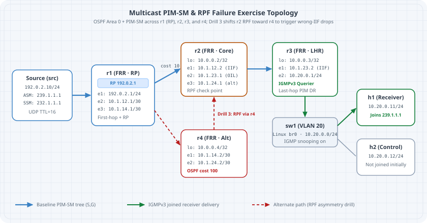

# Multicast Distribution Failure Exercises

Multicast forwarding depends on a tight chain of control-plane and data-plane agreements: IGMPv3 host membership, Layer 2 snooping, PIM-SM neighbor adjacencies, Rendezvous Point (RP) mapping, unicast-driven Reverse Path Forwarding (RPF), and packet TTL. This Containerlab workbook builds a four-router FRR topology (`r1`–`r4`), a VLAN 20 snooping bridge (`sw1`), a multicast sender (`src`), and two receivers (`h1`, `h2`), then walks through five structured failure drills.



## Learning Goals

By the end of this lab you can:

- Deploy an OSPF + PIM-SM multicast lab in Containerlab using FRR (`ospfd`, `pimd`) and Linux hosts
- Verify baseline PIM neighbors, `(*,G)` and `(S,G)` mroute state, and RPF lookups
- Diagnose and repair five classic multicast failures: IGMP leave timers, VLAN/snooping loss, RPF asymmetry via an alternate path, `TTL=1` drops, and Source-Specific Multicast (SSM) joins

## Topology and Addressing

| Node | Role | Loopback | Interfaces & Subnets |
|:---|:---|:---|:---|
| `src` | Linux sender | — | `eth1: 192.0.2.10/24` (gw `192.0.2.1`) |
| `r1` | FRR first-hop & ASM RP | `192.0.2.1/32` | `eth1: 192.0.2.1/24`, `eth2: 10.1.12.1/30`, `eth3: 10.1.14.1/30` |
| `r2` | FRR core router (RPF test point) | `10.0.0.2/32` | `eth1: 10.1.12.2/30`, `eth2: 10.1.23.1/30`, `eth3: 10.1.24.1/30` |
| `r3` | FRR last-hop router (IGMPv3 querier) | `10.0.0.3/32` | `eth1: 10.1.23.2/30`, `eth2: 10.20.0.1/24` |
| `r4` | FRR alternate transit router | `10.0.0.4/32` | `eth1: 10.1.14.2/30`, `eth2: 10.1.24.2/30` |
| `sw1` | Linux VLAN 20 snooping bridge | — | `br0` (`eth1` to `r3`, `eth2` to `h1`, `eth3` to `h2`) |
| `h1` | Linux receiver (joined) | — | `eth1: 10.20.0.11/24` (gw `10.20.0.1`) |
| `h2` | Linux control host (idle) | — | `eth1: 10.20.0.12/24` (gw `10.20.0.1`) |

## Containerlab Topology (`clab.yml`)

```yaml
name: mcast-drills
topology:
  kinds:
    frr:
      image: quay.io/frrouting/frr:containerlab-10.7.1
    linux:
      image: ghcr.io/srl-labs/network-multitool:latest
  nodes:
    r1:
      kind: frr
      startup-config: r1.frr.conf
      daemons: [ospfd, pimd]
    r2:
      kind: frr
      startup-config: r2.frr.conf
      daemons: [ospfd, pimd]
    r3:
      kind: frr
      startup-config: r3.frr.conf
      daemons: [ospfd, pimd]
    r4:
      kind: frr
      startup-config: r4.frr.conf
      daemons: [ospfd, pimd]
    sw1:
      kind: linux
      exec:
        - ip link add br0 type bridge vlan_filtering 1 mcast_snooping 1 mcast_querier 0
        - ip link set eth1 master br0
        - ip link set eth2 master br0
        - ip link set eth3 master br0
        - bridge vlan add vid 20 dev eth1 pvid untagged
        - bridge vlan add vid 20 dev eth2 pvid untagged
        - bridge vlan add vid 20 dev eth3 pvid untagged
        - ip link set br0 up
    src:
      kind: linux
      exec:
        - ip addr add 192.0.2.10/24 dev eth1
        - ip route replace default via 192.0.2.1
    h1:
      kind: linux
      exec:
        - ip addr add 10.20.0.11/24 dev eth1
        - ip route replace default via 10.20.0.1
    h2:
      kind: linux
      exec:
        - ip addr add 10.20.0.12/24 dev eth1
        - ip route replace default via 10.20.0.1
  links:
    - endpoints: ["src:eth1", "r1:eth1"]
    - endpoints: ["r1:eth2", "r2:eth1"]
    - endpoints: ["r2:eth2", "r3:eth1"]
    - endpoints: ["r1:eth3", "r4:eth1"]
    - endpoints: ["r4:eth2", "r2:eth3"]
    - endpoints: ["r3:eth2", "sw1:eth1"]
    - endpoints: ["sw1:eth2", "h1:eth1"]
    - endpoints: ["sw1:eth3", "h2:eth1"]
```

## FRR Configurations (`ospfd` + `pimd`)

All four routers run OSPF Area 0 and PIM-SM with `r1` (`192.0.2.1`) configured as the static ASM Rendezvous Point for `239.0.0.0/8`. The alternate links via `r4` carry `ip ospf cost 100` so `r2` prefers the direct path to `r1` at baseline.

### `r1.frr.conf` (First-Hop Router and ASM RP)

```cfg
frr defaults traditional
service integrated-vtysh-config
!
interface lo
 ip address 192.0.2.1/32
 ip pim
 ip ospf area 0
!
interface eth1
 ip address 192.0.2.1/24
 ip pim
 ip ospf area 0
 ip ospf passive
!
interface eth2
 ip address 10.1.12.1/30
 ip pim
 ip ospf area 0
 ip ospf network point-to-point
 ip ospf cost 10
!
interface eth3
 ip address 10.1.14.1/30
 ip pim
 ip ospf area 0
 ip ospf network point-to-point
 ip ospf cost 100
!
router ospf
 ospf router-id 192.0.2.1
!
router pim
 rp 192.0.2.1 239.0.0.0/8
```

### `r2.frr.conf` (Core Transit Router)

```cfg
frr defaults traditional
service integrated-vtysh-config
!
interface lo
 ip address 10.0.0.2/32
 ip pim
 ip ospf area 0
!
interface eth1
 ip address 10.1.12.2/30
 ip pim
 ip ospf area 0
 ip ospf network point-to-point
 ip ospf cost 10
!
interface eth2
 ip address 10.1.23.1/30
 ip pim
 ip ospf area 0
 ip ospf network point-to-point
 ip ospf cost 10
!
interface eth3
 ip address 10.1.24.1/30
 ip pim
 ip ospf area 0
 ip ospf network point-to-point
 ip ospf cost 100
!
router ospf
 ospf router-id 10.0.0.2
!
router pim
 rp 192.0.2.1 239.0.0.0/8
```

### `r3.frr.conf` (Last-Hop Router and IGMPv3 Querier)

```cfg
frr defaults traditional
service integrated-vtysh-config
!
interface lo
 ip address 10.0.0.3/32
 ip pim
 ip ospf area 0
!
interface eth1
 ip address 10.1.23.2/30
 ip pim
 ip ospf area 0
 ip ospf network point-to-point
 ip ospf cost 10
!
interface eth2
 ip address 10.20.0.1/24
 ip pim
 ip igmp
 ip igmp version 3
 ip ospf area 0
 ip ospf passive
!
router ospf
 ospf router-id 10.0.0.3
!
router pim
 rp 192.0.2.1 239.0.0.0/8
```

### `r4.frr.conf` (Alternate Path Router)

```cfg
frr defaults traditional
service integrated-vtysh-config
!
interface lo
 ip address 10.0.0.4/32
 ip pim
 ip ospf area 0
!
interface eth1
 ip address 10.1.14.2/30
 ip pim
 ip ospf area 0
 ip ospf network point-to-point
 ip ospf cost 100
!
interface eth2
 ip address 10.1.24.2/30
 ip pim
 ip ospf area 0
 ip ospf network point-to-point
 ip ospf cost 100
!
router ospf
 ospf router-id 10.0.0.4
!
router pim
 rp 192.0.2.1 239.0.0.0/8
```

## Deploy and Verify Baseline

Deploy the topology, start a numbered UDP multicast stream on `src` (`239.1.1.1:5000`, `TTL=16`), and join the group on `h1`:

```bash
containerlab deploy -t clab.yml

# Start receiver on h1 (joins ASM group 239.1.1.1)
docker exec -d clab-mcast-drills-h1 socat -u UDP4-RECVFROM:5000,ip-add-membership=239.1.1.1:10.20.0.11,fork STDOUT

# Start numbered UDP stream on src with TTL 16
docker exec -d clab-mcast-drills-src sh -c \
  'i=1; while true; do echo "seq=$i"; i=$((i+1)); sleep 1; done | socat -u STDIN UDP4-DATAGRAM:239.1.1.1:5000,ip-multicast-ttl=16'
```

Verify PIM neighbors, mroute state, and RPF on `r2` (outputs below are illustrative):

```bash
docker exec clab-mcast-drills-r2 vtysh -c "show ip pim neighbor"
docker exec clab-mcast-drills-r2 vtysh -c "show ip mroute"
docker exec clab-mcast-drills-r2 vtysh -c "show ip rpf 192.0.2.10"
```

```text
# Illustrative output: show ip pim neighbor (on r2)
Interface  Neighbor   Uptime    Holdtime  DR Pri
eth1       10.1.12.1  00:04:12  00:01:45  1
eth2       10.1.23.2  00:04:10  00:01:45  1
eth3       10.1.24.2  00:04:08  00:01:45  1

# Illustrative output: show ip mroute (on r2)
IP Multicast Routing Table
Proto  Source       Group      RP-bit  IIF   OIL
PIM    *            239.1.1.1  y       eth1  eth2
PIM    192.0.2.10   239.1.1.1  n       eth1  eth2

# Illustrative output: show ip rpf 192.0.2.10 (on r2)
RPF information for 192.0.2.10
  RPF interface: eth1
  RPF neighbor:  10.1.12.1
  RPF route/mask: 192.0.2.0/24
  RPF type: unicast (ospf)
```

> [!NOTE]
> Record the baseline outputs on `r2`, `r3`, and `sw1` (`bridge mdb show`) before starting the drills. Restore every fault cleanly and confirm baseline recovery before moving to the next exercise.

## Failure Drills

### Drill 1: IGMP Leave and Shared LAN Interest

**Goal:** Observe IGMPv3 group-specific queries and confirm that one host leaving does not disrupt a second joined receiver on the same LAN.

1. **Inject Fault (Single Receiver):** Capture IGMP on `r3:eth2`, then stop the receiver on `h1`:
   ```bash
   docker exec clab-mcast-drills-h1 pkill socat
   docker exec clab-mcast-drills-r3 vtysh -c "show ip igmp groups"
   ```
2. **Expected Symptoms:** `h1` sends an IGMPv3 report changing filter mode to `INCLUDE {}` (leave). `r3` emits Group-Specific Queries; after the Last Member Query Interval expires, `r3` removes `eth2` from the OIL and sends a PIM Prune upstream to `r2`.
3. **Repeat with `h2` Joined:** Join `239.1.1.1` on both `h1` and `h2`, then stop `h1`. `h2` replies to `r3`'s Group-Specific Query, so `r3` keeps `eth2` in the OIL and `h2` experiences zero packet loss.
4. **Restore:** Stop `h2` and restart the baseline receiver on `h1`.

### Drill 2: VLAN and IGMP Snooping Isolation Break

**Goal:** Separate Layer 2 forwarding failure from Layer 3 IGMP router state.

1. **Inject Fault:** Remove `h1`'s switch port (`eth2`) from VLAN 20 on `sw1`:
   ```bash
   docker exec clab-mcast-drills-sw1 bridge vlan del vid 20 dev eth2
   ```
2. **Expected Symptoms:** `h1` stops receiving UDP sequence numbers immediately, and `bridge mdb show` on `sw1` drops `eth2` from `239.1.1.1`. However, `r3` continues showing `eth2` in `show ip igmp groups` until the IGMP group membership timer (~260s) expires, illustrating why router state alone does not prove host delivery.
3. **Restore:** Re-add VLAN 20 to `eth2` on `sw1` and confirm `h1` resumes receiving packets after the next IGMP query/report cycle:
   ```bash
   docker exec clab-mcast-drills-sw1 bridge vlan add vid 20 dev eth2 pvid untagged
   ```

### Drill 3: RPF Asymmetry via Alternate Path (`r4`)

**Goal:** Trigger a Reverse Path Forwarding failure on `r2` where multicast packets arrive on `eth1` while the unicast route to `192.0.2.10` points out `eth3` (toward `r4`).

1. **Inject Fault:** Disable PIM on `r4:eth2` (so `r4` cannot forward multicast to `r2`) and install a static unicast route on `r2` pointing `192.0.2.0/24` through `r4` (`10.1.24.2`):
   ```bash
   docker exec clab-mcast-drills-r4 vtysh -c "conf t" -c "interface eth2" -c "no ip pim"
   docker exec clab-mcast-drills-r2 vtysh -c "conf t" -c "ip route 192.0.2.0/24 10.1.24.2"
   ```
2. **Expected Symptoms:** On `r2`, `show ip rpf 192.0.2.10` now resolves to `eth3` (`10.1.24.2`), while traffic from `r1` still arrives on `eth1` (or `r2` sends PIM Joins toward `r4`, which has no PIM adjacency). `r2` drops the stream on RPF failure (`show ip mroute count` shows wrong-interface drops) and `h1` stops receiving packets.
3. **Restore:** Remove the static route on `r2` and re-enable `ip pim` on `r4:eth2`:
   ```bash
   docker exec clab-mcast-drills-r2 vtysh -c "conf t" -c "no ip route 192.0.2.0/24 10.1.24.2"
   docker exec clab-mcast-drills-r4 vtysh -c "conf t" -c "interface eth2" -c "ip pim"
   ```

> [!WARNING]
> In production networks, asymmetric static routes or BGP/IGP policy overrides are the #1 cause of silent multicast blackholes. Always check `show ip rpf <source>` on every hop along the path.

### Drill 4: Sender `TTL=1` Exhaustion

**Goal:** Confirm that valid PIM `(S,G)` state still fails to deliver traffic if the sender transmits with `TTL=1`.

1. **Inject Fault:** Restart the `src` stream with `ip-multicast-ttl=1`:
   ```bash
   docker exec clab-mcast-drills-src pkill socat
   docker exec -d clab-mcast-drills-src sh -c \
     'i=1; while true; do echo "seq=$i"; i=$((i+1)); sleep 1; done | socat -u STDIN UDP4-DATAGRAM:239.1.1.1:5000,ip-multicast-ttl=1'
   ```
2. **Expected Symptoms:** `tcpdump -ni eth1 host 239.1.1.1` on `r1` shows packets arriving with `ttl 1`, but `r1` decrements TTL to `0` and drops them before forwarding out `eth2`. `h1` receives nothing even though IIF/OIL state on `r2` and `r3` remains intact.
3. **Restore:** Restart the `src` stream with `ip-multicast-ttl=16` and confirm `h1` resumes receiving.

### Drill 5: Source-Specific Multicast (SSM) on `232.1.1.1`

**Goal:** Build a direct `(S,G)` shortest-path tree without involving the ASM Rendezvous Point (`r1`).

1. **Inject / Configure SSM:** Start an SSM sender on `src` targeting `232.1.1.1:5001` and issue an IGMPv3 source-specific join on `h1` for `(192.0.2.10, 232.1.1.1)`:
   ```bash
   # Receiver h1 joins SSM (192.0.2.10, 232.1.1.1)
   docker exec -d clab-mcast-drills-h1 python3 -c \
     'import socket, struct; s=socket.socket(socket.AF_INET, socket.SOCK_DGRAM); s.bind(("",5001)); mreq=struct.pack("4s4s4s", socket.inet_aton("232.1.1.1"), socket.inet_aton("10.20.0.11"), socket.inet_aton("192.0.2.10")); s.setsockopt(socket.IPPROTO_IP, 39, mreq); print(s.recv(1024))'

   # Sender src transmits to 232.1.1.1:5001 with TTL 16
   docker exec -d clab-mcast-drills-src sh -c \
     'i=1; while true; do echo "ssm=$i"; i=$((i+1)); sleep 1; done | socat -u STDIN UDP4-DATAGRAM:232.1.1.1:5001,ip-multicast-ttl=16'
   ```
2. **Expected Verification:** On `r3` and `r2`, `show ip mroute` displays **only** `(192.0.2.10, 232.1.1.1)` with no `(*, 232.1.1.1)` shared-tree entry and no RP registration. Repeating the join with a wrong source IP (e.g., `192.0.2.99`) builds no forwarding path for `192.0.2.10`'s stream.
3. **Cleanup:** Tear down the lab once all five drills are documented:
   ```bash
   containerlab destroy -t clab.yml --cleanup
   ```

> [!TIP]
> If IIF and OIL both look healthy during a multicast outage yet packets never reach the receiver, check four data-plane culprits in order: (1) sender `TTL=1`, (2) Linux `rp_filter` / ACL drops, (3) L2 IGMP snooping / VLAN membership, and (4) receiver socket bind address.
