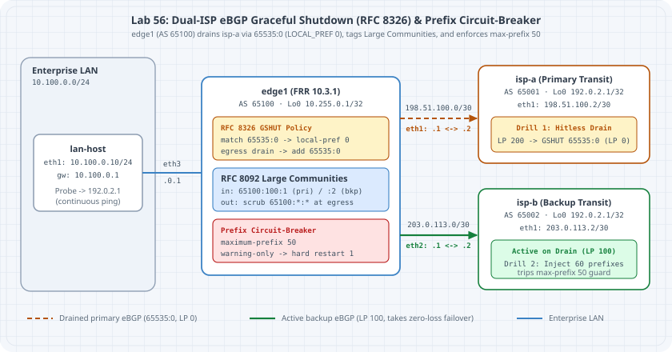

# Lab 56: Dual-ISP eBGP Graceful Shutdown (RFC 8326) and Prefix Circuit Breaker

Build a dual-homed enterprise edge router (`edge1`, AS `65100`) peering with two transit providers (`isp-a` in AS `65001` and `isp-b` in AS `65002`). Implement RFC 8326 `GRACEFUL_SHUTDOWN` (`65535:0`) for hitless maintenance drains, RFC 8092 Large Communities for internal traffic engineering with strict egress scrubbing, and a `maximum-prefix 50` circuit breaker to protect your FIB from a transit route leak.



## Scenario and Production Goal

Shutting down a live eBGP session with `neighbor ... shutdown` causes an immediate blackhole for in-flight packets while both sides tear down the session, withdraw prefixes, and reconverge. Worse, an unguarded transit peer that accidentally leaks a full table or a misconfigured static redistribution can exhaust router memory and crash the edge.

In this lab, you engineer a production-grade dual-ISP edge policy:

- **Hitless drain (RFC 8326)**: Match the well-known `GRACEFUL_SHUTDOWN` community (`65535:0`) inbound to drop `LOCAL_PREF` to `0`, and attach `65535:0` outbound during planned maintenance so traffic shifts to `isp-b` before the session closes.
- **Structured tagging (RFC 8092)**: Stamp inbound routes with Large Communities (`65100:100:1` for primary, `65100:100:2` for backup) and strip all `65100:*:*` tags at egress so internal policy metadata never leaks to external peers.
- **Prefix circuit breaker**: Enforce `maximum-prefix 50` on transit sessions so a runaway advertisement trips the session before it impacts the dataplane.

## Topology and Addressing

| Node | Role | ASN | Loopback (`lo`) | Links and IPv4 Addresses |
| :--- | :--- | :--- | :--- | :--- |
| `lan-host` | Enterprise Host | — | — | `eth1`: `10.100.0.10/24` (gw `10.100.0.1`) → `edge1:eth3` |
| `edge1` | Enterprise Edge | `65100` | `10.255.0.1/32` | `eth1`: `198.51.100.1/30` → `isp-a:eth1`; `eth2`: `203.0.113.1/30` → `isp-b:eth1`; `eth3`: `10.100.0.1/24` → `lan-host:eth1` |
| `isp-a` | Primary Transit | `65001` | `192.0.2.1/32` | `eth1`: `198.51.100.2/30` → `edge1:eth1` |
| `isp-b` | Backup Transit | `65002` | `192.0.2.1/32` | `eth1`: `203.0.113.2/30` → `edge1:eth2` |

Save the topology below as `clab.yml` in a working directory (for example `~/labs/lab56-bgp-gshut/`).

```yaml
name: lab56-bgp-gshut
topology:
  nodes:
    lan-host:
      kind: linux
      image: wbitt/network-multitool:alpine-extra
      exec:
        - ip addr add 10.100.0.10/24 dev eth1
        - ip route replace default via 10.100.0.1
    edge1:
      kind: linux
      image: quay.io/frrouting/frr:10.3.1
      binds:
        - configs/daemons:/etc/frr/daemons:ro
        - configs/edge1.conf:/etc/frr/frr.conf:ro
      exec:
        - sysctl -w net.ipv4.ip_forward=1
    isp-a:
      kind: linux
      image: quay.io/frrouting/frr:10.3.1
      binds:
        - configs/daemons:/etc/frr/daemons:ro
        - configs/isp-a.conf:/etc/frr/frr.conf:ro
      exec:
        - sysctl -w net.ipv4.ip_forward=1
    isp-b:
      kind: linux
      image: quay.io/frrouting/frr:10.3.1
      binds:
        - configs/daemons:/etc/frr/daemons:ro
        - configs/isp-b.conf:/etc/frr/frr.conf:ro
      exec:
        - sysctl -w net.ipv4.ip_forward=1
  links:
    - endpoints: ["lan-host:eth1", "edge1:eth3"]
    - endpoints: ["edge1:eth1", "isp-a:eth1"]
    - endpoints: ["edge1:eth2", "isp-b:eth1"]
```

## Node Configurations

Create `configs/daemons` (shared by `edge1`, `isp-a`, and `isp-b`):

```cfg
zebra=yes
bgpd=yes
vtysh_enable=yes
zebra_options=" -A 127.0.0.1 -s 90000000"
bgpd_options="  -A 127.0.0.1"
```

### Enterprise Edge (`configs/edge1.conf`)

```cfg
frr defaults traditional
hostname edge1
service integrated-vtysh-config
!
interface lo
 ip address 10.255.0.1/32
!
interface eth1
 ip address 198.51.100.1/30
!
interface eth2
 ip address 203.0.113.1/30
!
interface eth3
 ip address 10.100.0.1/24
!
bgp community-list standard GSHUT permit graceful-shutdown
bgp large-community-list expanded INTERNAL_LC permit ^65100:
ip prefix-list ENTERPRISE_LAN seq 10 permit 10.100.0.0/24
!
route-map RM_ISP_A_IN permit 10
 match community GSHUT
 set local-preference 0
 set large-community 65100:100:1 additive
route-map RM_ISP_A_IN permit 20
 set local-preference 200
 set large-community 65100:100:1 additive
!
route-map RM_ISP_B_IN permit 10
 match community GSHUT
 set local-preference 0
 set large-community 65100:100:2 additive
route-map RM_ISP_B_IN permit 20
 set local-preference 100
 set large-community 65100:100:2 additive
!
route-map RM_ISP_OUT permit 10
 match ip address prefix-list ENTERPRISE_LAN
 set large-comm-list INTERNAL_LC delete
!
route-map RM_ISP_OUT_DRAIN permit 10
 match ip address prefix-list ENTERPRISE_LAN
 set large-comm-list INTERNAL_LC delete
 set community graceful-shutdown additive
!
router bgp 65100
 bgp router-id 10.255.0.1
 no bgp ebgp-requires-policy
 neighbor 198.51.100.2 remote-as 65001
 neighbor 198.51.100.2 description isp-a-primary
 neighbor 203.0.113.2 remote-as 65002
 neighbor 203.0.113.2 description isp-b-backup
 !
 address-family ipv4 unicast
  network 10.100.0.0/24
  neighbor 198.51.100.2 maximum-prefix 50 80 restart 1
  neighbor 198.51.100.2 route-map RM_ISP_A_IN in
  neighbor 198.51.100.2 route-map RM_ISP_OUT out
  neighbor 203.0.113.2 maximum-prefix 50 80 restart 1
  neighbor 203.0.113.2 route-map RM_ISP_B_IN in
  neighbor 203.0.113.2 route-map RM_ISP_OUT out
 exit-address-family
!
line vty
```

### Transit Providers (`configs/isp-a.conf` and `configs/isp-b.conf`)

Both ISPs originate the anycast destination `192.0.2.1/32` and honor RFC 8326 `GRACEFUL_SHUTDOWN` inbound.

```cfg
frr defaults traditional
hostname isp-a
service integrated-vtysh-config
!
interface lo
 ip address 192.0.2.1/32
!
interface eth1
 ip address 198.51.100.2/30
!
bgp community-list standard GSHUT permit graceful-shutdown
!
route-map RM_CUST_IN permit 10
 match community GSHUT
 set local-preference 0
route-map RM_CUST_IN permit 20
 set local-preference 100
!
route-map RM_DRAIN_OUT permit 10
 set community graceful-shutdown additive
!
router bgp 65001
 bgp router-id 198.51.100.2
 no bgp ebgp-requires-policy
 neighbor 198.51.100.1 remote-as 65100
 !
 address-family ipv4 unicast
  network 192.0.2.1/32
  neighbor 198.51.100.1 route-map RM_CUST_IN in
 exit-address-family
!
line vty
```

For `configs/isp-b.conf`, copy `isp-a.conf` and replace `hostname isp-b`, `eth1` IP `203.0.113.2/30`, `router bgp 65002`, `bgp router-id 203.0.113.2`, and `neighbor 203.0.113.1 remote-as 65100`.

Deploy the lab:

```bash
sudo containerlab deploy -t clab.yml
```

## Baseline Verification

Confirm both eBGP sessions are `Established`, `edge1` prefers `isp-a` (`LOCAL_PREF 200`, Large Community `65100:100:1`), and `lan-host` reaches `192.0.2.1`.

```bash
docker exec clab-lab56-bgp-gshut-edge1 vtysh -c "show bgp ipv4 unicast summary"
docker exec clab-lab56-bgp-gshut-edge1 vtysh -c "show bgp ipv4 unicast 192.0.2.1/32"
docker exec clab-lab56-bgp-gshut-lan-host ping -c 3 192.0.2.1
```

> [!NOTE]
> Illustrative expected output (lab not executed on the authoring host).

```text
Neighbor        V         AS   MsgRcvd   MsgSent   TblVer  InQ OutQ  Up/Down State/PfxRcd   PfxSnt Desc
198.51.100.2    4      65001        12        13        4    0    0 00:01:20            1        1 isp-a-primary
203.0.113.2     4      65002        12        13        4    0    0 00:01:19            1        1 isp-b-backup

BGP routing table entry for 192.0.2.1/32, version 4
Paths: (2 available, best #1, table default)
  65001
    198.51.100.2 from 198.51.100.2 (198.51.100.2)
      Origin IGP, localpref 200, valid, external, best (Local Pref)
      Large Community: 65100:100:1
  65002
    203.0.113.2 from 203.0.113.2 (203.0.113.2)
      Origin IGP, localpref 100, valid, external
      Large Community: 65100:100:2
```

## Production Drills and Failure Injection

### Drill 1: Hitless Drain of `isp-a` Using RFC 8326 `GRACEFUL_SHUTDOWN`

Start a rapid continuous ping from `lan-host` in one terminal (`10` packets/sec) so any blackhole is immediately visible:

```bash
docker exec clab-lab56-bgp-gshut-lan-host ping -i 0.1 -c 100 192.0.2.1
```

While the ping is running, trigger a graceful drain from `isp-a` (inbound `GSHUT` to `edge1`) and from `edge1` toward `isp-a` (outbound `GSHUT` for return traffic):

```bash
docker exec clab-lab56-bgp-gshut-isp-a vtysh \
  -c "conf t" -c "router bgp 65001" -c "address-family ipv4 unicast" \
  -c "neighbor 198.51.100.1 route-map RM_DRAIN_OUT out"
docker exec clab-lab56-bgp-gshut-edge1 vtysh \
  -c "conf t" -c "router bgp 65100" -c "address-family ipv4 unicast" \
  -c "neighbor 198.51.100.2 route-map RM_ISP_OUT_DRAIN out"
docker exec clab-lab56-bgp-gshut-edge1 vtysh -c "show bgp ipv4 unicast 192.0.2.1/32"
```

**Expected symptoms**: `edge1` receives `65535:0` (`graceful-shutdown`) from `isp-a`, drops `isp-a`'s `LOCAL_PREF` from `200` to `0`, and shifts best path to `isp-b` (`LOCAL_PREF 100`). Because `isp-a`'s RIB and forwarding plane remain up during the transition, `lan-host` reports `0% packet loss`. You can now safely shut down `isp-a` with zero user impact.

**Rollback**: Remove `RM_DRAIN_OUT` on `isp-a` and restore `RM_ISP_OUT` on `edge1`.

### Drill 2: Trip the `maximum-prefix 50` Circuit Breaker on `isp-b`

Simulate a route leak from `isp-b` by injecting 60 static `/24` prefixes and redistributing them into BGP:

```bash
docker exec clab-lab56-bgp-gshut-isp-b bash -c '
  cmds="conf t"
  for i in $(seq 1 60); do cmds="$cmds\nip route 10.200.$i.0/24 Null0"; done
  cmds="$cmds\nrouter bgp 65002\naddress-family ipv4 unicast\nredistribute static"
  printf "$cmds\n" | vtysh
'
sleep 3
docker exec clab-lab56-bgp-gshut-edge1 vtysh -c "show bgp ipv4 unicast summary"
```

**Expected symptoms**: At 40 prefixes (80% threshold), `edge1` logs a warning; at 51 prefixes, `edge1` sends a BGP `NOTIFICATION` (`Cease / Maximum Number of Prefixes Reached`) and tears down `203.0.113.2` into `Idle (PfxCt)` state for 1 minute (`restart 1`). Traffic on `isp-a` remains unaffected.

**Rollback**: Remove `redistribute static` on `isp-b`, wait for the 1-minute restart timer (or run `clear bgp 203.0.113.2` on `edge1`), and confirm `203.0.113.2` returns to `Established`.

### Drill 3: Verify RFC 8092 Large Community Scrubbing at Egress

Tag `10.100.0.0/24` locally on `edge1` with an internal Large Community (`65100:999:1`) and confirm that `RM_ISP_OUT` strips it before advertising to `isp-a`:

```bash
docker exec clab-lab56-bgp-gshut-edge1 vtysh \
  -c "conf t" -c "route-map RM_ORIGINATE permit 10" -c "set large-community 65100:999:1" \
  -c "router bgp 65100" -c "address-family ipv4 unicast" -c "network 10.100.0.0/24 route-map RM_ORIGINATE"
docker exec clab-lab56-bgp-gshut-edge1 vtysh -c "show bgp ipv4 unicast 10.100.0.0/24"
docker exec clab-lab56-bgp-gshut-isp-a vtysh -c "show bgp ipv4 unicast 10.100.0.0/24"
```

**Expected symptoms**: `edge1`'s local RIB shows `Large Community: 65100:999:1`, while `isp-a` receives `10.100.0.0/24` with **no** `65100:*:*` Large Communities attached.

**Rollback**: Restore `network 10.100.0.0/24` without `route-map RM_ORIGINATE` on `edge1`.

## Cleanup and Key Takeaways

```bash
sudo containerlab destroy -t clab.yml --cleanup
```

- **Production checklist**: Always deploy RFC 8326 `65535:0` inbound matching across every transit and peering edge before you need it; pair `maximum-prefix` with a warning threshold (`80%`) and alerting; scrub your own ASN's Large Communities (`^<OWN_AS>:`) at egress boundaries.
- **Related reading**: [BGP Graceful Restart, LLGR, and Graceful Shutdown](../05-dynamic-routing/13-bgp-graceful-restart-llgr-gshut.md), [BGP Large Communities and ADD-PATH](../05-dynamic-routing/15-bgp-large-communities-and-add-path.md), [Policy and Filters](../05-dynamic-routing/03-policy-and-filters.md), and [Lab 15: BGP Policy](15-bgp-policy.md).
