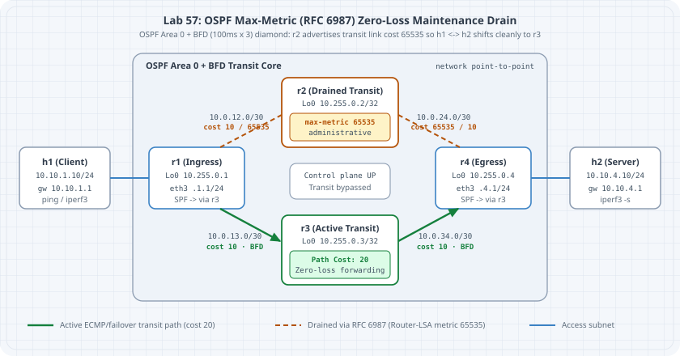

# Lab 57: OSPF Max-Metric (RFC 6987) Zero-Loss Maintenance Drain

Build a 4-router OSPF Area 0 diamond (`r1`, `r2`, `r3`, `r4`) with BFD enabled on every transit link and two endpoints (`h1`, `h2`). Practice draining transit router `r2` cleanly using RFC 6987 OSPF Stub Router Advertisement (`max-metric router-lsa`), verify zero packet loss during live `ping`/`iperf3` flows, and contrast a graceful drain against an unplanned BFD-detected link cut.



## Scenario and Production Goal

Rebooting a core transit router or upgrading its NOS without draining traffic first drops packets until neighbors detect the dead link (even with 300 ms BFD timers, a 10 Gbps link drops hundreds of thousands of packets). Moreover, when the router boots back up, OSPF may converge before BGP or downstream linecards are ready, creating a post-reboot blackhole.

In this lab, you validate both halves of RFC 6987 operational hygiene:

- **Administrative drain**: Configure `max-metric router-lsa administrative` on `r2` so it re-originates its Router-LSA with transit link metric `65535` (`LSInfinity`), steering `r1` and `r4` onto `r3` while `r2` still forwards any in-flight packets.
- **Startup protection**: Configure `max-metric router-lsa on-startup 60` so a newly booted router stays out of the transit path until upper-layer routing protocols settle.
- **Drain vs. BFD failover**: Measure the exact packet loss difference between a planned RFC 6987 drain (`0` drops) and a hard interface failure protected by BFD (`100 ms x 3`).

## Topology and Addressing

| Node | Role | Loopback (`lo`) | Interfaces and IPv4 Addresses |
| :--- | :--- | :--- | :--- |
| `h1` | Client Host | — | `eth1`: `10.10.1.10/24` (gw `10.10.1.1`) → `r1:eth3` |
| `r1` | Ingress Router | `10.255.0.1/32` | `eth1`: `10.0.12.1/30` → `r2:eth1`; `eth2`: `10.0.13.1/30` → `r3:eth1`; `eth3`: `10.10.1.1/24` → `h1:eth1` |
| `r2` | Transit Router (Drain Target) | `10.255.0.2/32` | `eth1`: `10.0.12.2/30` → `r1:eth1`; `eth2`: `10.0.24.1/30` → `r4:eth1` |
| `r3` | Transit Router (Active Path) | `10.255.0.3/32` | `eth1`: `10.0.13.2/30` → `r1:eth2`; `eth2`: `10.0.34.1/30` → `r4:eth2` |
| `r4` | Egress Router | `10.255.0.4/32` | `eth1`: `10.0.24.2/30` → `r2:eth2`; `eth2`: `10.0.34.2/30` → `r3:eth2`; `eth3`: `10.10.4.1/24` → `h2:eth1` |
| `h2` | Server Host | — | `eth1`: `10.10.4.10/24` (gw `10.10.4.1`) → `r4:eth3` |

Save the topology below as `clab.yml` in a working directory (for example `~/labs/lab57-ospf-drain/`).

```yaml
name: lab57-ospf-drain
topology:
  nodes:
    h1:
      kind: linux
      image: wbitt/network-multitool:alpine-extra
      exec:
        - ip addr add 10.10.1.10/24 dev eth1
        - ip route replace default via 10.10.1.1
    h2:
      kind: linux
      image: wbitt/network-multitool:alpine-extra
      exec:
        - ip addr add 10.10.4.10/24 dev eth1
        - ip route replace default via 10.10.4.1
        - iperf3 -s -D
    r1:
      kind: linux
      image: quay.io/frrouting/frr:10.3.1
      binds:
        - configs/daemons:/etc/frr/daemons:ro
        - configs/r1.conf:/etc/frr/frr.conf:ro
      exec: [sysctl -w net.ipv4.ip_forward=1]
    r2:
      kind: linux
      image: quay.io/frrouting/frr:10.3.1
      binds:
        - configs/daemons:/etc/frr/daemons:ro
        - configs/r2.conf:/etc/frr/frr.conf:ro
      exec: [sysctl -w net.ipv4.ip_forward=1]
    r3:
      kind: linux
      image: quay.io/frrouting/frr:10.3.1
      binds:
        - configs/daemons:/etc/frr/daemons:ro
        - configs/r3.conf:/etc/frr/frr.conf:ro
      exec: [sysctl -w net.ipv4.ip_forward=1]
    r4:
      kind: linux
      image: quay.io/frrouting/frr:10.3.1
      binds:
        - configs/daemons:/etc/frr/daemons:ro
        - configs/r4.conf:/etc/frr/frr.conf:ro
      exec: [sysctl -w net.ipv4.ip_forward=1]
  links:
    - endpoints: ["h1:eth1", "r1:eth3"]
    - endpoints: ["r1:eth1", "r2:eth1"]
    - endpoints: ["r1:eth2", "r3:eth1"]
    - endpoints: ["r2:eth2", "r4:eth1"]
    - endpoints: ["r3:eth2", "r4:eth2"]
    - endpoints: ["r4:eth3", "h2:eth1"]
```

## Node Configurations

Create `configs/daemons` (shared by `r1`–`r4`):

```cfg
zebra=yes
ospfd=yes
bfdd=yes
vtysh_enable=yes
zebra_options=" -A 127.0.0.1 -s 90000000"
ospfd_options=" -A 127.0.0.1"
bfdd_options="  -A 127.0.0.1"
```

### Edge Routers (`configs/r1.conf` and `configs/r4.conf`)

```cfg
frr defaults traditional
hostname r1
service integrated-vtysh-config
!
interface lo
 ip address 10.255.0.1/32
 ip ospf area 0.0.0.0
!
interface eth1
 ip address 10.0.12.1/30
 ip ospf area 0.0.0.0
 ip ospf cost 10
 ip ospf network point-to-point
 ip ospf bfd profile FAST-BFD
!
interface eth2
 ip address 10.0.13.1/30
 ip ospf area 0.0.0.0
 ip ospf cost 10
 ip ospf network point-to-point
 ip ospf bfd profile FAST-BFD
!
interface eth3
 ip address 10.10.1.1/24
 ip ospf area 0.0.0.0
 ip ospf passive
!
router ospf
 ospf router-id 10.255.0.1
!
bfd
 profile FAST-BFD
  detect-multiplier 3
  transmit-interval 100
  receive-interval 100
 exit
!
line vty
```

For `configs/r4.conf`, copy `r1.conf` and change `hostname r4`, `lo` to `10.255.0.4/32`, `eth1` to `10.0.24.2/30`, `eth2` to `10.0.34.2/30`, `eth3` to `10.10.4.1/24`, and `ospf router-id 10.255.0.4`.

### Transit Routers (`configs/r2.conf` and `configs/r3.conf`)

```cfg
frr defaults traditional
hostname r2
service integrated-vtysh-config
!
interface lo
 ip address 10.255.0.2/32
 ip ospf area 0.0.0.0
!
interface eth1
 ip address 10.0.12.2/30
 ip ospf area 0.0.0.0
 ip ospf cost 10
 ip ospf network point-to-point
 ip ospf bfd profile FAST-BFD
!
interface eth2
 ip address 10.0.24.1/30
 ip ospf area 0.0.0.0
 ip ospf cost 10
 ip ospf network point-to-point
 ip ospf bfd profile FAST-BFD
!
router ospf
 ospf router-id 10.255.0.2
!
bfd
 profile FAST-BFD
  detect-multiplier 3
  transmit-interval 100
  receive-interval 100
 exit
!
line vty
```

For `configs/r3.conf`, copy `r2.conf` and change `hostname r3`, `lo` to `10.255.0.3/32`, `eth1` to `10.0.13.2/30`, `eth2` to `10.0.34.1/30`, and `ospf router-id 10.255.0.3`.

Deploy the lab:

```bash
sudo containerlab deploy -t clab.yml
```

## Baseline Verification

Verify OSPF adjacencies are `Full`, BFD sessions are `up`, and `r1` installs a 2-way ECMP route to `10.10.4.0/24` across both `r2` and `r3`.

```bash
docker exec clab-lab57-ospf-drain-r1 vtysh -c "show ip ospf neighbor"
docker exec clab-lab57-ospf-drain-r1 vtysh -c "show bfd peers brief"
docker exec clab-lab57-ospf-drain-r1 vtysh -c "show ip route 10.10.4.0/24"
```

> [!NOTE]
> Illustrative expected output (lab not executed on the authoring host).

```text
Neighbor ID     Pri State           Up Time         Dead Time Address         Interface
10.255.0.2        1 Full/DROther      00:01:12          34.120s 10.0.12.2       eth1:10.0.12.1
10.255.0.3        1 Full/DROther      00:01:11          33.890s 10.0.13.2       eth2:10.0.13.1

SessionId  LocalAddress     PeerAddress      Status
1048577    10.0.12.1        10.0.12.2        up
1048578    10.0.13.1        10.0.13.2        up

Routing entry for 10.10.4.0/24
  Known via "ospf", distance 110, metric 30, best
  * 10.0.12.2, via eth1, weight 1
  * 10.0.13.2, via eth2, weight 1
```

## Production Drills and Failure Injection

### Drill 1: Zero-Loss Drain of `r2` via `max-metric router-lsa administrative`

Start a continuous high-rate probe from `h1` to `h2` (in a second terminal, you can also run `iperf3 -c 10.10.4.10 -t 30`):

```bash
docker exec clab-lab57-ospf-drain-h1 ping -i 0.05 -c 300 10.10.4.10
```

While traffic is flowing, drain `r2` and inspect its Router-LSA and `r1`'s updated FIB:

```bash
docker exec clab-lab57-ospf-drain-r2 vtysh -c "conf t" -c "router ospf" -c "max-metric router-lsa administrative"
docker exec clab-lab57-ospf-drain-r1 vtysh -c "show ip ospf database router 10.255.0.2" | grep -E "Link connected|TOS 0 Metrics"
docker exec clab-lab57-ospf-drain-r1 vtysh -c "show ip route 10.10.4.0/24"
```

**Expected symptoms**: `r2`'s Router-LSA now advertises `TOS 0 Metrics: 65535` for its point-to-point transit links to `r1` and `r4`. `r1` and `r4` run SPF and remove `10.0.12.2` / `10.0.24.1` from the ECMP group, forwarding 100% of traffic through `r3`. Because `r2`'s OSPF and BFD adjacencies stay `Full`/`up` and its FIB stays intact, `h1` observes **0% packet loss**.

**Rollback**: Remove the drain with `no max-metric router-lsa administrative` on `r2` and verify ECMP returns on `r1`.

### Drill 2: Post-Reboot Protection with `max-metric router-lsa on-startup 60`

Configure startup stub-router protection on `r2` and restart `ospfd` to simulate a cold boot:

```bash
docker exec clab-lab57-ospf-drain-r2 vtysh \
  -c "conf t" -c "router ospf" -c "max-metric router-lsa on-startup 60" -c "end" -c "write memory"
docker exec clab-lab57-ospf-drain-r2 pkill -HUP ospfd || docker exec clab-lab57-ospf-drain-r2 /usr/lib/frr/frrinit.sh restart
sleep 5
docker exec clab-lab57-ospf-drain-r2 vtysh -c "show ip ospf" | grep -i "max-metric"
```

**Expected symptoms**: Immediately after `r2` re-establishes OSPF adjacencies, `show ip ospf` reports that `max-metric` is active for the remaining startup timer (up to 60 seconds). `r1` and `r4` keep forwarding through `r3` until the timer expires, preventing transient post-boot blackholes.

**Rollback**: Wait for the 60-second timer to expire (or remove `on-startup 60`) and verify `r2` rejoins ECMP.

### Drill 3: Hard Link Cut Without Drain vs. Planned Drain (BFD Failover)

First ensure `r2` is active in ECMP and force `r1` to send all traffic via `r2` (set `ip ospf cost 5` on `r1:eth1` and `r4:eth1`), then run a `20 ms` ping while cutting `r2:eth1` abruptly:

```bash
docker exec clab-lab57-ospf-drain-h1 ping -i 0.02 -c 200 10.10.4.10 &
sleep 1
docker exec clab-lab57-ospf-drain-r2 ip link set eth1 down
wait
```

**Expected symptoms**: BFD detects the peer loss in ~300 ms (`100 ms x 3`) and triggers immediate OSPF adjacency teardown and SPF, which is far faster than OSPF's 40-second dead timer — yet `h1` still loses roughly `10`–`18` packets during the failover window, proving why RFC 6987 drain is mandatory for planned maintenance even when BFD is deployed.

**Rollback**: Bring `r2:eth1` back up (`ip link set eth1 up`) and restore `ip ospf cost 10`.

## Cleanup and Key Takeaways

```bash
sudo containerlab destroy -t clab.yml --cleanup
```

- **Production checklist**: Always pair `max-metric router-lsa administrative` (for planned drains) with `max-metric router-lsa on-startup <seconds>` (for reboot protection); verify `show ip ospf database router` shows metric `65535` and interface counters on the drained node drop to zero before powering it down.
- **Related reading**: [IGP Maintenance and Graceful Drain](../05-dynamic-routing/16-igp-maintenance-and-graceful-drain.md), [BFD Fast Failure Detection](../05-dynamic-routing/04-bfd-fast-failure-detection.md), [OSPF Basics](../05-dynamic-routing/01-ospf-basics.md), and [Lab 11: OSPF Areas, Cost, and BFD](11-ospf-areas-cost-bfd.md).
