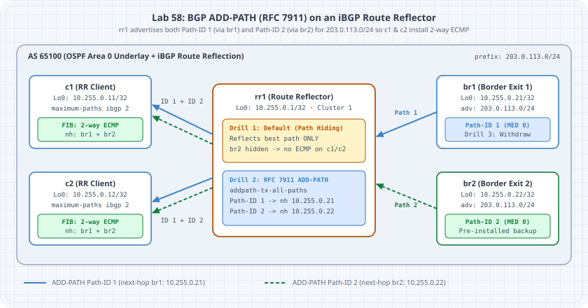

# Lab 58: BGP ADD-PATH (RFC 7911) on an iBGP Route Reflector

Build a 5-router AS `65100` topology over an OSPF Area 0 underlay with one Route Reflector (`rr1`), two border exit routers (`br1`, `br2`) advertising `203.0.113.0/24` with equal attributes, and two internal clients (`c1`, `c2`). Reproduce classic Route Reflector path-hiding, eliminate it using RFC 7911 BGP ADD-PATH (`addpath-tx-all-paths`), and measure faster failover when `br1` withdraws.



## Scenario and Production Goal

By default, an iBGP Route Reflector runs best-path selection and reflects **only its single winning path** to clients. Even when `br1` and `br2` both advertise `203.0.113.0/24` with identical `LOCAL_PREF`, `AS_PATH`, and `MED`, `rr1` breaks the tie on lowest BGP Router-ID (`10.255.0.21 < 10.255.0.22`) and hides `br2` completely. Clients lose iBGP ECMP and must wait for a full withdraw-and-readvertise control-plane cycle when `br1` fails.

In this lab, you solve path-hiding cleanly with RFC 7911:

- **Observe path-hiding**: Confirm that without ADD-PATH, `c1` and `c2` receive only `br1` (`10.255.0.21`) despite having `maximum-paths ibgp 2` configured.
- **Enable ADD-PATH**: Configure `addpath-tx-all-paths` on `rr1` so it advertises both paths with distinct 32-bit **Path-IDs** (`Path-ID 1` via `br1`, `Path-ID 2` via `br2`), unlocking 2-way iBGP ECMP in the client FIB.
- **Measure failover**: Withdraw `203.0.113.0/24` on `br1` and compare convergence with a pre-installed backup path versus classic RR path-hiding.

## Topology and Addressing

| Node | Role | ASN | Loopback (`lo`) | Transit Links (OSPF Area 0, cost 10) | Advertised Prefix |
| :--- | :--- | :--- | :--- | :--- | :--- |
| `rr1` | Route Reflector | `65100` | `10.255.0.1/32` | `eth1`: `10.0.1.1/30` → `c1`; `eth2`: `10.0.2.1/30` → `c2`; `eth3`: `10.0.3.1/30` → `br1`; `eth4`: `10.0.4.1/30` → `br2` | Reflects only |
| `c1` | RR Client 1 | `65100` | `10.255.0.11/32` | `eth1`: `10.0.1.2/30` → `rr1:eth1` | — |
| `c2` | RR Client 2 | `65100` | `10.255.0.12/32` | `eth1`: `10.0.2.2/30` → `rr1:eth2` | — |
| `br1` | Border Exit 1 | `65100` | `10.255.0.21/32` | `eth1`: `10.0.3.2/30` → `rr1:eth3` | `203.0.113.0/24` (`dum0`, MED `0`) |
| `br2` | Border Exit 2 | `65100` | `10.255.0.22/32` | `eth1`: `10.0.4.2/30` → `rr1:eth4` | `203.0.113.0/24` (`dum0`, MED `0`) |

Save the topology below as `clab.yml` in a working directory (for example `~/labs/lab58-bgp-addpath/`).

```yaml
name: lab58-bgp-addpath
topology:
  defaults:
    kind: linux
    image: quay.io/frrouting/frr:10.3.1
    binds:
      - configs/daemons:/etc/frr/daemons:ro
  nodes:
    rr1:
      binds: [configs/rr1.conf:/etc/frr/frr.conf:ro]
      exec: [sysctl -w net.ipv4.ip_forward=1]
    c1:
      binds: [configs/c1.conf:/etc/frr/frr.conf:ro]
      exec: [sysctl -w net.ipv4.ip_forward=1]
    c2:
      binds: [configs/c2.conf:/etc/frr/frr.conf:ro]
      exec: [sysctl -w net.ipv4.ip_forward=1]
    br1:
      binds: [configs/br1.conf:/etc/frr/frr.conf:ro]
      exec:
        - sysctl -w net.ipv4.ip_forward=1
        - ip link add dum0 type dummy && ip link set dum0 up
        - ip addr add 203.0.113.1/24 dev dum0
    br2:
      binds: [configs/br2.conf:/etc/frr/frr.conf:ro]
      exec:
        - sysctl -w net.ipv4.ip_forward=1
        - ip link add dum0 type dummy && ip link set dum0 up
        - ip addr add 203.0.113.1/24 dev dum0
  links:
    - endpoints: ["rr1:eth1", "c1:eth1"]
    - endpoints: ["rr1:eth2", "c2:eth1"]
    - endpoints: ["rr1:eth3", "br1:eth1"]
    - endpoints: ["rr1:eth4", "br2:eth1"]
```

## Node Configurations

Create `configs/daemons` (shared by all five FRR nodes):

```cfg
zebra=yes
ospfd=yes
bgpd=yes
vtysh_enable=yes
zebra_options=" -A 127.0.0.1 -s 90000000"
ospfd_options=" -A 127.0.0.1"
bgpd_options="  -A 127.0.0.1"
```

### Route Reflector (`configs/rr1.conf`)

Start **without** `addpath-tx-all-paths` so Drill 1 demonstrates path-hiding first.

```cfg
frr defaults traditional
hostname rr1
service integrated-vtysh-config
!
interface lo
 ip address 10.255.0.1/32
 ip ospf area 0.0.0.0
!
interface eth1
 ip address 10.0.1.1/30
 ip ospf area 0.0.0.0
 ip ospf cost 10
 ip ospf network point-to-point
!
interface eth2
 ip address 10.0.2.1/30
 ip ospf area 0.0.0.0
 ip ospf cost 10
 ip ospf network point-to-point
!
interface eth3
 ip address 10.0.3.1/30
 ip ospf area 0.0.0.0
 ip ospf cost 10
 ip ospf network point-to-point
!
interface eth4
 ip address 10.0.4.1/30
 ip ospf area 0.0.0.0
 ip ospf cost 10
 ip ospf network point-to-point
!
router ospf
 ospf router-id 10.255.0.1
!
router bgp 65100
 bgp router-id 10.255.0.1
 bgp cluster-id 0.0.0.1
 neighbor CLIENTS peer-group
 neighbor CLIENTS remote-as 65100
 neighbor CLIENTS update-source lo
 neighbor 10.255.0.11 peer-group CLIENTS
 neighbor 10.255.0.12 peer-group CLIENTS
 neighbor 10.255.0.21 peer-group CLIENTS
 neighbor 10.255.0.22 peer-group CLIENTS
 !
 address-family ipv4 unicast
  neighbor CLIENTS route-reflector-client
 exit-address-family
!
line vty
```

### Clients (`configs/c1.conf` and `configs/c2.conf`)

```cfg
frr defaults traditional
hostname c1
service integrated-vtysh-config
!
interface lo
 ip address 10.255.0.11/32
 ip ospf area 0.0.0.0
!
interface eth1
 ip address 10.0.1.2/30
 ip ospf area 0.0.0.0
 ip ospf cost 10
 ip ospf network point-to-point
!
router ospf
 ospf router-id 10.255.0.11
!
router bgp 65100
 bgp router-id 10.255.0.11
 neighbor 10.255.0.1 remote-as 65100
 neighbor 10.255.0.1 update-source lo
 !
 address-family ipv4 unicast
  maximum-paths ibgp 2
 exit-address-family
!
line vty
```

For `configs/c2.conf`, copy `c1.conf` and replace `c1` with `c2`, `10.255.0.11` with `10.255.0.12`, and `10.0.1.2/30` with `10.0.2.2/30`.

### Border Exits (`configs/br1.conf` and `configs/br2.conf`)

```cfg
frr defaults traditional
hostname br1
service integrated-vtysh-config
!
interface lo
 ip address 10.255.0.21/32
 ip ospf area 0.0.0.0
!
interface eth1
 ip address 10.0.3.2/30
 ip ospf area 0.0.0.0
 ip ospf cost 10
 ip ospf network point-to-point
!
router ospf
 ospf router-id 10.255.0.21
!
router bgp 65100
 bgp router-id 10.255.0.21
 neighbor 10.255.0.1 remote-as 65100
 neighbor 10.255.0.1 update-source lo
 !
 address-family ipv4 unicast
  network 203.0.113.0/24
 exit-address-family
!
line vty
```

For `configs/br2.conf`, copy `br1.conf` and replace `br1` with `br2`, `10.255.0.21` with `10.255.0.22`, and `10.0.3.2/30` with `10.0.4.2/30`.

Deploy the lab:

```bash
sudo containerlab deploy -t clab.yml
```

## Baseline Verification

Confirm OSPF loopbacks are reachable and all four iBGP sessions to `rr1` are `Established`.

```bash
docker exec clab-lab58-bgp-addpath-rr1 vtysh -c "show bgp ipv4 unicast summary"
docker exec clab-lab58-bgp-addpath-rr1 vtysh -c "show bgp ipv4 unicast 203.0.113.0/24"
```

> [!NOTE]
> Illustrative expected output (lab not executed on the authoring host).

```text
Neighbor        V         AS   MsgRcvd   MsgSent   TblVer  InQ OutQ  Up/Down State/PfxRcd   PfxSnt Desc
10.255.0.11     4      65100        10        12        3    0    0 00:01:05            0        1 N/A
10.255.0.12     4      65100        10        12        3    0    0 00:01:04            0        1 N/A
10.255.0.21     4      65100        12        10        3    0    0 00:01:05            1        1 N/A
10.255.0.22     4      65100        12        10        3    0    0 00:01:04            1        1 N/A

BGP routing table entry for 203.0.113.0/24, version 3
Paths: (2 available, best #1, table default)
  Local
    10.255.0.21 (metric 10) from 10.255.0.21 (10.255.0.21)
      Origin IGP, metric 0, localpref 100, valid, internal, best (Router ID)
  Local
    10.255.0.22 (metric 10) from 10.255.0.22 (10.255.0.22)
      Origin IGP, metric 0, localpref 100, valid, internal
```

## Production Drills and Failure Injection

### Drill 1: Observe Classic Route Reflector Path-Hiding

Check the BGP table and FIB on `c1` before enabling ADD-PATH:

```bash
docker exec clab-lab58-bgp-addpath-c1 vtysh -c "show bgp ipv4 unicast 203.0.113.0/24"
docker exec clab-lab58-bgp-addpath-c1 vtysh -c "show ip route 203.0.113.0/24"
```

**Expected symptoms**: Even though `rr1` holds 2 valid paths (`10.255.0.21` and `10.255.0.22`) and `c1` has `maximum-paths ibgp 2`, `c1` sees **only 1 path** (`10.255.0.21` via `br1`). Path `10.255.0.22` (`br2`) is hidden by `rr1`, so `c1` and `c2` cannot load-balance across both border exits.

### Drill 2: Enable RFC 7911 ADD-PATH and Verify Dual Path-IDs and ECMP

Enable `addpath-tx-all-paths` on `rr1` for the `CLIENTS` peer-group (FRR clients negotiate ADD-PATH receive by default) and reset the sessions cleanly so the `OPEN` capability is exchanged:

```bash
docker exec clab-lab58-bgp-addpath-rr1 vtysh \
  -c "conf t" -c "router bgp 65100" -c "address-family ipv4 unicast" \
  -c "neighbor CLIENTS addpath-tx-all-paths"
docker exec clab-lab58-bgp-addpath-rr1 vtysh -c "clear bgp 10.255.0.11" -c "clear bgp 10.255.0.12"
sleep 3
docker exec clab-lab58-bgp-addpath-c1 vtysh -c "show bgp neighbors 10.255.0.1" | grep -A 3 -i "AddPath"
docker exec clab-lab58-bgp-addpath-c1 vtysh -c "show bgp ipv4 unicast 203.0.113.0/24"
docker exec clab-lab58-bgp-addpath-c1 vtysh -c "show ip route 203.0.113.0/24"
```

**Expected symptoms**: `c1` reports `AddPath: IPv4 Unicast: RX advertised, TX received`, displays **2 paths** for `203.0.113.0/24` with distinct `AddPath ID` values (`1` for `10.255.0.21`, `2` for `10.255.0.22`), and installs a **2-way ECMP** route in the FIB (`multipath`).

### Drill 3: Withdraw `br1` and Compare Convergence Behavior

Capture BGP `UPDATE` packets on `c1:eth1` while withdrawing `203.0.113.0/24` on `br1`:

```bash
docker exec clab-lab58-bgp-addpath-c1 tcpdump -i eth1 -n -c 4 tcp port 179 &
sleep 1
docker exec clab-lab58-bgp-addpath-br1 vtysh \
  -c "conf t" -c "router bgp 65100" -c "address-family ipv4 unicast" -c "no network 203.0.113.0/24"
wait
docker exec clab-lab58-bgp-addpath-c1 vtysh -c "show bgp ipv4 unicast 203.0.113.0/24"
```

**Expected symptoms**: With ADD-PATH active, `rr1` sends a single `WITHDRAW` targeting only `Path-ID 1` (`br1`). Because `Path-ID 2` (`br2`) is already pre-installed in `c1`'s RIB and FIB, `c1` shifts 100% of traffic to `br2` immediately without waiting for `rr1` to run best-path selection and originate a new `UPDATE` for `br2`.

**Rollback**: Re-advertise `network 203.0.113.0/24` on `br1` and verify 2-way ECMP returns on `c1` and `c2`.

## Cleanup and Key Takeaways

```bash
sudo containerlab destroy -t clab.yml --cleanup
```

- **Production checklist**: On large Route Reflectors, prefer `addpath-tx-bestpath-per-AS` over `addpath-tx-all-paths` when dozens of border routers advertise the same internet prefix so client memory stays bounded; always verify `AddPath` capability negotiation after enabling it, as changing capabilities requires a session reset unless dynamic capabilities are supported.
- **Related reading**: [BGP Large Communities and ADD-PATH](../05-dynamic-routing/15-bgp-large-communities-and-add-path.md), [BGP Route Reflectors](../05-dynamic-routing/07-bgp-route-reflectors.md), [BGP Basics](../05-dynamic-routing/02-bgp-basics.md), and [Lab 14: iBGP Route Reflector](14-ibgp-route-reflector.md).
