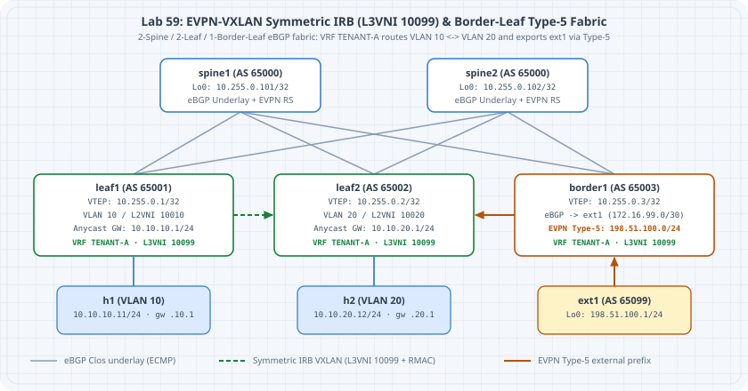

# Lab 59: EVPN-VXLAN Symmetric IRB (L3VNI 10099) and Border-Leaf Type-5 Fabric

Build a production 2-spine, 2-leaf, 1-border-leaf EVPN-VXLAN fabric in FRR `10.3.1` with Symmetric Integrated Routing and Bridging (IRB) inside VRF `TENANT-A` (`L3VNI 10099`), Distributed Anycast Gateways for VLAN `10` (`L2VNI 10010`) and VLAN `20` (`L2VNI 10020`), and an external router (`ext1`, AS `65099`) whose prefix (`198.51.100.0/24`) is exported across the fabric as an EVPN Type-5 IP Prefix route.



## Scenario and Production Goal

Asymmetric IRB forces every leaf switch to configure every tenant VLAN/L2VNI even when no local host uses it, wasting hardware MAC/ARP scale. Symmetric IRB solves this by routing inter-subnet traffic through a single shared **Layer-3 VNI (`L3VNI 10099`)** per tenant VRF, using each remote VTEP's **Router MAC (RMAC)** in the inner Ethernet header.

In this lab, you construct and validate the full data-center overlay stack:

- **eBGP Clos underlay + EVPN overlay**: Spines (`AS 65000`) act as eBGP underlay routers and EVPN route servers preserving leaf VTEP next-hops (`attribute-unchanged next-hop`).
- **Symmetric IRB (`L3VNI 10099`)**: `leaf1` (`VLAN 10`, `10.10.10.0/24`) routes to `leaf2` (`VLAN 20`, `10.10.20.0/24`) over `VNI 10099` without stretching VLAN `20` onto `leaf1`.
- **Border-Leaf Type-5 egress**: `border1` peers via eBGP in VRF `TENANT-A` with `ext1` (`AS 65099`) and advertises `198.51.100.0/24` into EVPN as a Type-5 route so `h1` and `h2` reach external networks seamlessly.

## Topology and Addressing

| Node | Role | ASN | Loopback / VTEP (`lo`) | Tenant / External Networks |
| :--- | :--- | :--- | :--- | :--- |
| `spine1` | Spine / EVPN RS | `65000` | `10.255.0.101/32` | eBGP unnumbered to `leaf1`, `leaf2`, `border1` |
| `spine2` | Spine / EVPN RS | `65000` | `10.255.0.102/32` | eBGP unnumbered to `leaf1`, `leaf2`, `border1` |
| `leaf1` | Compute Leaf 1 | `65001` | `10.255.0.1/32` | `VLAN 10` / `L2VNI 10010` (`10.10.10.1/24`), VRF `TENANT-A` (`L3VNI 10099`) |
| `leaf2` | Compute Leaf 2 | `65002` | `10.255.0.2/32` | `VLAN 20` / `L2VNI 10020` (`10.10.20.1/24`), VRF `TENANT-A` (`L3VNI 10099`) |
| `border1` | Border Leaf | `65003` | `10.255.0.3/32` | VRF `TENANT-A` (`L3VNI 10099`), `eth3`: `172.16.99.1/30` → `ext1:eth1` |
| `ext1` | External Router | `65099` | `198.51.100.1/24` | `eth1`: `172.16.99.2/30` → `border1:eth3` |
| `h1` | Tenant Host 1 | — | — | `eth1`: `10.10.10.11/24` (gw `10.10.10.1`) → `leaf1:eth3` |
| `h2` | Tenant Host 2 | — | — | `eth1`: `10.10.20.12/24` (gw `10.10.20.1`) → `leaf2:eth3` |

Save the topology below as `clab.yml` in a working directory (for example `~/labs/lab59-evpn-irb/`).

```yaml
name: lab59-evpn-irb
topology:
  nodes:
    spine1:
      kind: linux
      image: quay.io/frrouting/frr:10.3.1
      binds: [configs/daemons:/etc/frr/daemons:ro, configs/spine1.conf:/etc/frr/frr.conf:ro]
      exec: [sysctl -w net.ipv4.ip_forward=1 net.ipv6.conf.all.forwarding=1]
    spine2:
      kind: linux
      image: quay.io/frrouting/frr:10.3.1
      binds: [configs/daemons:/etc/frr/daemons:ro, configs/spine2.conf:/etc/frr/frr.conf:ro]
      exec: [sysctl -w net.ipv4.ip_forward=1 net.ipv6.conf.all.forwarding=1]
    leaf1:
      kind: linux
      image: quay.io/frrouting/frr:10.3.1
      binds: [configs/daemons:/etc/frr/daemons:ro, configs/leaf1.conf:/etc/frr/frr.conf:ro, configs/leaf1-net.sh:/tmp/net.sh:ro]
      exec: [bash /tmp/net.sh]
    leaf2:
      kind: linux
      image: quay.io/frrouting/frr:10.3.1
      binds: [configs/daemons:/etc/frr/daemons:ro, configs/leaf2.conf:/etc/frr/frr.conf:ro, configs/leaf2-net.sh:/tmp/net.sh:ro]
      exec: [bash /tmp/net.sh]
    border1:
      kind: linux
      image: quay.io/frrouting/frr:10.3.1
      binds: [configs/daemons:/etc/frr/daemons:ro, configs/border1.conf:/etc/frr/frr.conf:ro, configs/border1-net.sh:/tmp/net.sh:ro]
      exec: [bash /tmp/net.sh]
    ext1:
      kind: linux
      image: quay.io/frrouting/frr:10.3.1
      binds: [configs/daemons:/etc/frr/daemons:ro, configs/ext1.conf:/etc/frr/frr.conf:ro]
      exec: [sysctl -w net.ipv4.ip_forward=1]
    h1:
      kind: linux
      image: wbitt/network-multitool:alpine-extra
      exec: [ip addr add 10.10.10.11/24 dev eth1, ip route replace default via 10.10.10.1]
    h2:
      kind: linux
      image: wbitt/network-multitool:alpine-extra
      exec: [ip addr add 10.10.20.12/24 dev eth1, ip route replace default via 10.10.20.1]
  links:
    - endpoints: ["spine1:eth1", "leaf1:eth1"]
    - endpoints: ["spine1:eth2", "leaf2:eth1"]
    - endpoints: ["spine1:eth3", "border1:eth1"]
    - endpoints: ["spine2:eth1", "leaf1:eth2"]
    - endpoints: ["spine2:eth2", "leaf2:eth2"]
    - endpoints: ["spine2:eth3", "border1:eth2"]
    - endpoints: ["leaf1:eth3", "h1:eth1"]
    - endpoints: ["leaf2:eth3", "h2:eth1"]
    - endpoints: ["border1:eth3", "ext1:eth1"]
```

## Node Configurations

Create `configs/daemons` (shared by all FRR nodes):

```cfg
zebra=yes
bgpd=yes
vtysh_enable=yes
zebra_options=" -A 127.0.0.1 -s 90000000"
bgpd_options="  -A 127.0.0.1"
```

### Linux Bridge, VRF, and VXLAN Setup (`configs/leaf1-net.sh`, `leaf2-net.sh`, `border1-net.sh`)

Create `configs/leaf1-net.sh` to build VRF `TENANT-A`, L3VNI `10099` (`br99`/`vxlan10099`), and L2VNI `10010` (`br10`/`vxlan10010`) with Anycast Gateway `10.10.10.1/24`:

```bash
#!/usr/bin/env bash
set -euo pipefail
sysctl -w net.ipv4.ip_forward=1 net.ipv6.conf.all.forwarding=1
ip link add TENANT-A type vrf table 1099 && ip link set TENANT-A up
# L3VNI 10099
ip link add br99 type bridge && ip link set br99 master TENANT-A addrgenmode none && ip link set br99 up
ip link add vxlan10099 type vxlan id 10099 dstport 4789 local 10.255.0.1 nolearning
ip link set vxlan10099 master br99 && ip link set vxlan10099 up
# L2VNI 10010 (VLAN 10) + Anycast GW
ip link add br10 type bridge && ip link set br10 master TENANT-A && ip link set br10 address 00:00:5e:00:01:10
ip addr add 10.10.10.1/24 dev br10 && ip link set br10 up
ip link add vxlan10010 type vxlan id 10010 dstport 4789 local 10.255.0.1 nolearning
ip link set vxlan10010 master br10 && ip link set vxlan10010 up
ip link set eth3 master br10 && ip link set eth3 up
```

- For `configs/leaf2-net.sh`: copy `leaf1-net.sh` and replace `10.255.0.1` → `10.255.0.2`, `br10` → `br20`, `10010` → `10020`, `00:00:5e:00:01:10` → `00:00:5e:00:01:20`, and `10.10.10.1/24` → `10.10.20.1/24`.
- For `configs/border1-net.sh`: keep only the `TENANT-A` VRF and `L3VNI 10099` (`local 10.255.0.3`), then enslave `eth3` into `TENANT-A` (`ip link set eth3 master TENANT-A && ip addr add 172.16.99.1/30 dev eth3 && ip link set eth3 up`).

### Spines (`configs/spine1.conf` and `configs/spine2.conf`)

```cfg
frr defaults datacenter
hostname spine1
service integrated-vtysh-config
!
interface lo
 ip address 10.255.0.101/32
!
interface eth1
 ipv6 nd ra-interval 5
 no ipv6 nd suppress-ra
!
interface eth2
 ipv6 nd ra-interval 5
 no ipv6 nd suppress-ra
!
interface eth3
 ipv6 nd ra-interval 5
 no ipv6 nd suppress-ra
!
router bgp 65000
 bgp router-id 10.255.0.101
 bgp bestpath as-path multipath-relax
 neighbor LEAVES peer-group
 neighbor LEAVES remote-as external
 neighbor LEAVES capability extended-nexthop
 neighbor eth1 interface peer-group LEAVES
 neighbor eth2 interface peer-group LEAVES
 neighbor eth3 interface peer-group LEAVES
 !
 address-family ipv4 unicast
  network 10.255.0.101/32
  maximum-paths 4
 exit-address-family
 !
 address-family l2vpn evpn
  neighbor LEAVES activate
  neighbor LEAVES attribute-unchanged next-hop
 exit-address-family
!
line vty
```

For `configs/spine2.conf`, copy `spine1.conf` and replace `spine1` with `spine2` and `10.255.0.101` with `10.255.0.102`.

### Leaves, Border Leaf, and External Router (`configs/leaf1.conf`, `leaf2.conf`, `border1.conf`, `ext1.conf`)

```cfg
frr defaults datacenter
hostname leaf1
service integrated-vtysh-config
!
vrf TENANT-A
 vni 10099
exit-vrf
!
interface lo
 ip address 10.255.0.1/32
!
interface eth1
 ipv6 nd ra-interval 5
 no ipv6 nd suppress-ra
!
interface eth2
 ipv6 nd ra-interval 5
 no ipv6 nd suppress-ra
!
router bgp 65001
 bgp router-id 10.255.0.1
 bgp bestpath as-path multipath-relax
 neighbor SPINES peer-group
 neighbor SPINES remote-as external
 neighbor SPINES capability extended-nexthop
 neighbor eth1 interface peer-group SPINES
 neighbor eth2 interface peer-group SPINES
 !
 address-family ipv4 unicast
  network 10.255.0.1/32
  maximum-paths 4
 exit-address-family
 !
 address-family l2vpn evpn
  neighbor SPINES activate
  advertise-all-vni
 exit-address-family
!
router bgp 65001 vrf TENANT-A
 bgp router-id 10.255.0.1
 address-family ipv4 unicast
  redistribute connected
 exit-address-family
 address-family l2vpn evpn
  advertise ipv4 unicast
 exit-address-family
!
line vty
```

- For `configs/leaf2.conf`: copy `leaf1.conf` and change `hostname leaf2`, `10.255.0.1` → `10.255.0.2`, and `65001` → `65002`.
- For `configs/border1.conf`: copy `leaf1.conf`, change `hostname border1`, `10.255.0.1` → `10.255.0.3`, `65001` → `65003`, and inside `router bgp 65003 vrf TENANT-A` add `neighbor 172.16.99.2 remote-as 65099` (with `no bgp ebgp-requires-policy`).
- For `configs/ext1.conf`: configure `lo` `198.51.100.1/24`, `eth1` `172.16.99.2/30`, and `router bgp 65099` with `neighbor 172.16.99.1 remote-as 65003` advertising `network 198.51.100.0/24`.

Deploy the lab:

```bash
sudo containerlab deploy -t clab.yml
```

## Baseline Verification

Confirm EVPN sessions are `Established`, `L3VNI 10099` is active in `TENANT-A`, and `h1` can ping both `h2` (`10.10.20.12`) and `ext1` (`198.51.100.1`).

```bash
docker exec clab-lab59-evpn-irb-leaf1 vtysh -c "show bgp l2vpn evpn summary"
docker exec clab-lab59-evpn-irb-leaf1 vtysh -c "show ip route vrf TENANT-A"
docker exec clab-lab59-evpn-irb-h1 ping -c 3 10.10.20.12
docker exec clab-lab59-evpn-irb-h1 ping -c 3 198.51.100.1
```

> [!NOTE]
> Illustrative expected output (lab not executed on the authoring host).

```text
Neighbor        V         AS   MsgRcvd   MsgSent   TblVer  InQ OutQ  Up/Down State/PfxRcd   PfxSnt
spine1(eth1)    4      65000        24        22        0    0    0 00:02:10            8        4
spine2(eth2)    4      65000        24        22        0    0    0 00:02:09            8        4

VRF TENANT-A:
C>* 10.10.10.0/24 is directly connected, br10
B>* 10.10.20.0/24 [20/0] via 10.255.0.2, br99 onlink, weight 1
B>* 198.51.100.0/24 [20/0] via 10.255.0.3, br99 onlink, weight 1
```

## Production Drills and Failure Injection

### Drill 1: Verify Symmetric IRB Traversal Over `L3VNI 10099` and Router MAC

Inspect `leaf1`'s EVPN next-hop RMAC table and capture VXLAN-encapsulated packets on `leaf1:eth1` while `h1` pings `h2`:

```bash
docker exec clab-lab59-evpn-irb-leaf1 vtysh -c "show evpn next-hops vni 10099"
docker exec clab-lab59-evpn-irb-leaf1 tcpdump -i eth1 -n -c 4 udp port 4789 &
sleep 1
docker exec clab-lab59-evpn-irb-h1 ping -c 2 10.10.20.12
wait
```

**Expected symptoms**: `show evpn next-hops vni 10099` maps VTEP `10.255.0.2` (`leaf2`) to `leaf2`'s `br99` Router MAC. The packet capture shows UDP port `4789` frames carrying `VNI 10099` (not `10010` or `10020`), confirming Symmetric IRB routing in VRF `TENANT-A`.

### Drill 2: Inspect EVPN Type-5 IP Prefix Export from `border1`

Inspect the EVPN Type-5 (`[5]:[0]:[24]:[198.51.100.0]`) route on `leaf1` and verify `border1` attaches the `L3VNI 10099` label and Router MAC extended community:

```bash
docker exec clab-lab59-evpn-irb-leaf1 vtysh -c "show bgp l2vpn evpn route type prefix"
docker exec clab-lab59-evpn-irb-leaf1 vtysh -c "show bgp l2vpn evpn route rd 10.255.0.3:2 prefix 198.51.100.0/24"
```

**Expected symptoms**: `198.51.100.0/24` appears as an EVPN Route Type-5 entry with `Next Hop 10.255.0.3` (`border1`), `RT:65003:10099` (or auto-RT), `ET:8` (VXLAN), and `Rmac:<border1-br99-mac>`.

### Drill 3: Spine Failure (`spine1`) and ECMP Underlay Resilience

Start a continuous ping from `h1` to `198.51.100.1`, then isolate `spine1` by shutting down its fabric ports:

```bash
docker exec clab-lab59-evpn-irb-h1 ping -i 0.2 -c 40 198.51.100.1 &
sleep 1
docker exec clab-lab59-evpn-irb-spine1 bash -c "ip link set eth1 down && ip link set eth2 down && ip link set eth3 down"
wait
docker exec clab-lab59-evpn-irb-leaf1 vtysh -c "show bgp l2vpn evpn summary"
```

**Expected symptoms**: `spine1(eth1)` transitions to `Active`, while `spine2(eth2)` remains `Established` with all EVPN Type-2 and Type-5 routes intact. Both underlay VTEP reachability (`10.255.0.2`, `10.255.0.3`) and overlay traffic from `h1` to `h2` and `ext1` survive via `spine2`.

**Rollback**: Bring `eth1`, `eth2`, and `eth3` back up on `spine1` and confirm 2-way ECMP restores across both spines.

## Cleanup and Key Takeaways

```bash
sudo containerlab destroy -t clab.yml --cleanup
```

- **Production checklist**: Ensure every leaf in a tenant VRF shares the exact same `L3VNI` (`10099`); enable `attribute-unchanged next-hop` on eBGP EVPN spines so leaf VTEP IPs are never overwritten; use `nolearning` on Linux VXLAN devices so MAC/IP learning is strictly control-plane driven by EVPN.
- **Related reading**: [EVPN Symmetric IRB and Type-5 Routes](../07-a-overlays-tunnels/04c-evpn-symmetric-irb-and-type5-routes.md), [EVPN Control Plane Intro](../07-a-overlays-tunnels/04-evpn-control-plane-intro.md), [EVPN-VXLAN Fabric Design](../07-b-fabrics-multi-area/06-evpn-vxlan-fabric-design.md), and [Lab 19: EVPN-VXLAN](19-evpn-vxlan.md).
