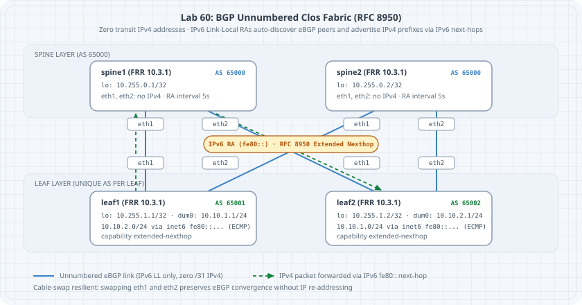

# Lab 60: BGP Unnumbered Clos Fabric (RFC 8950)

Build a 2-spine, 2-leaf eBGP Clos fabric with **zero transit IPv4 addresses**. Every fabric link relies solely on IPv6 Link-Local (`fe80::/10`) Router Advertisements for neighbor discovery and RFC 8950 (`capability extended-nexthop`) to install IPv4 prefixes over IPv6 next-hops in the Linux FIB.



## Scenario and Production Goal

Traditional IPv4 leaf-spine fabrics burn hundreds of `/31` transit subnets and require strict interface-to-IP mapping in automation templates. When a technician swaps two fiber patch cords during rack turn-up, BGP sessions fail to establish until the IPAM database or cabling is corrected.

In this lab, you eliminate transit IPv4 addressing completely:

- **Auto-discovery**: FRR sends IPv6 Router Advertisements (RAs) on each point-to-point link so peers learn each other's `fe80::` link-local address automatically.
- **RFC 8950 IPv4-over-IPv6**: BGP negotiates `extended-nexthop` so IPv4 loopback and tenant prefixes (`10.255.0.0/16`, `10.10.0.0/16`) resolve via IPv6 link-local next-hops in the Linux kernel (`via inet6 fe80::...`).
- **Cable-swap resilience**: Because `neighbor eth1 interface remote-as external` binds to the port rather than a peer IP, swapping links between spines requires zero IP changes.

## Topology and Addressing

| Node | Role | ASN | Loopback (`lo`) | Tenant Prefix (`dum0`) | Fabric Links (IPv6 LL only) |
| :--- | :--- | :--- | :--- | :--- | :--- |
| `spine1` | Spine | `65000` | `10.255.0.1/32` | — | `eth1` → `leaf1:eth1`, `eth2` → `leaf2:eth1` |
| `spine2` | Spine | `65000` | `10.255.0.2/32` | — | `eth1` → `leaf1:eth2`, `eth2` → `leaf2:eth2` |
| `leaf1` | Leaf | `65001` | `10.255.1.1/32` | `10.10.1.1/24` | `eth1` → `spine1:eth1`, `eth2` → `spine2:eth1` |
| `leaf2` | Leaf | `65002` | `10.255.1.2/32` | `10.10.2.1/24` | `eth1` → `spine1:eth2`, `eth2` → `spine2:eth2` |

Save the topology below as `clab.yml` in a working directory (for example `~/labs/lab60-bgp-unnumbered/`).

```yaml
name: lab60-bgp-unnumbered
topology:
  defaults:
    kind: linux
    image: quay.io/frrouting/frr:10.3.1
    binds:
      - configs/daemons:/etc/frr/daemons:ro
  nodes:
    spine1:
      binds:
        - configs/spine1.conf:/etc/frr/frr.conf:ro
      exec:
        - sysctl -w net.ipv4.ip_forward=1 net.ipv6.conf.all.forwarding=1
    spine2:
      binds:
        - configs/spine2.conf:/etc/frr/frr.conf:ro
      exec:
        - sysctl -w net.ipv4.ip_forward=1 net.ipv6.conf.all.forwarding=1
    leaf1:
      binds:
        - configs/leaf1.conf:/etc/frr/frr.conf:ro
      exec:
        - sysctl -w net.ipv4.ip_forward=1 net.ipv6.conf.all.forwarding=1
        - ip link add dum0 type dummy
        - ip link set dum0 up
        - ip addr add 10.10.1.1/24 dev dum0
    leaf2:
      binds:
        - configs/leaf2.conf:/etc/frr/frr.conf:ro
      exec:
        - sysctl -w net.ipv4.ip_forward=1 net.ipv6.conf.all.forwarding=1
        - ip link add dum0 type dummy
        - ip link set dum0 up
        - ip addr add 10.10.2.1/24 dev dum0
  links:
    - endpoints: ["spine1:eth1", "leaf1:eth1"]
    - endpoints: ["spine1:eth2", "leaf2:eth1"]
    - endpoints: ["spine2:eth1", "leaf1:eth2"]
    - endpoints: ["spine2:eth2", "leaf2:eth2"]
```

## Node Configurations

Create `configs/daemons` (shared by all four FRR nodes):

```cfg
zebra=yes
bgpd=yes
bfdd=yes
vtysh_enable=yes
zebra_options=" -A 127.0.0.1 -s 90000000"
bgpd_options="  -A 127.0.0.1"
```

### Spine Configurations (`configs/spine1.conf` and `configs/spine2.conf`)

Both spines share `AS 65000` and differ only in `hostname`, `lo` IP (`10.255.0.1/32` vs `10.255.0.2/32`), and `bgp router-id`.

```cfg
frr defaults datacenter
hostname spine1
service integrated-vtysh-config
!
interface lo
 ip address 10.255.0.1/32
!
interface eth1
 ipv6 nd ra-interval 5
 no ipv6 nd suppress-ra
!
interface eth2
 ipv6 nd ra-interval 5
 no ipv6 nd suppress-ra
!
router bgp 65000
 bgp router-id 10.255.0.1
 bgp bestpath as-path multipath-relax
 neighbor FABRIC peer-group
 neighbor FABRIC remote-as external
 neighbor FABRIC capability extended-nexthop
 neighbor eth1 interface peer-group FABRIC
 neighbor eth2 interface peer-group FABRIC
 !
 address-family ipv4 unicast
  network 10.255.0.1/32
  maximum-paths 4
 exit-address-family
!
line vty
```

For `configs/spine2.conf`, copy `spine1.conf` and replace `spine1` with `spine2` and `10.255.0.1` with `10.255.0.2`.

### Leaf Configurations (`configs/leaf1.conf` and `configs/leaf2.conf`)

```cfg
frr defaults datacenter
hostname leaf1
service integrated-vtysh-config
!
interface lo
 ip address 10.255.1.1/32
!
interface eth1
 ipv6 nd ra-interval 5
 no ipv6 nd suppress-ra
!
interface eth2
 ipv6 nd ra-interval 5
 no ipv6 nd suppress-ra
!
router bgp 65001
 bgp router-id 10.255.1.1
 bgp bestpath as-path multipath-relax
 neighbor FABRIC peer-group
 neighbor FABRIC remote-as external
 neighbor FABRIC capability extended-nexthop
 neighbor eth1 interface peer-group FABRIC
 neighbor eth2 interface peer-group FABRIC
 !
 address-family ipv4 unicast
  network 10.255.1.1/32
  network 10.10.1.0/24
  maximum-paths 4
 exit-address-family
!
line vty
```

For `configs/leaf2.conf`, copy `leaf1.conf` and change `hostname leaf2`, `10.255.1.2/32`, `router bgp 65002`, `bgp router-id 10.255.1.2`, and `network 10.10.2.0/24`.

Deploy the lab:

```bash
sudo containerlab deploy -t clab.yml
```

## Baseline Verification

Verify that all four eBGP sessions reached `Established` purely over interface names, and confirm that `leaf1` installs IPv4 routes with IPv6 link-local next-hops in Linux.

```bash
docker exec clab-lab60-bgp-unnumbered-leaf1 vtysh -c "show bgp summary"
docker exec clab-lab60-bgp-unnumbered-leaf1 ip -4 route show proto bgp
docker exec clab-lab60-bgp-unnumbered-leaf1 ping -c 3 -I 10.10.1.1 10.10.2.1
```

> [!NOTE]
> Illustrative expected output (lab not executed on the authoring host).

```text
IPv4 Unicast Summary:
BGP router identifier 10.255.1.1, local AS number 65001 VRF default vrf-id 0
Neighbor        V         AS   MsgRcvd   MsgSent   TblVer  InQ OutQ  Up/Down State/PfxRcd   PfxSnt Desc
spine1(eth1)    4      65000        14        15        6    0    0 00:01:42            3        2 N/A
spine2(eth2)    4      65000        14        15        6    0    0 00:01:41            3        2 N/A

10.10.2.0/24 nhid 22 proto bgp metric 20
        nexthop via inet6 fe80::a8c1:abff:fe11:0101 dev eth1 weight 1
        nexthop via inet6 fe80::a8c1:abff:fe22:0101 dev eth2 weight 1
10.255.0.1/32 nhid 18 via inet6 fe80::a8c1:abff:fe11:0101 dev eth1 proto bgp metric 20
10.255.0.2/32 nhid 19 via inet6 fe80::a8c1:abff:fe22:0101 dev eth2 proto bgp metric 20
10.255.1.2/32 nhid 22 proto bgp metric 20
        nexthop via inet6 fe80::a8c1:abff:fe11:0101 dev eth1 weight 1
        nexthop via inet6 fe80::a8c1:abff:fe22:0101 dev eth2 weight 1

PING 10.10.2.1 (10.10.2.1) from 10.10.1.1 : 56(84) bytes of data.
64 bytes from 10.10.2.1: icmp_seq=1 ttl=63 time=0.412 ms
```

Notice `via inet6 fe80::...` on an IPv4 route table entry (`ip -4 route`) — that is RFC 8950 operating directly in the Linux kernel FIB.

## Production Drills and Failure Injection

### Drill 1: Inspect RFC 8950 Capabilities and Kernel Next-Hop Objects

Confirm that `Extended Nexthop Encoding` was negotiated in the BGP `OPEN` message and inspect the Linux nexthop group object:

```bash
docker exec clab-lab60-bgp-unnumbered-leaf1 vtysh -c "show bgp neighbors eth1" | grep -A 3 -i "Extended Nexthop"
docker exec clab-lab60-bgp-unnumbered-leaf1 ip nexthop show
```

**Expected symptoms**: Both `advertised and received` appear for `Extended Nexthop Encoding`, and `ip nexthop show` lists an ECMP group referencing two `via fe80::...` entries. No IPv4 address exists on `eth1` or `eth2` (`ip -4 addr show dev eth1` is empty).

### Drill 2: Cable Swap Test (Zero Re-Addressing)

Simulate a technician swapping the uplinks of `leaf1` (`eth1` ↔ `eth2`) without touching any router configuration:

```bash
# Edit clab.yml links so spine1:eth1 connects to leaf1:eth2 and spine2:eth1 connects to leaf1:eth1
sed -i.bak \
  -e 's/"spine1:eth1", "leaf1:eth1"/"spine1:eth1", "leaf1:eth2"/' \
  -e 's/"spine2:eth1", "leaf1:eth2"/"spine2:eth1", "leaf1:eth1"/' clab.yml
sudo containerlab deploy -t clab.yml --reconfigure
docker exec clab-lab60-bgp-unnumbered-leaf1 vtysh -c "show bgp summary"
```

**Expected symptoms**: Within 5–10 seconds, `leaf1` re-discovers `spine2` on `eth1` and `spine1` on `eth2`. All IPv4 routes reconverge automatically with zero config edits.

**Rollback**: Restore `clab.yml.bak` and run `sudo containerlab deploy -t clab.yml --reconfigure`.

### Drill 3: Suppress IPv6 Router Advertisements and Diagnose Stuck BGP

In production, a misconfigured switch port or RA-Guard policy silently breaks BGP unnumbered neighbor discovery. Inject this fault on `spine1:eth1`:

```bash
docker exec clab-lab60-bgp-unnumbered-spine1 vtysh -c "conf t" -c "interface eth1" -c "ipv6 nd suppress-ra"
docker exec clab-lab60-bgp-unnumbered-leaf1 vtysh -c "clear bgp eth1"
sleep 8
docker exec clab-lab60-bgp-unnumbered-leaf1 vtysh -c "show bgp summary"
docker exec clab-lab60-bgp-unnumbered-leaf1 vtysh -c "show bgp neighbors eth1" | grep -E "BGP state|Link-local"
```

**Expected symptoms**: `eth1` stays stuck in `Active` or `Connect` because `leaf1` never receives an IPv6 RA containing `spine1`'s link-local address. Meanwhile, traffic from `10.10.1.1` to `10.10.2.1` continues uninterrupted over `spine2` (`eth2`).

**Rollback**: Re-enable RAs on `spine1:eth1` and confirm the session returns to `Established`:

```bash
docker exec clab-lab60-bgp-unnumbered-spine1 vtysh -c "conf t" -c "interface eth1" -c "no ipv6 nd suppress-ra"
```

## Cleanup and Key Takeaways

```bash
sudo containerlab destroy -t clab.yml --cleanup
```

- **Production checklist**: Always set `ipv6 nd ra-interval 5` and `no ipv6 nd suppress-ra` on fabric links; enable `bgp bestpath as-path multipath-relax` when spines or leaves use distinct ASNs; verify kernel support for IPv4-over-IPv6 nexthops (`Linux >= 4.18`).
- **Related reading**: [BGP IPv4 Routes with IPv6 Next-Hops (RFC 8950)](../05-dynamic-routing/08-bgp-ipv4-routes-ipv6-next-hops-rfc8950.md), [BGP Unnumbered Clos](../07-b-fabrics-multi-area/07-bgp-unnumbered-clos.md), [Clos Leaf-Spine Fabrics](../07-b-fabrics-multi-area/01-clos-leaf-spine.md), and [Fabric with FRR](../07-b-fabrics-multi-area/03-fabric-with-frr.md).
