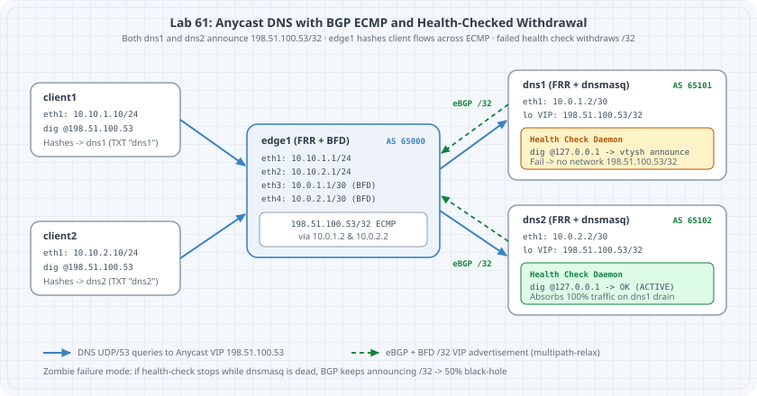

# Lab 61: Anycast DNS with BGP ECMP and Health-Checked Withdrawal

Build a production-style Anycast DNS service where two independent DNS nodes (`dns1` and `dns2`) advertise the same `/32` service VIP (`198.51.100.53/32`) over eBGP + BFD to an upstream router (`edge1`). A local health-check daemon ties BGP route origination directly to live DNS query health so failed instances drain automatically instead of black-holing queries.



## Scenario and Production Goal

Anycast is the backbone of public DNS resolvers (`1.1.1.1`, `8.8.8.8`) and authoritative name servers. Multiple servers bind the exact same loopback VIP and announce it via BGP; upstream routers install equal-cost multipath (ECMP) routes and hash flows across healthy nodes.

However, routing protocols only know whether the **network** is up — not whether the **DNS daemon** is answering queries. In this lab, you implement:

- **eBGP ECMP + BFD**: `edge1` uses `bgp bestpath as-path multipath-relax` and BFD to balance queries across `dns1` and `dns2` and detect link/host death in under a second.
- **Health-checked route origination**: A lightweight daemon on each DNS server probes `127.0.0.1:53` every 2 seconds and adds or withdraws `198.51.100.53/32` via `vtysh`.
- **Zombie failure analysis**: You intentionally decouple the health checker from the DNS daemon to observe the classic Anycast black-hole failure mode.

## Topology and Addressing

| Node | Role | ASN | Interfaces | Loopback / Anycast VIP |
| :--- | :--- | :--- | :--- | :--- |
| `client1` | DNS Client | — | `eth1: 10.10.1.10/24` (gw `10.10.1.1`) | — |
| `client2` | DNS Client | — | `eth1: 10.10.2.10/24` (gw `10.10.2.1`) | — |
| `edge1` | Edge Router | `65000` | `eth1: 10.10.1.1/24`, `eth2: 10.10.2.1/24`, `eth3: 10.0.1.1/30`, `eth4: 10.0.2.1/30` | `10.255.0.1/32` |
| `dns1` | Anycast DNS 1 | `65101` | `eth1: 10.0.1.2/30` | `198.51.100.53/32` |
| `dns2` | Anycast DNS 2 | `65102` | `eth1: 10.0.2.2/30` | `198.51.100.53/32` |

Save this topology as `clab.yml`:

```yaml
name: lab61-anycast-dns
topology:
  nodes:
    edge1:
      kind: linux
      image: quay.io/frrouting/frr:10.3.1
      binds:
        - configs/daemons:/etc/frr/daemons:ro
        - configs/edge1.conf:/etc/frr/frr.conf:ro
      exec:
        - sysctl -w net.ipv4.ip_forward=1 net.ipv4.fib_multipath_hash_policy=1
    dns1:
      kind: linux
      image: quay.io/frrouting/frr:10.3.1
      binds:
        - configs/daemons:/etc/frr/daemons:ro
        - configs/dns1.conf:/etc/frr/frr.conf:ro
        - configs/healthcheck.sh:/usr/local/bin/healthcheck.sh:ro
      exec:
        - apk add --no-cache dnsmasq bind-tools
        - ip addr add 198.51.100.53/32 dev lo
        - dnsmasq --no-daemon --listen-address=127.0.0.1,198.51.100.53 --bind-interfaces --txt-record=whoami.lab.internal,"dns1" &
        - sh -c "nohup /usr/local/bin/healthcheck.sh 65101 >/var/log/hc.log 2>&1 &"
    dns2:
      kind: linux
      image: quay.io/frrouting/frr:10.3.1
      binds:
        - configs/daemons:/etc/frr/daemons:ro
        - configs/dns2.conf:/etc/frr/frr.conf:ro
        - configs/healthcheck.sh:/usr/local/bin/healthcheck.sh:ro
      exec:
        - apk add --no-cache dnsmasq bind-tools
        - ip addr add 198.51.100.53/32 dev lo
        - dnsmasq --no-daemon --listen-address=127.0.0.1,198.51.100.53 --bind-interfaces --txt-record=whoami.lab.internal,"dns2" &
        - sh -c "nohup /usr/local/bin/healthcheck.sh 65102 >/var/log/hc.log 2>&1 &"
    client1:
      kind: linux
      image: nicolaka/netshoot:latest
      exec:
        - ip addr add 10.10.1.10/24 dev eth1
        - ip route replace default via 10.10.1.1
    client2:
      kind: linux
      image: nicolaka/netshoot:latest
      exec:
        - ip addr add 10.10.2.10/24 dev eth1
        - ip route replace default via 10.10.2.1
  links:
    - endpoints: ["client1:eth1", "edge1:eth1"]
    - endpoints: ["client2:eth1", "edge1:eth2"]
    - endpoints: ["edge1:eth3", "dns1:eth1"]
    - endpoints: ["edge1:eth4", "dns2:eth1"]
```

## Node Configurations

Create `configs/daemons` enabling `zebra`, `bgpd`, and `bfdd`:

```cfg
zebra=yes
bgpd=yes
bfdd=yes
vtysh_enable=yes
```

### Edge Router (`configs/edge1.conf`)

```cfg
frr defaults datacenter
hostname edge1
service integrated-vtysh-config
!
interface lo
 ip address 10.255.0.1/32
!
interface eth1
 ip address 10.10.1.1/24
!
interface eth2
 ip address 10.10.2.1/24
!
interface eth3
 ip address 10.0.1.1/30
!
interface eth4
 ip address 10.0.2.1/30
!
bfd
 profile FAST
  detect-multiplier 3
  transmit-interval 300
  receive-interval 300
!
router bgp 65000
 bgp router-id 10.255.0.1
 bgp bestpath as-path multipath-relax
 neighbor 10.0.1.2 remote-as 65101
 neighbor 10.0.1.2 bfd profile FAST
 neighbor 10.0.2.2 remote-as 65102
 neighbor 10.0.2.2 bfd profile FAST
 !
 address-family ipv4 unicast
  network 10.10.1.0/24
  network 10.10.2.0/24
  maximum-paths 4
 exit-address-family
!
line vty
```

### Anycast DNS Nodes (`configs/dns1.conf` and `configs/dns2.conf`)

Note that `network 198.51.100.53/32` is **not** hardcoded in `dns1.conf` — the health-check script injects it only after verifying local DNS resolution.

```cfg
frr defaults datacenter
hostname dns1
service integrated-vtysh-config
!
interface eth1
 ip address 10.0.1.2/30
!
bfd
 profile FAST
  detect-multiplier 3
  transmit-interval 300
  receive-interval 300
!
router bgp 65101
 bgp router-id 10.0.1.2
 neighbor 10.0.1.1 remote-as 65000
 neighbor 10.0.1.1 bfd profile FAST
 !
 address-family ipv4 unicast
  neighbor 10.0.1.1 activate
 exit-address-family
!
line vty
```

For `configs/dns2.conf`, copy `dns1.conf` and replace `dns1` with `dns2`, `10.0.1.2` with `10.0.2.2`, `10.0.1.1` with `10.0.2.1`, and `65101` with `65102`.

### Health-Check Daemon (`configs/healthcheck.sh`)

Make this file executable (`chmod +x configs/healthcheck.sh`):

```bash
#!/bin/sh
ASN="$1"
VIP="198.51.100.53/32"
ANNOUNCED=0

while true; do
  if dig @127.0.0.1 whoami.lab.internal TXT +time=1 +tries=1 +short | grep -q "dns"; then
    if [ "$ANNOUNCED" -eq 0 ]; then
      vtysh -c "conf t" -c "router bgp $ASN" -c "address-family ipv4 unicast" -c "network $VIP"
      ANNOUNCED=1
      echo "$(date -Iseconds) UP: announced $VIP"
    fi
  else
    if [ "$ANNOUNCED" -eq 1 ]; then
      vtysh -c "conf t" -c "router bgp $ASN" -c "address-family ipv4 unicast" -c "no network $VIP"
      ANNOUNCED=0
      echo "$(date -Iseconds) DOWN: withdrew $VIP"
    fi
  fi
  sleep 2
done
```

Deploy the lab:

```bash
sudo containerlab deploy -t clab.yml
```

## Baseline Verification

Verify both BFD sessions are `Up`, `edge1` has a 2-way ECMP route for `198.51.100.53/32`, and clients reach both Anycast backends:

```bash
docker exec clab-lab61-anycast-dns-edge1 vtysh -c "show bfd peers brief"
docker exec clab-lab61-anycast-dns-edge1 ip route show 198.51.100.53/32
docker exec clab-lab61-anycast-dns-client1 dig @198.51.100.53 whoami.lab.internal TXT +short
docker exec clab-lab61-anycast-dns-client2 dig @198.51.100.53 whoami.lab.internal TXT +short
```

> [!NOTE]
> Illustrative expected output (lab not executed on the authoring host).

```text
Session count: 2
SessionId  LocalAddress                             PeerAddress                             Status
=========  ============                             ===========                             ======
1          10.0.1.1                                 10.0.1.2                                up
2          10.0.2.1                                 10.0.2.2                                up

198.51.100.53 proto bgp metric 20
        nexthop via 10.0.1.2 dev eth3 weight 1
        nexthop via 10.0.2.2 dev eth4 weight 1

"dns1"
"dns2"
```

## Production Drills and Failure Injection

### Drill 1: Verify L4 ECMP Load Distribution

Because `edge1` has `net.ipv4.fib_multipath_hash_policy=1` (L4 5-tuple hashing), different UDP source ports distribute across both backends even from a single client. Run 20 queries from `client1` and count hits per backend:

```bash
docker exec clab-lab61-anycast-dns-client1 sh -c \
  'for i in $(seq 1 20); do dig @198.51.100.53 whoami.lab.internal TXT +short; done | sort | uniq -c'
```

**Expected symptoms**: Roughly even distribution (for example, `11 "dns1"` and `9 "dns2"`). If you set `fib_multipath_hash_policy=0` (L3 hashing), all 20 queries from `client1` stick to a single server while `client2` may hash to the other.

### Drill 2: Application Failure and Automated Route Withdrawal

Stop `dnsmasq` on `dns1` while leaving FRR and the network link completely intact:

```bash
docker exec clab-lab61-anycast-dns-dns1 pkill dnsmasq
sleep 3
docker exec clab-lab61-anycast-dns-edge1 ip route show 198.51.100.53/32
docker exec clab-lab61-anycast-dns-client1 sh -c \
  'for i in $(seq 1 10); do dig @198.51.100.53 whoami.lab.internal TXT +short; done | sort | uniq -c'
```

**Expected symptoms**: Within 2–3 seconds, `healthcheck.sh` logs `DOWN: withdrew 198.51.100.53/32`. `edge1` removes `10.0.1.2` from the FIB, and 100% of queries return `"dns2"` with zero timeouts.

**Rollback**: Restart `dnsmasq` on `dns1` and verify `10.0.1.2` rejoins the ECMP route:

```bash
docker exec -d clab-lab61-anycast-dns-dns1 \
  dnsmasq --no-daemon --listen-address=127.0.0.1,198.51.100.53 --bind-interfaces --txt-record=whoami.lab.internal,"dns1"
```

### Drill 3: Simulate a Zombie Service (Anycast Black-Hole)

Demonstrate why health-check supervision is as critical as the service itself. Kill the health-check daemon on `dns1` **first**, then kill `dnsmasq`:

```bash
docker exec clab-lab61-anycast-dns-dns1 pkill -f healthcheck.sh
docker exec clab-lab61-anycast-dns-dns1 pkill dnsmasq
docker exec clab-lab61-anycast-dns-edge1 ip route show 198.51.100.53/32
docker exec clab-lab61-anycast-dns-client1 sh -c \
  'for i in $(seq 1 6); do dig @198.51.100.53 whoami.lab.internal TXT +time=1 +tries=1 +short || echo TIMEOUT; done'
```

**Expected symptoms**: Because BGP and BFD are still healthy, `edge1` continues to hash ~50% of queries to `dns1`, where the kernel returns ICMP Port Unreachable or drops them — intermittent timeouts for end users.

**Rollback**: Restart both `dnsmasq` and `/usr/local/bin/healthcheck.sh 65101` on `dns1`.

## Cleanup and Key Takeaways

```bash
sudo containerlab destroy -t clab.yml --cleanup
```

- **Production checklist**: Never announce an Anycast VIP statically in FRR without tying it to an active health checker (ExaBGP, BIRD + `anycast-healthchecker`, or FRR + systemd `BindsTo=`); always run BFD to catch silent L2/host hangs; expose a node-identity TXT record (`CH TXT hostname.bind` or custom TXT) for instant on-call triage.
- **Related reading**: [Anycast Services and DNS](../04-network-services/19-anycast-services-and-dns.md), [BFD Fast Failure Detection](../05-dynamic-routing/04-bfd-fast-failure-detection.md), [Paris Traceroute and ECMP](../06-security-operations/05c-paris-traceroute-ecmp.md), and [Lab 51: ECMP Real Flows](51-ecmp-real-flows.md).
