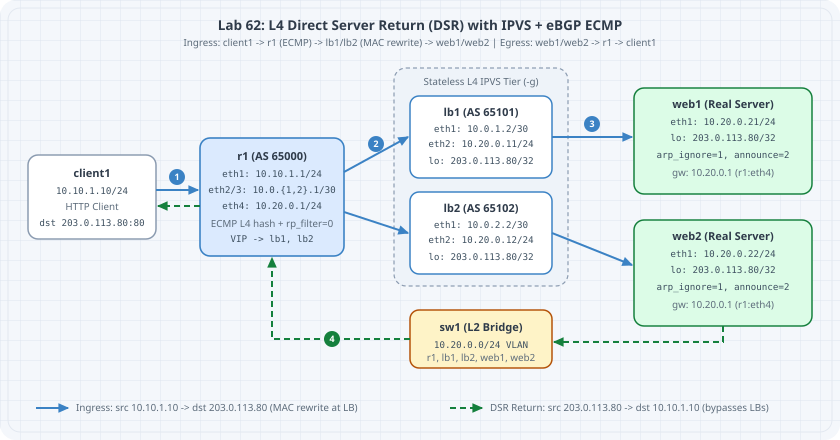

# Lab 62: L4 Direct Server Return (DSR) Load Balancer with IPVS and BGP

Build a production-grade Layer 4 Direct Server Return (DSR) load-balancing tier using Linux IPVS (`ipvsadm`) in Direct Routing (`-g`) mode fronted by eBGP ECMP (`FRR`). Inbound client requests traverse `r1` and one of two stateless L4 load balancers (`lb1`, `lb2`), which rewrite only the destination MAC address toward `web1` or `web2`. Backend servers hold the VIP on `lo` with strict ARP suppression and return response traffic directly to `r1`, bypassing the load balancers completely.



## Scenario and Production Goal

In high-throughput web, video, and API tiers, outbound response traffic often exceeds inbound request traffic by 10x or more. A stateful NAT load balancer must process both directions and maintain symmetric conntrack state, becoming an egress bandwidth bottleneck.

Direct Server Return solves this by decoupling ingress and egress:

- **eBGP ECMP ingress**: `lb1` and `lb2` advertise the service VIP (`203.0.113.80/32`) to `r1` over eBGP. `r1` hashes flows across both load balancers using L4 multipath hashing.
- **L2 MAC-rewrite forwarding (`ipvsadm -g`)**: IPVS leaves the client source IP (`10.10.1.10`) and VIP destination IP (`203.0.113.80`) untouched, rewriting only the Ethernet destination MAC to the chosen real server on the shared server VLAN (`10.20.0.0/24`).
- **ARP-suppressed loopback VIP**: `web1` and `web2` bind `203.0.113.80/32` on `lo` so the kernel accepts packets for the VIP, while `arp_ignore=1` and `arp_announce=2` prevent them from answering ARP for the VIP and hijacking traffic.

## Topology and Addressing

| Node | Role | ASN | Interfaces | Loopback / VIP |
| :--- | :--- | :--- | :--- | :--- |
| `client1` | HTTP Client | — | `eth1: 10.10.1.10/24` (gw `10.10.1.1`) | — |
| `r1` | Edge Router | `65000` | `eth1: 10.10.1.1/24`, `eth2: 10.0.1.1/30`, `eth3: 10.0.2.1/30`, `eth4: 10.20.0.1/24` | `10.255.0.1/32` |
| `lb1` | L4 IPVS LB 1 | `65101` | `eth1: 10.0.1.2/30`, `eth2: 10.20.0.11/24` | `203.0.113.80/32` |
| `lb2` | L4 IPVS LB 2 | `65102` | `eth1: 10.0.2.2/30`, `eth2: 10.20.0.12/24` | `203.0.113.80/32` |
| `sw1` | Server L2 Switch | — | Linux bridge `br0` (`eth1`–`eth5`) | — |
| `web1` | Backend Server 1 | — | `eth1: 10.20.0.21/24` (gw `10.20.0.1`) | `203.0.113.80/32` |
| `web2` | Backend Server 2 | — | `eth1: 10.20.0.22/24` (gw `10.20.0.1`) | `203.0.113.80/32` |

> [!IMPORTANT]
> IPVS runs in the Linux kernel (`ip_vs`, `ip_vs_rr`, `ip_vs_sh`). Ensure the host kernel has the `ip_vs` modules loaded (`sudo modprobe ip_vs ip_vs_rr ip_vs_sh`) before deploying.

Save this topology as `clab.yml`:

```yaml
name: lab62-dsr-ipvs
topology:
  nodes:
    r1:
      kind: linux
      image: quay.io/frrouting/frr:10.3.1
      binds:
        - configs/daemons:/etc/frr/daemons:ro
        - configs/r1.conf:/etc/frr/frr.conf:ro
      exec:
        - sysctl -w net.ipv4.ip_forward=1 net.ipv4.fib_multipath_hash_policy=1
        - sysctl -w net.ipv4.conf.all.rp_filter=0 net.ipv4.conf.eth4.rp_filter=0
    lb1:
      kind: linux
      image: quay.io/frrouting/frr:10.3.1
      binds:
        - configs/daemons:/etc/frr/daemons:ro
        - configs/lb1.conf:/etc/frr/frr.conf:ro
      exec:
        - apk add --no-cache ipvsadm tcpdump
        - sysctl -w net.ipv4.ip_forward=1 net.ipv4.conf.all.rp_filter=0
        - ip addr add 203.0.113.80/32 dev lo
        - ipvsadm -A -t 203.0.113.80:80 -s rr
        - ipvsadm -a -t 203.0.113.80:80 -r 10.20.0.21:80 -g
        - ipvsadm -a -t 203.0.113.80:80 -r 10.20.0.22:80 -g
    lb2:
      kind: linux
      image: quay.io/frrouting/frr:10.3.1
      binds:
        - configs/daemons:/etc/frr/daemons:ro
        - configs/lb2.conf:/etc/frr/frr.conf:ro
      exec:
        - apk add --no-cache ipvsadm tcpdump
        - sysctl -w net.ipv4.ip_forward=1 net.ipv4.conf.all.rp_filter=0
        - ip addr add 203.0.113.80/32 dev lo
        - ipvsadm -A -t 203.0.113.80:80 -s rr
        - ipvsadm -a -t 203.0.113.80:80 -r 10.20.0.21:80 -g
        - ipvsadm -a -t 203.0.113.80:80 -r 10.20.0.22:80 -g
    sw1:
      kind: linux
      image: alpine:3.20
      exec:
        - ip link add br0 type bridge
        - sh -c "for i in eth1 eth2 eth3 eth4 eth5; do ip link set $i master br0 up; done"
        - ip link set br0 up
    web1:
      kind: linux
      image: nicolaka/netshoot:latest
      exec:
        - ip addr add 10.20.0.21/24 dev eth1
        - ip route replace default via 10.20.0.1
        - sysctl -w net.ipv4.conf.all.arp_ignore=1 net.ipv4.conf.all.arp_announce=2
        - sysctl -w net.ipv4.conf.lo.arp_ignore=1 net.ipv4.conf.lo.arp_announce=2
        - ip addr add 203.0.113.80/32 dev lo
        - sh -c "mkdir -p /www && echo web1 >/www/index.html && nohup python3 -m http.server 80 -d /www >/dev/null 2>&1 &"
    web2:
      kind: linux
      image: nicolaka/netshoot:latest
      exec:
        - ip addr add 10.20.0.22/24 dev eth1
        - ip route replace default via 10.20.0.1
        - sysctl -w net.ipv4.conf.all.arp_ignore=1 net.ipv4.conf.all.arp_announce=2
        - sysctl -w net.ipv4.conf.lo.arp_ignore=1 net.ipv4.conf.lo.arp_announce=2
        - ip addr add 203.0.113.80/32 dev lo
        - sh -c "mkdir -p /www && echo web2 >/www/index.html && nohup python3 -m http.server 80 -d /www >/dev/null 2>&1 &"
    client1:
      kind: linux
      image: nicolaka/netshoot:latest
      exec:
        - ip addr add 10.10.1.10/24 dev eth1
        - ip route replace default via 10.10.1.1
  links:
    - endpoints: ["client1:eth1", "r1:eth1"]
    - endpoints: ["r1:eth2", "lb1:eth1"]
    - endpoints: ["r1:eth3", "lb2:eth1"]
    - endpoints: ["r1:eth4", "sw1:eth1"]
    - endpoints: ["lb1:eth2", "sw1:eth2"]
    - endpoints: ["lb2:eth2", "sw1:eth3"]
    - endpoints: ["web1:eth1", "sw1:eth4"]
    - endpoints: ["web2:eth1", "sw1:eth5"]
```

## Node Configurations

Create `configs/daemons` with `zebra=yes`, `bgpd=yes`, and `vtysh_enable=yes`.

### Edge Router (`configs/r1.conf`)

```cfg
frr defaults datacenter
hostname r1
service integrated-vtysh-config
!
interface lo
 ip address 10.255.0.1/32
!
interface eth1
 ip address 10.10.1.1/24
!
interface eth2
 ip address 10.0.1.1/30
!
interface eth3
 ip address 10.0.2.1/30
!
interface eth4
 ip address 10.20.0.1/24
!
router bgp 65000
 bgp router-id 10.255.0.1
 bgp bestpath as-path multipath-relax
 neighbor 10.0.1.2 remote-as 65101
 neighbor 10.0.2.2 remote-as 65102
 !
 address-family ipv4 unicast
  network 10.10.1.0/24
  maximum-paths 4
 exit-address-family
!
line vty
```

### Load Balancers (`configs/lb1.conf` and `configs/lb2.conf`)

```cfg
frr defaults datacenter
hostname lb1
service integrated-vtysh-config
!
interface eth1
 ip address 10.0.1.2/30
!
interface eth2
 ip address 10.20.0.11/24
!
router bgp 65101
 bgp router-id 10.0.1.2
 neighbor 10.0.1.1 remote-as 65000
 !
 address-family ipv4 unicast
  network 203.0.113.80/32
 exit-address-family
!
line vty
```

For `configs/lb2.conf`, copy `lb1.conf` and replace `lb1` with `lb2`, `10.0.1.2` with `10.0.2.2`, `10.0.1.1` with `10.0.2.1`, `10.20.0.11/24` with `10.20.0.12/24`, and `65101` with `65102`.

Deploy the lab:

```bash
sudo modprobe ip_vs ip_vs_rr ip_vs_sh
sudo containerlab deploy -t clab.yml
```

## Baseline Verification

Confirm ECMP installation on `r1`, IPVS Direct Routing (`Route`) entries on `lb1`, and round-robin HTTP responses from `client1`:

```bash
docker exec clab-lab62-dsr-ipvs-r1 ip route show 203.0.113.80/32
docker exec clab-lab62-dsr-ipvs-lb1 ipvsadm -Ln
docker exec clab-lab62-dsr-ipvs-client1 sh -c \
  'for i in $(seq 1 6); do curl -s http://203.0.113.80/; done'
```

> [!NOTE]
> Illustrative expected output (lab not executed on the authoring host).

```text
203.0.113.80 proto bgp metric 20
        nexthop via 10.0.1.2 dev eth2 weight 1
        nexthop via 10.0.2.2 dev eth3 weight 1

IP Virtual Server version 1.2.1 (size=4096)
Prot LocalAddress:Port Scheduler Flags
  -> RemoteAddress:Port           Forward Weight ActiveConn InActConn
TCP  203.0.113.80:80 rr
  -> 10.20.0.21:80                Route   1      0          3
  -> 10.20.0.22:80                Route   1      0          3

web1
web2
web1
web2
web1
web2
```

Notice the `Forward` column shows `Route` (Direct Routing / DSR), not `Masq` (NAT).

## Production Drills and Failure Injection

### Drill 1: Verify Asymmetric DSR Packet Flow with `tcpdump`

Capture TCP port 80 traffic simultaneously on `lb1:eth2` and `r1:eth4` while issuing a request from `client1`:

```bash
docker exec clab-lab62-dsr-ipvs-lb1 tcpdump -ni eth2 -c 6 'tcp port 80' &
docker exec clab-lab62-dsr-ipvs-r1 tcpdump -ni eth4 -c 6 'tcp port 80' &
sleep 1
docker exec clab-lab62-dsr-ipvs-client1 curl -s http://203.0.113.80/ >/dev/null
wait
```

**Expected symptoms**: On `lb1:eth2` (or `lb2:eth2`), you see **only client-to-VIP packets** (`10.10.1.10.xxxxx > 203.0.113.80.80: Flags [S]`, `Flags [P.]`, `Flags [F.]`) and **zero** return packets from `203.0.113.80.80`. On `r1:eth4`, you see **only VIP-to-client return packets** (`203.0.113.80.80 > 10.10.1.10.xxxxx: Flags [S.]`, `Flags [P.]`). Because `r1` has `rp_filter=0` on `eth4`, it forwards the asymmetric reply back to `client1` without dropping it.

### Drill 2: Break `arp_ignore` on `web1` and Observe VIP ARP Hijacking

Disable ARP suppression on `web1`, flush ARP caches on `lb1`, and probe `203.0.113.80` on the server LAN:

```bash
docker exec clab-lab62-dsr-ipvs-web1 sysctl -w net.ipv4.conf.all.arp_ignore=0 net.ipv4.conf.lo.arp_ignore=0
docker exec clab-lab62-dsr-ipvs-lb1 sh -c "ip neigh flush dev eth2; arping -I eth2 -c 2 203.0.113.80"
docker exec clab-lab62-dsr-ipvs-lb1 ip neigh show dev eth2
```

**Expected symptoms**: `web1` answers the ARP Who-Has for `203.0.113.80` with its own MAC address even though the VIP lives on `lo`. In a production shared VLAN where an upstream router or peer L2 device ARPs for the VIP, `web1` hijacks all VIP traffic directly—bypassing IPVS scheduling, starving `web2`, and breaking health checks.

**Rollback**: Restore strict ARP suppression on `web1`:

```bash
docker exec clab-lab62-dsr-ipvs-web1 sysctl -w net.ipv4.conf.all.arp_ignore=1 net.ipv4.conf.lo.arp_ignore=1
```

### Drill 3: Fail `lb1` and Verify ECMP + IPVS Continuity

Simulate an abrupt load balancer failure by taking `lb1:eth1` down, then test HTTP continuity and inspect `r1`'s FIB:

```bash
docker exec clab-lab62-dsr-ipvs-lb1 ip link set eth1 down
docker exec clab-lab62-dsr-ipvs-r1 ip route show 203.0.113.80/32
docker exec clab-lab62-dsr-ipvs-client1 sh -c \
  'for i in $(seq 1 6); do curl -s http://203.0.113.80/; done'
```

**Expected symptoms**: `r1` withdraws the `10.0.1.2` nexthop and routes 100% of VIP traffic to `lb2` (`10.0.2.2`). All six `curl` requests still balance cleanly across `web1` and `web2`. With round-robin (`-s rr`), existing long-lived connections hashed to `lb1` could land on a different backend after failover; in production, use source-hash (`-s sh`) or Maglev consistent hashing so `lb2` selects the exact same backend without state synchronization.

**Rollback**: Restore `lb1:eth1`:

```bash
docker exec clab-lab62-dsr-ipvs-lb1 ip link set eth1 up
```

## Cleanup and Key Takeaways

```bash
sudo containerlab destroy -t clab.yml --cleanup
```

- **Asymmetric paths require `rp_filter=0` (or loose mode `2`)** on routers handling DSR return traffic, otherwise strict uRPF drops packets whose source VIP is routed via another interface.
- **Loopback VIPs on Linux answer ARP by default** because Linux implements the weak host model; always configure `arp_ignore=1` and `arp_announce=2` before adding the VIP to `lo`.
- **Consistent hashing (`-s sh` / Maglev)** is essential on multi-LB DSR tiers so an ECMP rehash after an LB failure maps existing TCP flows to the same backend.

Related reading: [L4/L7 Load Balancing, DSR, and Proxies](../07-d-dataplanes-and-traffic-delivery/02-l4-l7-load-balancing-dsr-and-proxies.md), [Maglev Consistent Hashing](../08-transport-and-applications/16-load-balancer-hashing-maglev.md), [ARP Flux and Neighbour Tables](../02-networking-foundations/07b-neighbour-tables-timers-limits-arp-flux.md), and [Linux ECMP Nexthop Groups](../04-ip-routing-services/08-linux-ecmp-nexthop-groups.md).
