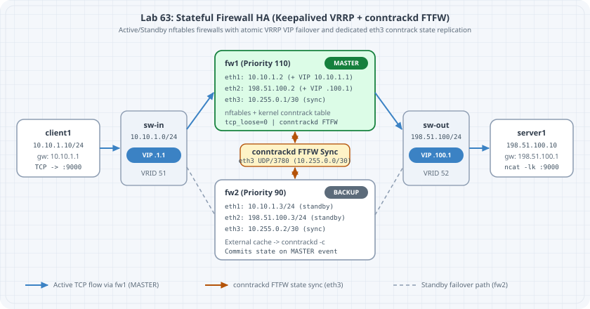

# Lab 63: Stateful Firewall HA with Keepalived (VRRP) and `conntrackd`

Build an Active/Standby Linux `nftables` firewall pair (`fw1` MASTER, `fw2` BACKUP) that fails over without dropping established TCP connections. `keepalived` synchronizes inside and outside VRRP virtual IPs (`10.10.1.1/24` and `198.51.100.1/24`), while `conntrackd` in Fault-Tolerant (`FTFW`) mode replicates kernel connection-tracking state over a dedicated `eth3` sync link (`10.255.0.0/30`).



## Scenario and Production Goal

VRRP alone provides Layer 3 gateway redundancy, but a stateful firewall that drops packets in `ct state invalid` will immediately break every in-flight TCP session during failover unless the standby node already possesses the connection-tracking entries.

In this lab, you build a complete Linux stateful HA pair:

- **VRRP sync group (`keepalived`)**: Binds the inside (`10.10.1.1/24`) and outside (`198.51.100.1/24`) VIPs into a single `vrrp_sync_group` so both interfaces fail over atomically.
- **Fault-Tolerant state replication (`conntrackd`)**: Streams conntrack creation and update events from `fw1` to `fw2`'s external cache over `eth3` (`10.255.0.0/30`), using UDP with sequence tracking and retransmission.
- **State commit on promotion**: When `fw2` transitions to `MASTER`, Keepalived invokes `notify_master` to execute `conntrackd -c`, committing the external cache into the kernel conntrack table so mid-stream TCP packets match `ct state established`.

## Topology and Addressing

| Node | Role | Interfaces | VRRP VIP / Notes |
| :--- | :--- | :--- | :--- |
| `client1` | Inside Host | `eth1: 10.10.1.10/24` (gw `10.10.1.1`) | Initiates long-lived TCP flows |
| `sw-in` | Inside L2 Bridge | `br0` (`eth1`–`eth3`) | `10.10.1.0/24` LAN |
| `fw1` | Firewall MASTER | `eth1: 10.10.1.2/24`, `eth2: 198.51.100.2/24`, `eth3: 10.255.0.1/30` | VRRP Priority `110`; holds VIPs `10.10.1.1`, `198.51.100.1` |
| `fw2` | Firewall BACKUP | `eth1: 10.10.1.3/24`, `eth2: 198.51.100.3/24`, `eth3: 10.255.0.2/30` | VRRP Priority `90`; standby `conntrackd` external cache |
| `sw-out` | Outside L2 Bridge | `br0` (`eth1`–`eth3`) | `198.51.100.0/24` DMZ/WAN |
| `server1` | Outside Server | `eth1: 198.51.100.10/24` (gw `198.51.100.1`) | TCP echo server on port `9000` |

Save this topology as `clab.yml`:

```yaml
name: lab63-stateful-ha
topology:
  nodes:
    sw-in:
      kind: linux
      image: alpine:3.20
      exec:
        - ip link add br0 type bridge
        - sh -c "for i in eth1 eth2 eth3; do ip link set $i master br0 up; done"
        - ip link set br0 up
    sw-out:
      kind: linux
      image: alpine:3.20
      exec:
        - ip link add br0 type bridge
        - sh -c "for i in eth1 eth2 eth3; do ip link set $i master br0 up; done"
        - ip link set br0 up
    fw1:
      kind: linux
      image: alpine:3.20
      binds:
        - configs/nftables.conf:/etc/nftables.conf:ro
        - configs/keepalived-fw1.conf:/etc/keepalived/keepalived.conf:ro
        - configs/conntrackd-fw1.conf:/etc/conntrackd/conntrackd.conf:ro
        - configs/primary-backup.sh:/etc/keepalived/primary-backup.sh:ro
      exec:
        - apk add --no-cache nftables keepalived conntrack-tools iproute2 tcpdump
        - ip addr add 10.10.1.2/24 dev eth1
        - ip addr add 198.51.100.2/24 dev eth2
        - ip addr add 10.255.0.1/30 dev eth3
        - sysctl -w net.ipv4.ip_forward=1 net.netfilter.nf_conntrack_tcp_loose=0
        - nft -f /etc/nftables.conf
        - conntrackd -C /etc/conntrackd/conntrackd.conf -d
        - keepalived -f /etc/keepalived/keepalived.conf
    fw2:
      kind: linux
      image: alpine:3.20
      binds:
        - configs/nftables.conf:/etc/nftables.conf:ro
        - configs/keepalived-fw2.conf:/etc/keepalived/keepalived.conf:ro
        - configs/conntrackd-fw2.conf:/etc/conntrackd/conntrackd.conf:ro
        - configs/primary-backup.sh:/etc/keepalived/primary-backup.sh:ro
      exec:
        - apk add --no-cache nftables keepalived conntrack-tools iproute2 tcpdump
        - ip addr add 10.10.1.3/24 dev eth1
        - ip addr add 198.51.100.3/24 dev eth2
        - ip addr add 10.255.0.2/30 dev eth3
        - sysctl -w net.ipv4.ip_forward=1 net.netfilter.nf_conntrack_tcp_loose=0
        - nft -f /etc/nftables.conf
        - conntrackd -C /etc/conntrackd/conntrackd.conf -d
        - keepalived -f /etc/keepalived/keepalived.conf
    client1:
      kind: linux
      image: nicolaka/netshoot:latest
      exec:
        - ip addr add 10.10.1.10/24 dev eth1
        - ip route replace default via 10.10.1.1
    server1:
      kind: linux
      image: nicolaka/netshoot:latest
      exec:
        - ip addr add 198.51.100.10/24 dev eth1
        - ip route replace default via 198.51.100.1
        - sh -c "nohup ncat -lk -p 9000 -c 'cat' >/dev/null 2>&1 &"
  links:
    - endpoints: ["client1:eth1", "sw-in:eth1"]
    - endpoints: ["fw1:eth1", "sw-in:eth2"]
    - endpoints: ["fw2:eth1", "sw-in:eth3"]
    - endpoints: ["fw1:eth2", "sw-out:eth1"]
    - endpoints: ["fw2:eth2", "sw-out:eth2"]
    - endpoints: ["server1:eth1", "sw-out:eth3"]
    - endpoints: ["fw1:eth3", "fw2:eth3"]
```

> [!TIP]
> Setting `net.netfilter.nf_conntrack_tcp_loose=0` enforces strict TCP state tracking: the kernel refuses to pick up mid-stream TCP packets (non-SYN) unless a matching conntrack entry already exists. Without this sysctl, Linux silently creates a new conntrack entry on an ACK and masks broken state sync.

## Node Configurations

### Stateful Firewall Policy (`configs/nftables.conf`)

```cfg
flush ruleset

table inet filter {
  chain forward {
    type filter hook forward priority 0; policy drop;
    ct state established,related counter accept
    ct state invalid counter drop
    iifname "eth1" oifname "eth2" ct state new counter accept
  }
}
```

### Keepalived (`configs/keepalived-fw1.conf` and `keepalived-fw2.conf`)

```cfg
vrrp_sync_group VG_FW {
  group {
    VI_INSIDE
    VI_OUTSIDE
  }
  notify_master "/etc/keepalived/primary-backup.sh primary"
  notify_backup "/etc/keepalived/primary-backup.sh backup"
  notify_fault  "/etc/keepalived/primary-backup.sh fault"
}

vrrp_instance VI_INSIDE {
  state MASTER
  interface eth1
  virtual_router_id 51
  priority 110
  advert_int 1
  virtual_ipaddress { 10.10.1.1/24 }
}

vrrp_instance VI_OUTSIDE {
  state MASTER
  interface eth2
  virtual_router_id 52
  priority 110
  advert_int 1
  virtual_ipaddress { 198.51.100.1/24 }
}
```

For `configs/keepalived-fw2.conf`, copy `keepalived-fw1.conf` and change `state MASTER` to `state BACKUP` and `priority 110` to `priority 90`.

### `conntrackd` (`configs/conntrackd-fw1.conf`) and Transition Script

```cfg
Sync {
  Mode FTFW {
    DisableExternalCache Off
  }
  UDP {
    IPv4_address 10.255.0.1
    IPv4_Destination_Address 10.255.0.2
    Port 3780
    Interface eth3
  }
}
General {
  HashSize 32768
  HashLimit 131072
  UNIX { Path /var/run/conntrackd.ctl }
  Filter From Userspace {
    Protocol Accept { TCP UDP ICMP }
    Address Ignore { IPv4_address 127.0.0.1 IPv4_address 10.255.0.1 IPv4_address 10.255.0.2 }
  }
}
```

For `configs/conntrackd-fw2.conf`, swap `IPv4_address` (`10.255.0.2`) and `IPv4_Destination_Address` (`10.255.0.1`).

Create executable `configs/primary-backup.sh` (`chmod +x configs/primary-backup.sh`):

```bash
#!/bin/sh
case "$1" in
  primary)
    conntrackd -c
    conntrackd -f
    conntrackd -R
    conntrackd -B
    ;;
  backup|fault)
    conntrackd -t
    conntrackd -n
    ;;
esac
```

Deploy the lab:

```bash
sudo containerlab deploy -t clab.yml
```

## Baseline Verification

Confirm `fw1` holds both VRRP VIPs, `fw2` does not, and `client1` can reach `server1` through `fw1`:

```bash
docker exec clab-lab63-stateful-ha-fw1 ip -br addr show dev eth1 dev eth2
docker exec clab-lab63-stateful-ha-fw2 ip -br addr show dev eth1 dev eth2
docker exec clab-lab63-stateful-ha-client1 ping -c 2 198.51.100.10
```

> [!NOTE]
> Illustrative expected output (lab not executed on the authoring host).

```text
eth1@if24        UP             10.10.1.2/24 10.10.1.1/24
eth2@if26        UP             198.51.100.2/24 198.51.100.1/24
eth1@if28        UP             10.10.1.3/24
eth2@if30        UP             198.51.100.3/24
2 packets transmitted, 2 received, 0% packet loss
```

## Production Drills and Failure Injection

### Drill 1: Verify Live Conntrack Replication (`conntrack -L` vs `conntrackd -e`)

Start a long-lived interactive TCP session from `client1` to `server1:9000` (sending a line every second), then inspect `fw1`'s kernel table and `fw2`'s external cache:

```bash
docker exec -d clab-lab63-stateful-ha-client1 sh -c \
  '(i=1; while true; do echo "tick-$i"; i=$((i+1)); sleep 1; done) | ncat 198.51.100.10 9000 >/tmp/tcp.log 2>&1'
sleep 2
docker exec clab-lab63-stateful-ha-fw1 conntrack -L -p tcp --dport 9000
docker exec clab-lab63-stateful-ha-fw2 conntrackd -e
```

**Expected symptoms**: `fw1` shows the `ESTABLISHED` TCP tuple (`src=10.10.1.10 dst=198.51.100.10 ... dport=9000`) in the kernel conntrack table, and `fw2` shows the identical entry in its userspace external cache (`conntrackd -e`), while `conntrack -L` on `fw2` is still empty.

### Drill 2: Stateful VRRP Failover Without Dropping the TCP Session

Force `fw1` into `FAULT` by bringing down `eth1`, then verify `fw2` claims both VIPs, commits the external cache via `conntrackd -c`, and keeps the TCP stream alive:

```bash
docker exec clab-lab63-stateful-ha-fw1 ip link set eth1 down
sleep 4
docker exec clab-lab63-stateful-ha-fw2 ip -br addr show dev eth1 dev eth2
docker exec clab-lab63-stateful-ha-fw2 conntrack -L -p tcp --dport 9000
docker exec clab-lab63-stateful-ha-client1 tail -n 5 /tmp/tcp.log
```

**Expected symptoms**: Within ~3 seconds (`3 * advert_int`), `fw2` assumes `MASTER`, adds `10.10.1.1/24` and `198.51.100.1/24`, and commits the synced TCP flow into `conntrack -L`. `client1`'s `/tmp/tcp.log` continues printing incrementing `tick-N` lines with zero TCP resets.

**Rollback**: Bring `fw1:eth1` back up so `fw1` reclaims `MASTER` (preemption):

```bash
docker exec clab-lab63-stateful-ha-fw1 ip link set eth1 up
sleep 4
```

### Drill 3: Break the Sync Link and Observe `INVALID` Stateful Drops

Disable the dedicated sync link (`eth3`), open a fresh TCP session across `fw1`, and trigger another failover:

```bash
docker exec clab-lab63-stateful-ha-fw1 ip link set eth3 down
docker exec clab-lab63-stateful-ha-client1 pkill ncat
docker exec -d clab-lab63-stateful-ha-client1 sh -c \
  '(i=1; while true; do echo "nosync-$i"; i=$((i+1)); sleep 1; done) | ncat 198.51.100.10 9000 >/tmp/nosync.log 2>&1'
sleep 2
docker exec clab-lab63-stateful-ha-fw1 ip link set eth1 down
sleep 4
docker exec clab-lab63-stateful-ha-fw2 nft list ruleset
```

**Expected symptoms**: Because `eth3` is down, `fw2` never received the new TCP flow in its external cache. When `fw2` takes over the VIPs and receives mid-stream `PSH,ACK` packets with `nf_conntrack_tcp_loose=0`, they classify as `ct state invalid`. The `ct state invalid counter drop` rule increments rapidly in `nft list ruleset`, and `client1`'s TCP session stalls and times out.

**Rollback**: Restore `eth3` and `eth1` on `fw1`:

```bash
docker exec clab-lab63-stateful-ha-fw1 sh -c "ip link set eth3 up; ip link set eth1 up"
```

## Cleanup and Key Takeaways

```bash
sudo containerlab destroy -t clab.yml --cleanup
```

- **Always test failover with `nf_conntrack_tcp_loose=0`**; otherwise Linux's default loose pickup hides broken `conntrackd` replication until a stricter firewall rule or NAT mapping breaks in production.
- **Bind all firewall interfaces into a `vrrp_sync_group`** so an inside link failure also steps down the outside VIP and prevents asymmetric routing.
- **Isolate and monitor the `conntrackd` sync link** (`conntrackd -s`): silent sync-link loss leaves the cluster running in a false-HA state that only surfaces during an outage.

Related reading: [Stateful Firewall HA and Conntrack Sync](../06-policy-qos-hardening/08b-stateful-firewall-ha-and-conntrack-sync.md), [nftables Fundamentals](../06-policy-qos-hardening/07-nftables-fundamentals.md), [First-Hop Redundancy (VRRP/HSRP)](../04-network-services/01-first-hop-redundancy.md), and [Conntrack Exhaustion](../06-policy-qos-hardening/08-conntrack-exhaustion.md).
