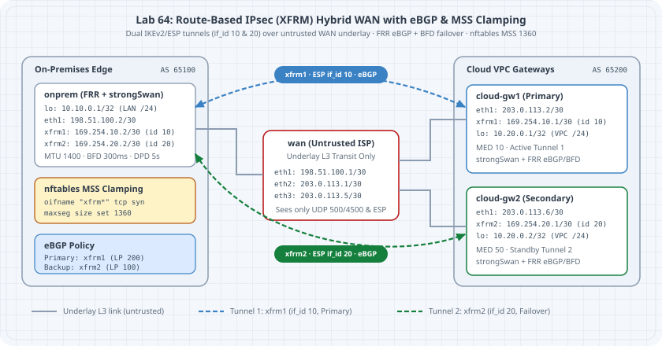

# Lab 64: Route-Based IPsec (XFRM) Hybrid WAN with eBGP and MSS Clamping

Modern hybrid-cloud WAN links replace brittle policy-based IPsec traffic selectors with **route-based XFRM interfaces** (`ip link add type xfrm`). Binding each IKEv2 Child SA to a distinct kernel `if_id` turns encrypted tunnels into normal routed interfaces that run **eBGP**, **BFD**, and **nftables TCP MSS clamping**—mirroring AWS Site-to-Site VPN and GCP HA VPN architectures.



## Scenario and Production Goal

An on-premises edge router (`onprem`, AS `65100`) must reach a cloud VPC (`10.20.0.0/24`, AS `65200`) across an untrusted WAN router (`wan`) with encrypted transit, automatic failover, and zero Path MTU black-holing.

By the end of this lab you will:
- Build two route-based IPsec tunnels (`xfrm1` with `if_id 10`, `xfrm2` with `if_id 20`) using strongSwan `swanctl.conf`.
- Run FRR eBGP with BFD over both tunnels, preferring Tunnel 1 (`LP 200`) and failing over cleanly to Tunnel 2 (`LP 100`).
- Verify ESP-only visibility on the untrusted transit hop and reproduce/fix a classic PMTUD black-hole using `nftables` MSS clamping (`1360`).

## Topology and Addressing

| Node | Role | Underlay Interface | Overlay / Loopback | ASN |
|---|---|---|---|---|
| `onprem` | On-prem VPN edge | `eth1`: `198.51.100.2/30` | `xfrm1`: `169.254.10.2/30` (`if_id 10`), `xfrm2`: `169.254.20.2/30` (`if_id 20`), `lo`: `10.10.0.1/32` | `65100` |
| `wan` | Untrusted ISP router | `eth1`: `198.51.100.1/30`, `eth2`: `203.0.113.1/30`, `eth3`: `203.0.113.5/30` | None (underlay transit only) | — |
| `cloud-gw1` | Primary cloud gateway | `eth1`: `203.0.113.2/30` | `xfrm1`: `169.254.10.1/30` (`if_id 10`), `lo`: `10.20.0.1/32` | `65200` |
| `cloud-gw2` | Standby cloud gateway | `eth1`: `203.0.113.6/30` | `xfrm2`: `169.254.20.1/30` (`if_id 20`), `lo`: `10.20.0.2/32` | `65200` |

Save the following topology as `clab.yml` (the `frr-strongswan:latest` image is a standard Ubuntu/Debian container with `frr`, `strongswan-swanctl`, `charon-systemd`, `nftables`, `tcpdump`, and `iproute2` installed):

```yaml
name: lab64-ipsec-xfrm-bgp
topology:
  nodes:
    onprem:
      kind: linux
      image: ghcr.io/srl-labs/frr-strongswan:latest
      binds:
        - configs/onprem/swanctl.conf:/etc/swanctl/swanctl.conf:ro
        - configs/onprem/frr.conf:/etc/frr/frr.conf:ro
        - configs/onprem/init.sh:/init.sh:ro
      exec:
        - bash /init.sh
    wan:
      kind: linux
      image: quay.io/frrouting/frr:10.1.1
      exec:
        - ip addr add 198.51.100.1/30 dev eth1
        - ip addr add 203.0.113.1/30 dev eth2
        - ip addr add 203.0.113.5/30 dev eth3
        - sysctl -w net.ipv4.ip_forward=1
    cloud-gw1:
      kind: linux
      image: ghcr.io/srl-labs/frr-strongswan:latest
      binds:
        - configs/gw1/swanctl.conf:/etc/swanctl/swanctl.conf:ro
        - configs/gw1/frr.conf:/etc/frr/frr.conf:ro
        - configs/gw1/init.sh:/init.sh:ro
      exec:
        - bash /init.sh
    cloud-gw2:
      kind: linux
      image: ghcr.io/srl-labs/frr-strongswan:latest
      binds:
        - configs/gw2/swanctl.conf:/etc/swanctl/swanctl.conf:ro
        - configs/gw2/frr.conf:/etc/frr/frr.conf:ro
        - configs/gw2/init.sh:/init.sh:ro
      exec:
        - bash /init.sh
  links:
    - endpoints: ["onprem:eth1", "wan:eth1"]
    - endpoints: ["wan:eth2", "cloud-gw1:eth1"]
    - endpoints: ["wan:eth3", "cloud-gw2:eth1"]
```

## Node Configurations

### On-Premises Router (`onprem`)

`configs/onprem/init.sh` configures the underlay, creates `xfrm1`/`xfrm2` with `mtu 1400`, applies `nftables` MSS clamping, and starts strongSwan and FRR:

```bash
#!/usr/bin/env bash
set -euo pipefail
ip addr add 198.51.100.2/30 dev eth1
ip addr add 10.10.0.1/24 dev lo
ip route replace default via 198.51.100.1 dev eth1

# Route-based XFRM interfaces (if_id binds kernel XFRM policies to each netdev)
ip link add xfrm1 type xfrm dev eth1 if_id 10
ip addr add 169.254.10.2/30 dev xfrm1
ip link set xfrm1 mtu 1400 up

ip link add xfrm2 type xfrm dev eth1 if_id 20
ip addr add 169.254.20.2/30 dev xfrm2
ip link set xfrm2 mtu 1400 up

sysctl -w net.ipv4.ip_forward=1 net.ipv4.conf.all.rp_filter=0 net.ipv4.conf.xfrm1.disable_policy=1 net.ipv4.conf.xfrm2.disable_policy=1

# Clamp TCP MSS to 1360 bytes on both XFRM interfaces (1400 MTU - 40 IP/TCP)
nft -f - <<'EOF'
table inet mss_clamp {
  chain forward {
    type filter hook forward priority mangle; policy accept;
    oifname { "xfrm1", "xfrm2" } tcp flags syn tcp option maxseg size set 1360
  }
  chain output {
    type filter hook output priority mangle; policy accept;
    oifname { "xfrm1", "xfrm2" } tcp flags syn tcp option maxseg size set 1360
  }
}
EOF

/usr/lib/ipsec/charon &
sleep 1
swanctl --load-all
/usr/lib/frr/frrinit.sh start
```

`configs/onprem/swanctl.conf` defines both IKEv2 peers with `if_id_in`/`if_id_out`, `0.0.0.0/0` wildcard selectors (route-based), and 5-second DPD:

```cfg
connections {
  gw1 {
    version = 2
    local_addrs  = 198.51.100.2
    remote_addrs = 203.0.113.2
    dpd_delay    = 5s
    dpd_timeout  = 15s
    local  { auth = psk; id = onprem.lab }
    remote { auth = psk; id = gw1.lab }
    children {
      tun1 {
        local_ts  = 0.0.0.0/0
        remote_ts = 0.0.0.0/0
        if_id_in  = 10
        if_id_out = 10
        esp_proposals = aes256gcm16-x25519
        start_action  = start
      }
    }
  }
  gw2 {
    version = 2
    local_addrs  = 198.51.100.2
    remote_addrs = 203.0.113.6
    dpd_delay    = 5s
    dpd_timeout  = 15s
    local  { auth = psk; id = onprem.lab }
    remote { auth = psk; id = gw2.lab }
    children {
      tun2 {
        local_ts  = 0.0.0.0/0
        remote_ts = 0.0.0.0/0
        if_id_in  = 20
        if_id_out = 20
        esp_proposals = aes256gcm16-x25519
        start_action  = start
      }
    }
  }
}
secrets {
  ike-gw1 { id-1 = gw1.lab; secret = "Lab64-XFRM-Primary-Key!" }
  ike-gw2 { id-1 = gw2.lab; secret = "Lab64-XFRM-Backup-Key!" }
}
```

`configs/onprem/frr.conf` establishes eBGP + BFD over both tunnels and prefers `cloud-gw1` via Local Preference:

```cfg
frr defaults traditional
hostname onprem
!
bfd
 profile wan-fast
  transmit-interval 300
  receive-interval 300
  detect-multiplier 3
!
route-map PREFER-GW1 permit 10
 set local-preference 200
route-map BACKUP-GW2 permit 10
 set local-preference 100
!
router bgp 65100
 bgp router-id 10.10.0.1
 no bgp ebgp-requires-policy
 neighbor 169.254.10.1 remote-as 65200
 neighbor 169.254.10.1 bfd profile wan-fast
 neighbor 169.254.20.1 remote-as 65200
 neighbor 169.254.20.1 bfd profile wan-fast
 address-family ipv4 unicast
  network 10.10.0.0/24
  neighbor 169.254.10.1 route-map PREFER-GW1 in
  neighbor 169.254.20.1 route-map BACKUP-GW2 in
 exit-address-family
```

### Cloud Gateways (`cloud-gw1` and `cloud-gw2`)

`configs/gw1/init.sh` mirrors `onprem` with `eth1 = 203.0.113.2/30`, default route via `203.0.113.1`, `lo = 10.20.0.1/24`, and `xfrm1` (`if_id 10`, `169.254.10.1/30`, `mtu 1400`). `configs/gw2/init.sh` uses `203.0.113.6/30`, default route via `203.0.113.5`, `lo = 10.20.0.2/24`, and `xfrm2` (`if_id 20`, `169.254.20.1/30`, `mtu 1400`).

`configs/gw1/frr.conf` (and analogously `configs/gw2/frr.conf` with `169.254.20.2` and `MED 50`):

```cfg
frr defaults traditional
hostname cloud-gw1
!
bfd
 profile wan-fast
  transmit-interval 300
  receive-interval 300
  detect-multiplier 3
!
router bgp 65200
 bgp router-id 10.20.0.1
 no bgp ebgp-requires-policy
 neighbor 169.254.10.2 remote-as 65100
 neighbor 169.254.10.2 bfd profile wan-fast
 address-family ipv4 unicast
  network 10.20.0.0/24
 exit-address-family
```

## Baseline Verification

Deploy the lab and verify both IKEv2 SAs, kernel XFRM states, BFD sessions, and BGP routes:

```bash
containerlab deploy -t clab.yml
docker exec clab-lab64-ipsec-xfrm-bgp-onprem swanctl --list-sas
docker exec clab-lab64-ipsec-xfrm-bgp-onprem vtysh -c "show bgp ipv4 unicast 10.20.0.0/24" -c "show bfd peers brief"
```

> [!NOTE]
> Illustrative expected output (lab not executed on the authoring host).

```text
gw1: #1, ESTABLISHED, IKEv2, 9a1c..._i 4f8e..._r
  local  'onprem.lab' @ 198.51.100.2[500]
  remote 'gw1.lab'    @ 203.0.113.2[500]
  tun1: #1, reqid 1, INSTALLED, TUNNEL, ESP:AES_GCM_16-256
    installed 42s ago, if_id 10 (in/out)
    local  0.0.0.0/0
    remote 0.0.0.0/0

BGP routing table entry for 10.20.0.0/24
  65200
    169.254.10.1 from 169.254.10.1 (10.20.0.1)
      Origin IGP, localpref 200, valid, external, best (Local Pref)
  65200
    169.254.20.1 from 169.254.20.1 (10.20.0.2)
      Origin IGP, localpref 100, valid, external

Session ID  Peer          Status   Up Time
1           169.254.10.1  up       00:00:39
2           169.254.20.1  up       00:00:38
```

## Production Drills and Failure Injection

### Drill 1: Verify ESP Encryption on Untrusted WAN While eBGP Runs Inside XFRM

- **Fault / Test Action**: Generate overlay traffic from `onprem` (`ping -I 10.10.0.1 -c 5 10.20.0.1`) while capturing packets simultaneously on `wan:eth1` and `onprem:xfrm1`.
- **Expected Symptoms**: `wan:eth1` sees only opaque `ESP` packets between `198.51.100.2` and `203.0.113.2`—never `10.10.0.1`, `10.20.0.1`, or TCP port `179` BGP keepalives. `onprem:xfrm1` sees cleartext ICMP and BGP traffic before encapsulation.
- **Verification**:
  ```bash
  docker exec clab-lab64-ipsec-xfrm-bgp-wan tcpdump -ni eth1 -c 6 proto esp
  docker exec clab-lab64-ipsec-xfrm-bgp-onprem tcpdump -ni xfrm1 -c 6 icmp or tcp port 179
  ```
- **Rollback**: Stop `tcpdump`; no state changes were made.

### Drill 2: Tear Down Tunnel 1 and Measure DPD + BFD/BGP Failover to Tunnel 2

- **Fault Injection**: Terminate the primary IKE SA on `onprem`:
  ```bash
  docker exec clab-lab64-ipsec-xfrm-bgp-onprem swanctl --terminate --ike gw1
  ```
- **Expected Symptoms**: Within ~900 ms (`3 × 300ms` BFD detect multiplier), `bfd` marks `169.254.10.1` down, tears down the primary eBGP session immediately (without waiting for the 180s BGP hold timer), and promotes `169.254.20.1` via `xfrm2` as best path for `10.20.0.0/24`.
- **Verification**:
  ```bash
  docker exec clab-lab64-ipsec-xfrm-bgp-onprem ip route get 10.20.0.1
  # Expected: 10.20.0.1 via 169.254.20.1 dev xfrm2 src 169.254.20.2
  ```
- **Rollback**: Re-initiate Tunnel 1 and confirm preemptive failback to `xfrm1` (`LP 200`):
  ```bash
  docker exec clab-lab64-ipsec-xfrm-bgp-onprem swanctl --initiate --child tun1
  ```

### Drill 3: Reproduce and Fix a PMTUD Black-Hole by Removing MSS Clamping

- **Fault Injection**: Flush the `nftables` MSS clamp table on `onprem` and temporarily raise `xfrm1` MTU to `1500` while dropping ICMP Fragmentation Needed on `wan` to emulate an ISP firewall:
  ```bash
  docker exec clab-lab64-ipsec-xfrm-bgp-onprem nft delete table inet mss_clamp
  docker exec clab-lab64-ipsec-xfrm-bgp-onprem ip link set xfrm1 mtu 1500
  docker exec clab-lab64-ipsec-xfrm-bgp-wan iptables -A FORWARD -p icmp --icmp-type fragmentation-needed -j DROP
  ```
- **Expected Symptoms**: Small pings succeed, but a `DF=1` 1460-byte payload (`ping -I 10.10.0.1 -M do -s 1432 -c 3 10.20.0.1`) or an `iperf3` TCP stream stalls silently because ESP overhead (~60–73 bytes) pushes outer packets past 1500 bytes while ICMP Type 3 Code 4 is dropped.
- **Verification**: Observe 100% packet loss on the `DF=1` probe and zero throughput in `iperf3`, whereas `ping -M do -s 1360` succeeds.
- **Rollback**: Restore `xfrm1` MTU to `1400`, delete the `wan` ICMP drop rule, and re-apply the `mss_clamp` nftables ruleset from `init.sh`.

## Cleanup and Key Takeaways

Destroy the Containerlab topology when finished:

```bash
containerlab destroy -t clab.yml --cleanup
```

- **Production Checklist**: Always bind each route-based IPsec tunnel to a unique `if_id`, set `disable_policy=1` on XFRM netdevs, pair eBGP with BFD (300ms×3) + IKEv2 DPD so silent black-holes fail over in <1s, and clamp TCP MSS to `1360` (or lower for NAT-T + AES-CBC) at both tunnel edges.
- **Related Concept Chapters**: [IPsec ESP, XFRM, and IKEv2](../07-a-overlays-tunnels/02f-ipsec-esp-xfrm-and-ikev2.md), [MTU and MSS Lab](22-mtu-and-mss.md), and [nftables Fundamentals](../06-policy-qos-hardening/07-nftables-fundamentals.md).
