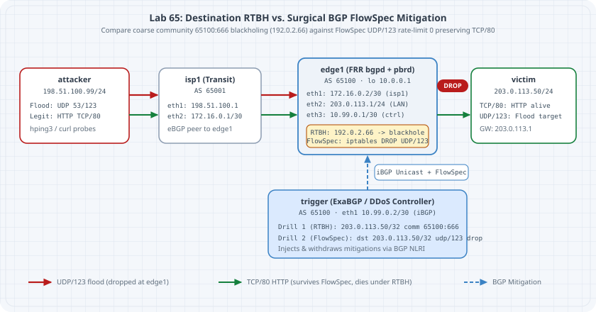

# Lab 65: Destination RTBH and BGP FlowSpec DDoS Mitigation

When a volumetric UDP amplification attack hits a customer host, operators choose between two BGP-driven levers: **Remotely Triggered Black Hole (RTBH)**, which drops all traffic to the victim IP at the edge (high collateral damage), and **BGP FlowSpec (RFC 8955)**, which pushes a surgical L3/L4 filter into the router's forwarding plane so legitimate traffic survives.



## Scenario and Production Goal

An edge router (`edge1`, AS `65100`) connects a victim web server (`203.0.113.50/32`) to a transit ISP (`isp1`, AS `65001`). An external `attacker` sends both a UDP port `123` (NTP amplification) flood and legitimate HTTP requests (`TCP/80`). A DDoS controller (`trigger`, running ExaBGP) peers via iBGP with `edge1` for both IPv4 Unicast and IPv4 FlowSpec.

By the end of this lab you will:
- Trigger destination-based RTBH via BGP community `65100:666` rewriting next-hop to `192.0.2.66` (`blackhole`), and observe the collateral outage on TCP/80.
- Replace RTBH with a surgical FlowSpec rule (`dst 203.0.113.50/32 proto udp dport 123 rate-limit 0`) that drops the flood while keeping HTTP alive.
- Inspect FRR's FlowSpec RIB and Linux `iptables`/`pbrd` drop counters, then cleanly withdraw the mitigation.

## Topology and Addressing

| Node | Role | Interfaces & IPs | ASN |
|---|---|---|---|
| `edge1` | Edge router (FRR `bgpd` + `pbrd`) | `eth1`: `172.16.0.2/30`, `eth2`: `203.0.113.1/24`, `eth3`: `10.99.0.1/30`, `lo`: `10.0.0.1/32` | `65100` |
| `trigger` | DDoS controller (ExaBGP) | `eth1`: `10.99.0.2/30` | `65100` |
| `isp1` | Transit ISP router (FRR) | `eth1`: `198.51.100.1/24`, `eth2`: `172.16.0.1/30` | `65001` |
| `victim` | Protected web server | `eth1`: `203.0.113.50/24` (GW `203.0.113.1`) | — |
| `attacker` | Attack + probe generator | `eth1`: `198.51.100.99/24` (GW `198.51.100.1`) | — |

Save the topology as `clab.yml`:

```yaml
name: lab65-rtbh-flowspec
topology:
  nodes:
    edge1:
      kind: linux
      image: quay.io/frrouting/frr:10.1.1
      binds:
        - configs/edge1/daemons:/etc/frr/daemons:ro
        - configs/edge1/frr.conf:/etc/frr/frr.conf:ro
      exec:
        - ip addr add 172.16.0.2/30 dev eth1
        - ip addr add 203.0.113.1/24 dev eth2
        - ip addr add 10.99.0.1/30 dev eth3
        - ip addr add 10.0.0.1/32 dev lo
        - ip route replace blackhole 192.0.2.66/32
    trigger:
      kind: linux
      image: ghcr.io/srl-labs/exabgp:4.2.21
      binds:
        - configs/trigger/exabgp.conf:/etc/exabgp/exabgp.conf:ro
      exec:
        - ip addr add 10.99.0.2/30 dev eth1
        - mkfifo /run/exabgp.in /run/exabgp.out
    isp1:
      kind: linux
      image: quay.io/frrouting/frr:10.1.1
      binds:
        - configs/isp1/frr.conf:/etc/frr/frr.conf:ro
      exec:
        - ip addr add 198.51.100.1/24 dev eth1
        - ip addr add 172.16.0.1/30 dev eth2
    victim:
      kind: linux
      image: nicolaka/netshoot:latest
      exec:
        - ip addr add 203.0.113.50/24 dev eth1
        - ip route replace default via 203.0.113.1
        - sh -c "python3 -m http.server 80 >/tmp/http.log 2>&1 &"
    attacker:
      kind: linux
      image: nicolaka/netshoot:latest
      exec:
        - ip addr add 198.51.100.99/24 dev eth1
        - ip route replace default via 198.51.100.1
  links:
    - endpoints: ["attacker:eth1", "isp1:eth1"]
    - endpoints: ["isp1:eth2", "edge1:eth1"]
    - endpoints: ["edge1:eth2", "victim:eth1"]
    - endpoints: ["edge1:eth3", "trigger:eth1"]
```

## Node Configurations

### Edge Router (`edge1`)

Enable `bgpd=yes`, `zebra=yes`, and `pbrd=yes` in `configs/edge1/daemons` so FRR installs FlowSpec rules into Linux `iptables`/`ipset`.

`configs/edge1/frr.conf` maps community `65100:666` to the blackhole next-hop `192.0.2.66` and activates the `ipv4 flowspec` address family toward `trigger`:

```cfg
frr defaults traditional
hostname edge1
!
ip route 192.0.2.66/32 blackhole
!
bgp community-list standard RTBH-COMM permit 65100:666
!
route-map RTBH-IN permit 10
 match community RTBH-COMM
 set ip next-hop 192.0.2.66
 set local-preference 500
 set community no-export additive
route-map RTBH-IN permit 20
!
router bgp 65100
 bgp router-id 10.0.0.1
 no bgp ebgp-requires-policy
 neighbor 172.16.0.1 remote-as 65001
 neighbor 10.99.0.2 remote-as 65100
 !
 address-family ipv4 unicast
  network 203.0.113.0/24
  neighbor 10.99.0.2 route-map RTBH-IN in
 exit-address-family
 !
 address-family ipv4 flowspec
  neighbor 10.99.0.2 activate
  local-install eth1
 exit-address-family
```

### Transit Router (`isp1`)

`configs/isp1/frr.conf` advertises `198.51.100.0/24` to `edge1`:

```cfg
frr defaults traditional
hostname isp1
!
router bgp 65001
 bgp router-id 172.16.0.1
 no bgp ebgp-requires-policy
 neighbor 172.16.0.2 remote-as 65100
 address-family ipv4 unicast
  network 198.51.100.0/24
 exit-address-family
```

### DDoS Trigger Controller (`trigger`)

`configs/trigger/exabgp.conf` establishes iBGP for both `ipv4 unicast` and `ipv4 flow` with a named pipe API so operators can inject and withdraw mitigations dynamically:

```cfg
process cli-pipe {
    run /bin/cat /run/exabgp.in;
    encoder text;
}
neighbor 10.99.0.1 {
    router-id 10.99.0.2;
    local-address 10.99.0.2;
    local-as 65100;
    peer-as 65100;
    family {
        ipv4 unicast;
        ipv4 flow;
    }
    api {
        processes [ cli-pipe ];
    }
}
```

## Baseline Verification

Deploy the lab, start ExaBGP on `trigger`, and confirm both HTTP (`TCP/80`) and UDP (`123`) reach `victim`:

```bash
containerlab deploy -t clab.yml
docker exec -d clab-lab65-rtbh-flowspec-trigger exabgp /etc/exabgp/exabgp.conf
docker exec clab-lab65-rtbh-flowspec-edge1 vtysh -c "show bgp summary"
docker exec clab-lab65-rtbh-flowspec-attacker curl -sI http://203.0.113.50/ | head -n 1
```

> [!NOTE]
> Illustrative expected output (lab not executed on the authoring host).

```text
IPv4 Unicast Summary:
Neighbor        V         AS   MsgRcvd   MsgSent  State/PfxRcd
10.99.0.2       4      65100         6         6             0
172.16.0.1      4      65001         8         8             1

IPv4 Flowspec Summary:
Neighbor        V         AS   MsgRcvd   MsgSent  State/PfxRcd
10.99.0.2       4      65100         6         6             0

HTTP/1.0 200 OK
```

## Production Drills and Failure Injection

### Drill 1: Destination-Based RTBH and Collateral Damage

- **Fault / Mitigation Injection**: Start a background UDP/123 flood from `attacker` (`hping3 --udp -p 123 -i u10000 203.0.113.50 &`), then inject a `/32` RTBH route tagged with `65100:666` from `trigger`:
  ```bash
  docker exec clab-lab65-rtbh-flowspec-trigger sh -c \
    'echo "announce route 203.0.113.50/32 next-hop self community [65100:666]" > /run/exabgp.in'
  ```
- **Expected Symptoms**: `edge1` installs `blackhole 203.0.113.50` via recursive lookup on `192.0.2.66`. The UDP/123 flood stops reaching `victim`, **but legitimate `curl http://203.0.113.50/` also times out** (100% collateral damage to the victim IP).
- **Verification**:
  ```bash
  docker exec clab-lab65-rtbh-flowspec-edge1 ip route show 203.0.113.50/32
  docker exec clab-lab65-rtbh-flowspec-attacker curl --max-time 3 -sI http://203.0.113.50/ || echo "HTTP blocked by RTBH"
  ```
- **Rollback**: Withdraw the RTBH route before moving to Drill 2:
  ```bash
  docker exec clab-lab65-rtbh-flowspec-trigger sh -c \
    'echo "withdraw route 203.0.113.50/32 next-hop self" > /run/exabgp.in'
  ```

### Drill 2: Surgical BGP FlowSpec Drop (UDP/123 Blocked, TCP/80 Alive)

- **Mitigation Injection**: Announce an `ipv4 flow` NLRI matching only UDP port 123 destined to `203.0.113.50/32` with `rate-limit 0` (discard):
  ```bash
  docker exec clab-lab65-rtbh-flowspec-trigger sh -c \
    'echo "announce flow route { match { destination 203.0.113.50/32; protocol =udp; destination-port =123; } then { rate-limit 0; } }" > /run/exabgp.in'
  ```
- **Expected Symptoms**: `edge1` drops incoming UDP/123 packets on `eth1` before forwarding to `eth2`, while `curl http://203.0.113.50/` continues returning `HTTP/1.0 200 OK` without interruption.
- **Verification**: Run `tcpdump -ni eth1 udp port 123` on `victim` (0 packets received) while `curl -sI http://203.0.113.50/` succeeds from `attacker`.
- **Rollback**: Retain for Drill 3 inspection, then withdraw in Drill 3.

### Drill 3: Inspect FlowSpec RIB & Dataplane Counters, Then Withdraw

- **Inspection**: Check FRR's FlowSpec table and the kernel `iptables` rule counters programmed by `pbrd`:
  ```bash
  docker exec clab-lab65-rtbh-flowspec-edge1 vtysh -c "show bgp ipv4 flowspec detail"
  docker exec clab-lab65-rtbh-flowspec-edge1 iptables -t mangle -L -v -n
  ```
- **Expected Output**: `show bgp ipv4 flowspec detail` reports `installed in PBR` and `Action: rate-limit 0.00`; `iptables -t mangle -L -v -n` shows incrementing packet/byte counters on the `DROP` rule matching `203.0.113.50/32` `udp dpt:123`.
- **Rollback**: Withdraw the FlowSpec rule and confirm the `iptables` entry disappears and UDP/123 traffic resumes:
  ```bash
  docker exec clab-lab65-rtbh-flowspec-trigger sh -c \
    'echo "withdraw flow route { match { destination 203.0.113.50/32; protocol =udp; destination-port =123; } then { rate-limit 0; } }" > /run/exabgp.in'
  ```

## Cleanup and Key Takeaways

```bash
containerlab destroy -t clab.yml --cleanup
```

- **Production Checklist**: Always scope RTBH community policies strictly to `/32` (IPv4) or `/128` (IPv6) prefixes to avoid accidentally blackholing an entire `/24`. Use BGP FlowSpec with RFC 8955 validation enabled so only valid origin-path rules install, and monitor TCAM/iptables rule limits under multi-vector attacks.
- **Related Concept Chapters**: [RTBH and BGP FlowSpec](../06-policy-qos-hardening/10-rtbh-and-flowspec.md), [BGP Policy and Communities](../08-bgp-security/04-bgp-path-attributes-and-policy-expression.md), and [Control-Plane Protection](../06-policy-qos-hardening/02-control-plane-protection.md).
