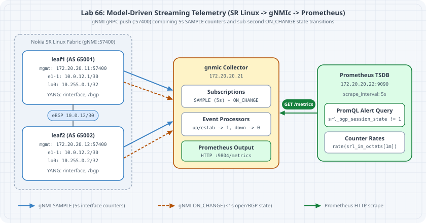

# Lab 66: Streaming Telemetry with Nokia SR Linux, gNMIc, and Prometheus

Deploy a model-driven streaming telemetry pipeline using two Nokia SR Linux switches (`leaf1`, `leaf2`), `gnmic` as the gNMI collector and Prometheus exporter, and `prometheus` for time-series storage and PromQL alerting. You combine periodic `SAMPLE` telemetry (interface counters every 5 seconds) with event-driven `ON_CHANGE` telemetry (interface `oper-state` and BGP `session-state`) so link flaps and peer drops surface in under a second.



## Scenario and Production Goal

Traditional SNMP polling on 60-second or 300-second intervals misses micro-flaps, overloads switch CPUs with bulk MIB walks, and delays incident detection. Model-driven streaming telemetry over gNMI (gRPC Network Management Interface) pushes structured YANG-modeled state from the router to the collector.

In this lab, you implement a production telemetry stack:

- **Periodic `SAMPLE` streaming**: `gnmic` subscribes to `/interface/statistics` at a 5-second cadence for counter rates (`in-octets`, `out-octets`, `in-discards`).
- **Event-driven `ON_CHANGE` streaming**: `gnmic` subscribes to `/interface/oper-state` and `/network-instance/protocols/bgp/neighbor/session-state`, receiving immediate gRPC updates whenever a link or BGP session changes state.
- **Prometheus pipeline + PromQL alerting**: `gnmic` transforms string states (`established` -> `1`, other -> `0`) into numeric gauges on `:9804/metrics`, scraped by `prometheus` for alerting on `srl_bgp_session_state != 1`.

## Topology and Addressing

| Node | Role | Image / OS | Management IP | Data-Plane / Endpoints |
| :--- | :--- | :--- | :--- | :--- |
| `leaf1` | SR Linux Switch (AS 65001) | `ghcr.io/nokia/srlinux:24.10.1` | `172.20.20.11` | `e1-1: 10.0.12.1/30`, `lo0: 10.255.0.1/32`, gNMI `:57400` |
| `leaf2` | SR Linux Switch (AS 65002) | `ghcr.io/nokia/srlinux:24.10.1` | `172.20.20.12` | `e1-1: 10.0.12.2/30`, `lo0: 10.255.0.2/32`, gNMI `:57400` |
| `gnmic` | gNMI Collector + Exporter | `ghcr.io/openconfig/gnmic:0.38.3` | `172.20.20.21` | Scrapes SR Linux `:57400`, exposes `:9804/metrics` |
| `prometheus` | Time-Series DB & Alerting | `prom/prometheus:v2.55.1` | `172.20.20.22` | Scrapes `gnmic:9804`, HTTP API `:9090` |

Save this topology as `clab.yml`:

```yaml
name: lab66-telemetry
mgmt:
  network: lab66-mgmt
  ipv4-subnet: 172.20.20.0/24
topology:
  nodes:
    leaf1:
      kind: nokia_srlinux
      image: ghcr.io/nokia/srlinux:24.10.1
      mgmt-ipv4: 172.20.20.11
      startup-config: configs/leaf1.cfg
    leaf2:
      kind: nokia_srlinux
      image: ghcr.io/nokia/srlinux:24.10.1
      mgmt-ipv4: 172.20.20.12
      startup-config: configs/leaf2.cfg
    gnmic:
      kind: linux
      image: ghcr.io/openconfig/gnmic:0.38.3
      mgmt-ipv4: 172.20.20.21
      binds:
        - configs/gnmic.yml:/gnmic.yml:ro
      cmd: --config /gnmic.yml subscribe
    prometheus:
      kind: linux
      image: prom/prometheus:v2.55.1
      mgmt-ipv4: 172.20.20.22
      binds:
        - configs/prometheus.yml:/etc/prometheus/prometheus.yml:ro
      ports:
        - "9090:9090"
  links:
    - endpoints: ["leaf1:e1-1", "leaf2:e1-1"]
```

## Node Configurations

### SR Linux Switches (`configs/leaf1.cfg` and `configs/leaf2.cfg`)

```cfg
set / interface ethernet-1/1 admin-state enable
set / interface ethernet-1/1 subinterface 0 ipv4 admin-state enable
set / interface ethernet-1/1 subinterface 0 ipv4 address 10.0.12.1/30
set / interface system0 subinterface 0 ipv4 admin-state enable
set / interface system0 subinterface 0 ipv4 address 10.255.0.1/32

set / network-instance default interface ethernet-1/1.0
set / network-instance default interface system0.0
set / network-instance default protocols bgp autonomous-system 65001
set / network-instance default protocols bgp router-id 10.255.0.1
set / network-instance default protocols bgp afi-safi ipv4-unicast admin-state enable
set / network-instance default protocols bgp group ebgp peer-as 65002
set / network-instance default protocols bgp group ebgp export-policy all
set / network-instance default protocols bgp group ebgp import-policy all
set / network-instance default protocols bgp neighbor 10.0.12.2 peer-group ebgp

set / routing-policy policy all default-action policy-result accept
set / system grpc-server mgmt admin-state enable
set / system grpc-server mgmt services [ gnmi ]
```

For `configs/leaf2.cfg`, copy `leaf1.cfg` and replace `10.0.12.1/30` with `10.0.12.2/30`, `10.255.0.1` with `10.255.0.2`, `autonomous-system 65001` with `65002`, `peer-as 65002` with `65001`, and `neighbor 10.0.12.2` with `neighbor 10.0.12.1`.

### gNMIc Collector (`configs/gnmic.yml`)

```yaml
username: admin
password: NokiaSrl1!
skip-verify: true
encoding: json_ietf

targets:
  clab-lab66-telemetry-leaf1:57400: {}
  clab-lab66-telemetry-leaf2:57400: {}

subscriptions:
  if-stats:
    paths:
      - /interface[name=ethernet-1/1]/statistics
    stream-mode: sample
    sample-interval: 5s
  oper-events:
    paths:
      - /interface[name=ethernet-1/1]/oper-state
      - /network-instance[name=default]/protocols/bgp/neighbor/session-state
    stream-mode: on-change

processors:
  map-states:
    event-strings:
      value-names: [".*session-state$", ".*oper-state$"]
      transforms:
        - replace: { old: "established", new: "1" }
        - replace: { old: "up", new: "1" }
        - replace: { old: "down", new: "0" }
        - replace: { old: "idle", new: "0" }
        - replace: { old: "active", new: "0" }
        - replace: { old: "connect", new: "0" }
  to-numeric:
    event-convert:
      value-names: [".*session-state$", ".*oper-state$"]
      type: int

outputs:
  prom-out:
    type: prometheus
    listen: :9804
    metric-prefix: srl
    event-processors: [ map-states, to-numeric ]
```

### Prometheus Scrape Config (`configs/prometheus.yml`)

```yaml
global:
  scrape_interval: 5s
scrape_configs:
  - job_name: gnmic-srl
    static_configs:
      - targets: ["172.20.20.21:9804"]
```

Deploy the lab:

```bash
sudo containerlab deploy -t clab.yml
```

## Baseline Verification

Verify BGP is `established` on `leaf1` and confirm `gnmic` is exporting both interface counters and BGP session state to Prometheus:

```bash
docker exec clab-lab66-telemetry-leaf1 sr_cli "show network-instance default protocols bgp neighbor"
docker exec clab-lab66-telemetry-prometheus wget -qO- http://172.20.20.21:9804/metrics | grep -E "srl_.*(in_octets|oper_state|session_state)" | head -n 8
```

> [!NOTE]
> Illustrative expected output (lab not executed on the authoring host).

```text
+-----------+----------+---------------+----------+--------+--------+------------------+
| Net-Inst  | Peer     | Group         | Peer AS  | State  | Uptime | Rx/Active/Tx     |
+===========+==========+===============+==========+========+========+==================+
| default   | 10.0.12.2| ebgp          | 65002    | estab  | 0d:0h  | 0/0/0            |
+-----------+----------+---------------+----------+--------+--------+------------------+

srl_interface_oper_state{interface_name="ethernet-1/1",source="clab-lab66-telemetry-leaf1:57400"} 1
srl_interface_statistics_in_octets{interface_name="ethernet-1/1",source="clab-lab66-telemetry-leaf1:57400"} 4820
srl_network_instance_protocols_bgp_neighbor_session_state{neighbor_peer_address="10.0.12.2",source="clab-lab66-telemetry-leaf1:57400"} 1
```

## Production Drills and Failure Injection

### Drill 1: Inspect Live `SAMPLE` vs `ON_CHANGE` gNMI Streams

Attach an ad-hoc `gnmic subscribe` CLI session to `leaf1` to observe the wire-level JSON updates for both subscription modes:

```bash
docker exec clab-lab66-telemetry-gnmic gnmic -a clab-lab66-telemetry-leaf1:57400 \
  -u admin -p NokiaSrl1! --skip-verify subscribe \
  --path "/interface[name=ethernet-1/1]/statistics/in-octets" --stream-mode sample --sample-interval 5s \
  --path "/interface[name=ethernet-1/1]/oper-state" --stream-mode on-change --count 4
```

**Expected symptoms**: You immediately receive an initial sync snapshot for both paths. Afterward, `in-octets` emits a timestamped update strictly every 5 seconds, while `oper-state` remains silent until an actual state transition occurs.

### Drill 2: Flap `ethernet-1/1` and Measure Sub-Second `ON_CHANGE` Detection

Run a background `gnmic subscribe` watching `oper-state` with millisecond timestamps, then bounce `ethernet-1/1` on `leaf1`:

```bash
docker exec clab-lab66-telemetry-gnmic gnmic -a clab-lab66-telemetry-leaf1:57400 \
  -u admin -p NokiaSrl1! --skip-verify subscribe \
  --path "/interface[name=ethernet-1/1]/oper-state" --stream-mode on-change --count 3 &
sleep 1
date -Iseconds
docker exec clab-lab66-telemetry-leaf1 sr_cli -e "enter candidate; set / interface ethernet-1/1 admin-state disable; commit now"
sleep 2
docker exec clab-lab66-telemetry-leaf1 sr_cli -e "enter candidate; set / interface ethernet-1/1 admin-state enable; commit now"
wait
```

**Expected symptoms**: The `oper-state: "down"` and `oper-state: "up"` gNMI notifications arrive within **<200 ms** of each `commit now` — far faster than the 5-second `SAMPLE` timer or a 60-second SNMP poll, ensuring short link flaps are never missed.

### Drill 3: Drop a BGP Peer and Fire a PromQL Alert Query

Administratively shut down the BGP neighbor on `leaf2` (leaving the physical link up), then query Prometheus for any non-established BGP peers:

```bash
docker exec clab-lab66-telemetry-leaf2 sr_cli -e \
  "enter candidate; set / network-instance default protocols bgp neighbor 10.0.12.1 admin-state disable; commit now"
sleep 6
curl -sG 'http://localhost:9090/api/v1/query' \
  --data-urlencode 'query=srl_network_instance_protocols_bgp_neighbor_session_state != 1'
```

**Expected symptoms**: Both `leaf1` and `leaf2` push an `ON_CHANGE` transition (`established` -> `idle`/`active`, mapped to `0`). Within one Prometheus scrape interval (`5s`), the PromQL query returns non-empty alert series with value `"0"` identifying the exact peer (`10.0.12.2` / `10.0.12.1`) and switch (`source`).

**Rollback**: Re-enable the BGP neighbor on `leaf2`:

```bash
docker exec clab-lab66-telemetry-leaf2 sr_cli -e \
  "enter candidate; set / network-instance default protocols bgp neighbor 10.0.12.1 admin-state enable; commit now"
```

## Cleanup and Key Takeaways

```bash
sudo containerlab destroy -t clab.yml --cleanup
```

- **Match subscription mode to signal type**: Use `ON_CHANGE` for discrete state machines (interface `oper-state`, BGP `session-state`, BFD state) and `SAMPLE` for monotonically increasing counters (`in-octets`, `in-discards`).
- **Normalize YANG enum strings into numeric gauges** at the collector (`gnmic` processors) so Prometheus alerting rules (`!= 1`) remain simple and avoid high-cardinality label churn on state changes.
- **Separate telemetry collection from alert evaluation**: Even with sub-second gNMI push to `gnmic`, Prometheus scrape intervals (`scrape_interval: 5s`) set the floor for PromQL alert latency unless you forward critical `ON_CHANGE` events directly to an alert bus or NATS/Kafka output.

Related reading: [YANG, NETCONF, and gNMI](../06-security-operations/06-yang-netconf-gnmi.md), [Pre-Change Verification and Streaming Telemetry](../06-security-operations/10-prechange-verification-and-streaming-telemetry.md), [Observability for Networks](../06-security-operations/01-observability-for-networks.md), and [Lab 20: gNMI on SR Linux](20-gnmi-srlinux.md).
