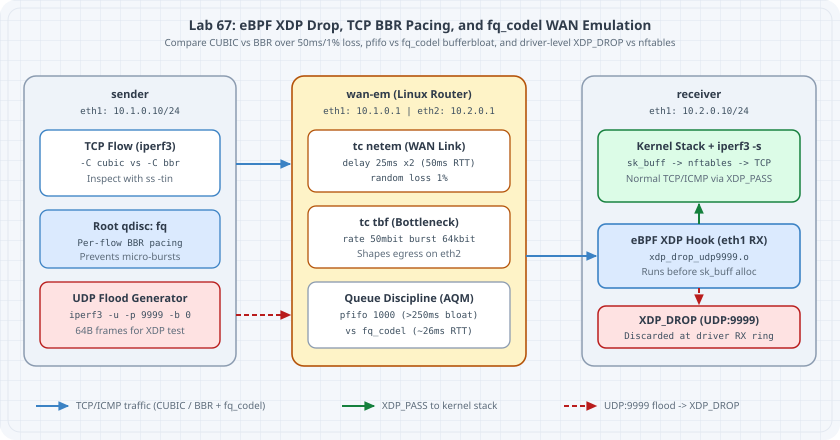

# Lab 67: eBPF XDP Packet Drop, TCP BBR, and `fq_codel` Bufferbloat Tuning

Build a three-node Linux kernel dataplane lab (`sender` — `wan-em` — `receiver`) to benchmark modern transport congestion control, active queue management, and XDP line-rate packet filtering. You emulate a lossy 50 Mbps WAN link with `tc netem` and `tbf`, compare TCP `cubic` against `bbr` with `fq` pacing, eliminate bufferbloat with `fq_codel`, and compile a minimal C eBPF/XDP program that drops UDP flood traffic (`XDP_DROP`) before the kernel even allocates an `sk_buff`.



## Scenario and Production Goal

Two dataplane bottlenecks dominate high-scale Linux edge servers:

1. **WAN throughput collapse and bufferbloat**: Loss-based TCP (`cubic`) interprets random 1% packet loss as congestion and halves its congestion window, starving high-BDP links. Meanwhile, deep FIFO queues (`pfifo`) inflate latency by hundreds of milliseconds during bulk transfers.
2. **DDoS CPU exhaustion in the network stack**: Dropping high-rate UDP floods in `nftables` or userspace requires allocating and parsing an `sk_buff` per packet. XDP executes an eBPF program directly in the NIC driver RX path, dropping malicious frames at millions of packets per second.

In this lab, you measure all three mechanisms side by side using `tc`, `iperf3`, `ss -tin`, `clang`, and `ip link ... xdp`.

## Topology and Addressing

| Node | Role | Interfaces | Kernel Dataplane Features |
| :--- | :--- | :--- | :--- |
| `sender` | Traffic Generator | `eth1: 10.1.0.10/24` (gw `10.1.0.1`) | `fq` pacing qdisc, `cubic` / `bbr`, `iperf3`, `ss -tin` |
| `wan-em` | WAN Emulator Router | `eth1: 10.1.0.1/24`, `eth2: 10.2.0.1/24` | `tc netem` (50 ms RTT, 1% loss), `tbf` (50 Mbps), `pfifo` / `fq_codel` |
| `receiver` | Edge Server + XDP | `eth1: 10.2.0.10/24` (gw `10.2.0.1`) | `iperf3 -s`, C eBPF/XDP UDP:9999 dropper, `nftables` |

> [!IMPORTANT]
> Ensure the host kernel has TCP BBR loaded (`sudo modprobe tcp_bbr sch_fq sch_netem sch_tbf sch_fq_codel`) before running the drills.

Save this topology as `clab.yml`:

```yaml
name: lab67-xdp-bbr
topology:
  nodes:
    sender:
      kind: linux
      image: ubuntu:24.04
      exec:
        - apt-get update && apt-get install -y iproute2 iputils-ping iperf3 tcpdump
        - ip addr add 10.1.0.10/24 dev eth1
        - ip route replace default via 10.1.0.1
        - tc qdisc replace dev eth1 root fq
    wan-em:
      kind: linux
      image: ubuntu:24.04
      exec:
        - apt-get update && apt-get install -y iproute2 iputils-ping
        - ip addr add 10.1.0.1/24 dev eth1
        - ip addr add 10.2.0.1/24 dev eth2
        - sysctl -w net.ipv4.ip_forward=1
    receiver:
      kind: linux
      image: ubuntu:24.04
      binds:
        - configs/xdp_drop_udp9999.c:/root/xdp_drop_udp9999.c:ro
      exec:
        - apt-get update && apt-get install -y iproute2 iputils-ping iperf3 clang llvm libbpf-dev linux-headers-generic nftables
        - ip addr add 10.2.0.10/24 dev eth1
        - ip route replace default via 10.2.0.1
        - sh -c "nohup iperf3 -s -D"
  links:
    - endpoints: ["sender:eth1", "wan-em:eth1"]
    - endpoints: ["wan-em:eth2", "receiver:eth1"]
```

## Node Configurations

### Minimal XDP UDP-9999 Drop Program (`configs/xdp_drop_udp9999.c`)

This eBPF program parses Ethernet -> IPv4 -> UDP headers with strict verifier bounds checks and returns `XDP_DROP` for any frame targeting UDP port `9999`:

```c
#include <linux/bpf.h>
#include <linux/if_ether.h>
#include <linux/ip.h>
#include <linux/udp.h>
#include <linux/in.h>
#include <bpf/bpf_helpers.h>
#include <bpf/bpf_endian.h>

SEC("xdp")
int xdp_drop_udp9999(struct xdp_md *ctx) {
    void *data = (void *)(long)ctx->data;
    void *data_end = (void *)(long)ctx->data_end;

    struct ethhdr *eth = data;
    if ((void *)(eth + 1) > data_end)
        return XDP_PASS;
    if (eth->h_proto != bpf_htons(ETH_P_IP))
        return XDP_PASS;

    struct iphdr *ip = (void *)(eth + 1);
    if ((void *)(ip + 1) > data_end)
        return XDP_PASS;
    if (ip->protocol != IPPROTO_UDP)
        return XDP_PASS;

    struct udphdr *udp = (void *)ip + (ip->ihl * 4);
    if ((void *)(udp + 1) > data_end)
        return XDP_PASS;
    if (udp->dest == bpf_htons(9999))
        return XDP_DROP;

    return XDP_PASS;
}

char _license[] SEC("license") = "GPL";
```

Deploy the lab and compile the XDP object inside `receiver`:

```bash
sudo modprobe tcp_bbr sch_fq sch_netem sch_tbf sch_fq_codel
sudo containerlab deploy -t clab.yml
docker exec clab-lab67-xdp-bbr-receiver clang -O2 -g -target bpf -c /root/xdp_drop_udp9999.c -o /root/xdp_drop_udp9999.o
```

## Baseline Verification

Confirm unloaded RTT is sub-millisecond and `iperf3` reaches multi-gigabit baseline throughput across `wan-em` before adding impairments:

```bash
docker exec clab-lab67-xdp-bbr-sender ping -c 3 10.2.0.10
docker exec clab-lab67-xdp-bbr-sender iperf3 -c 10.2.0.10 -t 3
```

> [!NOTE]
> Illustrative expected output (lab not executed on the authoring host).

```text
3 packets transmitted, 3 received, 0% packet loss, time 2003ms
rtt min/avg/max/mdev = 0.084/0.112/0.141/0.023 ms

[ ID] Interval           Transfer     Bitrate         Retr
[  5]   0.00-3.00   sec  4.12 GBytes  11.8 Gbits/sec    0   sender
[  5]   0.00-3.00   sec  4.12 GBytes  11.8 Gbits/sec        receiver
```

## Production Drills and Failure Injection

### Drill 1: 50 ms RTT + 1% Loss + 50 Mbps Bottleneck (`cubic` vs `bbr`)

Configure `wan-em` with 25 ms delay each way (50 ms RTT), 1% random loss, and a 50 Mbps token-bucket filter (`tbf`) toward `receiver`:

```bash
docker exec clab-lab67-xdp-bbr-wan-em tc qdisc replace dev eth1 root netem delay 25ms
docker exec clab-lab67-xdp-bbr-wan-em tc qdisc replace dev eth2 root handle 1: tbf rate 50mbit burst 64kbit latency 200ms
docker exec clab-lab67-xdp-bbr-wan-em tc qdisc add dev eth2 parent 1:1 handle 10: netem delay 25ms loss 1%
```

Run a 10-second `iperf3` test with `cubic`, then repeat with `bbr`, inspecting live socket metrics via `ss -tin`:

```bash
docker exec clab-lab67-xdp-bbr-sender sh -c "iperf3 -c 10.2.0.10 -C cubic -t 10 & sleep 5; ss -tin dst 10.2.0.10; wait"
docker exec clab-lab67-xdp-bbr-sender sh -c "iperf3 -c 10.2.0.10 -C bbr -t 10 & sleep 5; ss -tin dst 10.2.0.10; wait"
```

**Expected symptoms**: Under 50 ms RTT and 1% random loss, `cubic` collapses to ~2–4 Mbps because every loss event cuts `cwnd` by 30%. With `bbr` + `fq` pacing, throughput climbs to ~42–48 Mbps (near the 50 Mbps `tbf` ceiling), and `ss -tin` reports `bbr:(bw:...,mrtt:50.x,pacing_gain:...)` with a sustained pacing rate instead of repeated multiplicative backoff.

### Drill 2: Bufferbloat (`pfifo`) vs Active Queue Management (`fq_codel`)

Remove random loss on `wan-em:eth2` and attach a bloated 1000-packet `pfifo` queue behind the 50 Mbps `tbf`, then measure `ping` latency during an active `iperf3` saturation run:

```bash
docker exec clab-lab67-xdp-bbr-wan-em tc qdisc replace dev eth2 root handle 1: tbf rate 50mbit burst 64kbit limit 2000000
docker exec clab-lab67-xdp-bbr-wan-em tc qdisc add dev eth2 parent 1:1 handle 10: pfifo limit 1000
docker exec clab-lab67-xdp-bbr-sender sh -c "iperf3 -c 10.2.0.10 -C cubic -t 8 >/dev/null & sleep 1; ping -c 5 10.2.0.10; wait"
```

Now replace `pfifo` with `fq_codel` and re-run the identical loaded-latency test:

```bash
docker exec clab-lab67-xdp-bbr-wan-em tc qdisc replace dev eth2 parent 1:1 handle 10: fq_codel
docker exec clab-lab67-xdp-bbr-sender sh -c "iperf3 -c 10.2.0.10 -C cubic -t 8 >/dev/null & sleep 1; ping -c 5 10.2.0.10; wait"
```

**Expected symptoms**: With `pfifo`, loaded `ping` RTT balloons from 25 ms to **>250 ms** because the bulk TCP flow fills the entire FIFO buffer. With `fq_codel`, fair queueing isolates the ICMP probe flow and CoDel drops excess queue early, keeping loaded `ping` RTT near **~26–30 ms** while maintaining full 50 Mbps throughput.

**Rollback**: Clear `tc` qdiscs on `wan-em` before the XDP benchmark:

```bash
docker exec clab-lab67-xdp-bbr-wan-em sh -c "tc qdisc del dev eth1 root; tc qdisc del dev eth2 root"
```

### Drill 3: XDP `XDP_DROP` vs `nftables` Filter on a UDP:9999 Flood

First, measure baseline drop behavior with an `nftables` input rule on `receiver`, then remove `nftables` and attach the compiled eBPF/XDP program:

```bash
# 1. Baseline: nftables drop (allocates sk_buff for every packet)
docker exec clab-lab67-xdp-bbr-receiver nft 'add table inet ddos; add chain inet ddos input { type filter hook input priority 0; }; add rule inet ddos input udp dport 9999 counter drop'
docker exec clab-lab67-xdp-bbr-sender iperf3 -c 10.2.0.10 -u -p 9999 -b 0 -l 64 -t 5
docker exec clab-lab67-xdp-bbr-receiver nft list table inet ddos

# 2. Switch to XDP_DROP at RX hook (skips sk_buff & netfilter)
docker exec clab-lab67-xdp-bbr-receiver nft delete table inet ddos
docker exec clab-lab67-xdp-bbr-receiver ip link set dev eth1 xdpgeneric obj /root/xdp_drop_udp9999.o sec xdp
docker exec clab-lab67-xdp-bbr-receiver ip -d link show dev eth1
docker exec clab-lab67-xdp-bbr-sender iperf3 -c 10.2.0.10 -u -p 9999 -b 0 -l 64 -t 5
```

**Expected symptoms**: `ip -d link show dev eth1` displays `prog/xdp id ...` attached to `eth1`. During the UDP:9999 flood, `receiver`'s `iperf3` server and `tcpdump` see **zero** UDP:9999 packets because XDP drops them before the networking stack processes them, while normal TCP/ICMP traffic (`XDP_PASS`) remains unaffected. On bare-metal NICs supporting native `xdpdrv` mode, XDP sustains 5x–10x higher drop pps per core than `nftables` `input` filtering.

**Rollback**: Detach the XDP program from `receiver:eth1`:

```bash
docker exec clab-lab67-xdp-bbr-receiver ip link set dev eth1 xdpgeneric off
```

## Cleanup and Key Takeaways

```bash
sudo containerlab destroy -t clab.yml --cleanup
```

- **BBR requires `fq` pacing** (`tc qdisc replace ... root fq`) to smooth packet bursts at its estimated bottleneck bandwidth; without pacing, BBR can cause micro-bursts and excess retransmissions.
- **`fq_codel` solves bufferbloat without manual tuning** by separating sparse interactive flows (DNS, ICMP, SSH) from elephant flows and bounding queue sojourn time.
- **XDP drops DDoS traffic before `sk_buff` allocation**, making it the preferred Linux edge primitive for stateless L3/L4 flood mitigation while leaving stateful inspection to `nftables` or eBPF TC.

Related reading: [eBPF, XDP, and TC Dataplane](../07-d-dataplanes-and-traffic-delivery/01-ebpf-xdp-and-tc-dataplane.md), [TCP Congestion Control: CUBIC vs BBR](../08-transport-and-applications/09h-tcp-congestion-cubic-bbr.md), [FQ-CoDel and CAKE](../06-policy-qos-hardening/06-fq-codel-and-cake.md), and [Linux Drop Counters](../06-security-operations/05b-linux-drop-counters.md).
