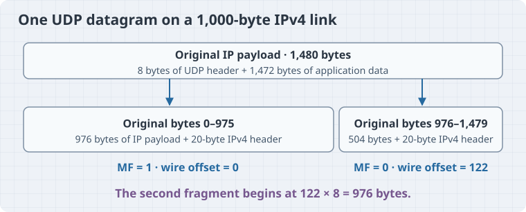

# Lab 68 — Read IPv4 Fragment Offsets on Loopback

An application sends 1,472 bytes to one UDP socket. Can the receiver get all 1,472 bytes in one read over a link with an IP MTU of 1,000? In this lab you observe the same message twice, first at the IPv4 layer as fragments, then at the receiving socket as one UDP datagram.

## Predict the two lengths

The topology fits inside one temporary Linux network namespace. Sender and receiver both use `127.0.0.1`. A packet socket observes IPv4 on the loopback interface, before IPv4 reassembly. The kernel creates ordinary packets for the UDP send. The experiment controls source fragmentation by changing the sending socket's path-MTU discovery setting.



Start with a 20-byte IPv4 header, an 8-byte UDP header, and 1,472 data bytes. Each fragment gets its own IPv4 header. At MTU 1,000, up to 980 bytes remain in a fragment for IP payload. Every fragment followed by another must end on an eight-byte boundary, so the first carries 976 bytes. The second begins at byte 976 of the original IP payload. **Predict the wire offset of the second fragment and the total IP length of each fragment.** [IPv4 fragmentation](https://www.rfc-editor.org/rfc/rfc791#section-3.2)

## Observe the fragments and the receiving socket

Run the whole block on Linux with util-linux `unshare`, iproute2, Bash, Python 3.10 or later, and permission to create user and network namespaces. The shell inside `unshare` changes only its own loopback interface. Its packet socket needs the raw-socket capability supplied by that namespace. The namespace disappears when the block exits.

```bash
unshare -rn bash -eu <<'LAB'
ip link set lo mtu 1000 up
python3 - <<'PY'
import errno
import socket
import struct

payload = b"x" * 1472
# Linux uapi constants for Python versions that omit their symbolic names.
mtu_discover = getattr(socket, "IP_MTU_DISCOVER", 10)
allow_fragments = getattr(socket, "IP_PMTUDISC_DONT", 0)
require_df = getattr(socket, "IP_PMTUDISC_DO", 2)
ipv4 = 0x0800

with (socket.socket(socket.AF_PACKET, socket.SOCK_DGRAM, socket.htons(ipv4)) as tap,
      socket.socket(socket.AF_INET, socket.SOCK_DGRAM) as tx,
      socket.socket(socket.AF_INET, socket.SOCK_DGRAM) as rx):
    tap.bind(("lo", 0))
    rx.bind(("127.0.0.1", 0))
    tap.settimeout(2)
    rx.settimeout(2)
    tx.setsockopt(socket.IPPROTO_IP, mtu_discover, allow_fragments)
    tx.sendto(payload, rx.getsockname())

    ids = set()
    for _ in range(2):
        packet = tap.recv(2048)
        length, ident, flags_offset = struct.unpack_from("!HHH", packet, 2)
        ids.add(ident)
        offset = flags_offset & 0x1fff
        more = int(bool(flags_offset & 0x2000))
        print(f"IP length {length}, MF {more}, offset {offset} ({offset * 8} bytes)")
    assert len(ids) == 1
    assert rx.recv(2048) == payload
    print("UDP delivered 1472 bytes")

    tx.setsockopt(socket.IPPROTO_IP, mtu_discover, require_df)
    try:
        tx.sendto(payload, rx.getsockname())
    except OSError as error:
        if error.errno != errno.EMSGSIZE:
            raise
        print("DF set: sender reported EMSGSIZE")
    else:
        raise AssertionError("oversized DF send unexpectedly succeeded")

    tx.sendto(payload[:972], rx.getsockname())
    assert rx.recv(2048) == payload[:972]
    print("DF set: UDP delivered 972 bytes")
PY
LAB
```

A namespace permission error occurs before the experiment starts. On systems that disable user namespaces, use a Linux lab VM that permits them. [Linux IPv4 socket options](https://man7.org/linux/man-pages/man7/ip.7.html)

## Interpret the evidence

```text
IP length 996, MF 1, offset 0 (0 bytes)
IP length 524, MF 0, offset 122 (976 bytes)
UDP delivered 1472 bytes
DF set: sender reported EMSGSIZE
DF set: UDP delivered 972 bytes
```

The first 976 payload bytes include the UDP header. The remaining 504 bytes are its continuation. The common identification value, source, destination, and protocol associate the fragments for reassembly. Offset 122 is measured from the beginning of the original **IP payload**. Adding the two captured IP lengths gives 1,520 because each fragment carries a header.

With Don't Fragment (DF) required, Linux already knows the local outgoing MTU and rejects the oversized send. Reducing the application data to 972 bytes lets the UDP and IPv4 headers fit exactly. A router discovering a smaller MTU farther down the path can instead return an ICMP error to the sender. Compare these observations with [ICMP and path MTU](../04-ip-routing-services/04-icmp-path-mtu.md) and [the routed MTU and MSS lab](22-mtu-and-mss.md).
