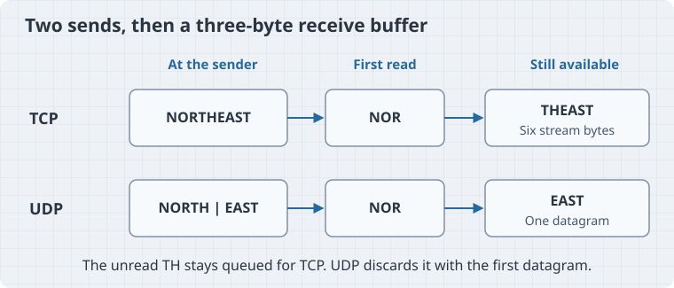

# Lab 69 — Short Reads on TCP and UDP Sockets

A sensor writes `NORTH` and then `EAST`. The receiver has room for three bytes on its first read. Where does the `TH` go? Use the same payloads on two loopback sockets and account for every byte the application receives.



## Predict the observation

TCP makes a sequence of bytes available to the receiving application. A read removes up to the requested number of available bytes. The application chooses how to find message boundaries in that sequence. UDP queues individual datagrams. On the Unix systems used here, a receive operation consumes one whole datagram even when the supplied buffer can hold only its prefix.

Write down three predictions: the bytes returned by the first read, the remaining bytes delivered on subsequent reads, and whether increasing the first read's buffer to 64 bytes can combine the two UDP messages. The send calls below finish before the reads begin. TCP can still split a read, so the program accumulates exactly three stream bytes for its first observation and drains to EOF for its second. [Python socket operations](https://docs.python.org/3/library/socket.html#socket.socket.recvmsg)

## Run both transports

Use Python 3 on Linux or macOS with `recvmsg` and `MSG_TRUNC`. Both endpoints use dynamically allocated loopback ports. No elevated privileges, external host, or background service is required. Save the program as `short_reads.py` and run `python3 short_reads.py`.

```python
import socket

host = "127.0.0.1"
messages = [b"NORTH", b"EAST"]

with socket.socket() as listener, socket.socket() as sender:
    listener.bind((host, 0))
    listener.listen(1)
    sender.connect(listener.getsockname())
    receiver, _ = listener.accept()
    with receiver:
        receiver.settimeout(2)
        for data in messages:
            sender.sendall(data)
        sender.shutdown(socket.SHUT_WR)
        first = bytearray()
        while len(first) < 3:
            part = receiver.recv(3 - len(first))
            if not part:
                raise EOFError("stream ended before three bytes")
            first.extend(part)
        rest = b"".join(iter(lambda: receiver.recv(64), b""))
        print("TCP first:", bytes(first), "remaining:", rest)

with socket.socket(type=socket.SOCK_DGRAM) as tx, socket.socket(type=socket.SOCK_DGRAM) as rx:
    rx.bind((host, 0))
    rx.settimeout(2)
    for capacity in (3, 64):
        for data in messages:
            tx.sendto(data, rx.getsockname())
        first, _, flags, _ = rx.recvmsg(capacity)
        second = rx.recv(64)
        truncated = bool(flags & socket.MSG_TRUNC)
        print(f"UDP buffer {capacity}:", first, "truncated:", truncated, "next:", second)
```

## Compare the output

```text
TCP first: b'NOR' remaining: b'THEAST'
UDP buffer 3: b'NOR' truncated: True next: b'EAST'
UDP buffer 64: b'NORTH' truncated: False next: b'EAST'
```

For TCP, the sender's half-close lets the receiver detect EOF after draining all nine bytes. The boundary between the two original writes is absent from the byte stream. A protocol carrying variable-length names could send each name's length before its bytes or use an agreed delimiter. Without framing, `NORTH` + `EAST` and `NOR` + `THEAST` produce identical stream content.

For UDP, the small first buffer omitted two bytes, and the kernel reported truncation. A larger buffer on the **next** receive cannot recover them. The second trial repeats the sends with a larger **first** buffer and delivers both complete messages. In both trials the second read returns `EAST`, evidence that the two datagrams retained their boundaries. A packet capture could contain a complete `NORTH` while the application logged only `NOR`.

## Change one variable

Change the sends to `[b"NOR", b"THEAST"]` and rerun. Predict which output lines change. The two TCP observations stay the same because the concatenated bytes are identical. UDP now fits the first message into the three-byte buffer, clears the truncation flag, and returns a six-byte second message. This distinguishes a receive-buffer problem from loss on a network link. Closing the sockets at the end of each block releases all listeners.

Use [Transport: TCP and UDP](../02-networking-foundations/09-transport-tcp-udp.md) to connect the socket observations to sequence numbers, acknowledgment, and transport selection.
