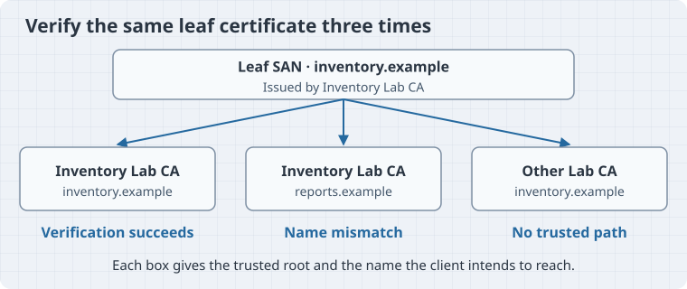

# Lab 70 — Verify the Certificate Path and Service Name

A client trusts the authority that issued a server's certificate. Can it use that certificate for either `inventory.example` or `reports.example`? Test both names against the same leaf certificate. Then keep the correct name and change only the trust anchor.



## Predict three client decisions

The server certificate has the DNS subject alternative name (SAN) `inventory.example` and the extended key usage for TLS server authentication. The lab issues it directly from a temporary root named Inventory Lab CA. A second, independently generated root stands in for a different organization's trust store.

| Trial | Only trusted root | Client's reference name | Predict the decision |
|---|---|---|---|
| Baseline | Inventory Lab CA | inventory.example | Does a valid path end at a trusted root, and does the SAN cover the requested name? |
| Different name | Inventory Lab CA | reports.example | Which fact about the leaf changed? |
| Different root | Other Lab CA | inventory.example | Can the verifier build a trusted path for the same leaf? |

The reference name comes from the service the client intended to contact. In this exercise the command supplies it directly. Name verification can run offline because it compares that reference with authenticated certificate identifiers. [Service identity in TLS](https://www.rfc-editor.org/rfc/rfc9525)

## Issue a leaf and run the checks

You need Bash and the OpenSSL 3 command-line program. Run this block as an ordinary user. It generates lab keys in a private temporary directory, uses an explicit trust anchor for each trial, and removes the directory on exit. The names are local test inputs and require no DNS records.

```bash
bash <<'LAB'
set -eu
umask 077
work=$(mktemp -d)
trap 'rm -rf -- "$work"' EXIT
cd "$work"

make_root() {
    openssl req -new -x509 -newkey ec -pkeyopt ec_paramgen_curve:P-256 \
        -noenc -days 2 -subj "/CN=$2" -keyout "$1.key" -out "$1.pem" \
        -addext 'basicConstraints=critical,CA:TRUE' \
        -addext 'keyUsage=critical,keyCertSign,cRLSign'
}

make_root inventory 'Inventory Lab CA'
make_root other 'Other Lab CA'

openssl req -new -newkey ec -pkeyopt ec_paramgen_curve:P-256 -noenc \
    -subj '/CN=Inventory lab endpoint' -keyout leaf.key -out leaf.csr
cat > leaf.ext <<'EXT'
basicConstraints=critical,CA:FALSE
keyUsage=critical,digitalSignature
extendedKeyUsage=serverAuth
subjectAltName=DNS:inventory.example
EXT
openssl x509 -req -in leaf.csr -CA inventory.pem -CAkey inventory.key \
    -set_serial 1001 -days 1 -extfile leaf.ext -out leaf.pem

openssl x509 -in leaf.pem -noout -issuer -ext subjectAltName
verify() {
    openssl verify -trusted "$1.pem" -purpose sslserver -verify_hostname "$2" leaf.pem
}

verify inventory inventory.example
if verify inventory reports.example; then
    echo "Unexpected success with a different name" >&2
    exit 1
fi
if verify other inventory.example; then
    echo "Unexpected success with an unrelated root" >&2
    exit 1
fi
verify inventory inventory.example
LAB
```

## Read the failures and the recovery

The inspection should show the Inventory Lab CA as issuer and `DNS:inventory.example` in the SAN. The baseline prints `leaf.pem: OK`. In the second trial, look for a hostname mismatch. In the third, look for an issuer or path-building failure. Diagnostic wording can vary across OpenSSL builds. Both failed verifications return a nonzero exit status. The final call restores the original inputs and succeeds with the same leaf. [OpenSSL verify](https://docs.openssl.org/3.6/man1/openssl-verify/) · [Verification options and trust anchors](https://docs.openssl.org/3.6/man1/openssl-verification-options/)

Adding an unrelated root cannot repair a hostname mismatch. If the intended service really is `reports.example`, its certificate must cover that name. Conversely, issuing the same name again from the same CA cannot help a client whose trust policy excludes that CA. Establish which input failed before changing either side of the relationship.

## What does the successful check establish?

Record the reference name, the SAN, the selected trust anchor, and the purpose used for verification. This test checks those inputs and certificate validity at the local time. It sends no network traffic. A real TLS client also connects to an endpoint and verifies its proof of private-key possession during the handshake. An offline success cannot show which certificate a particular listener actually serves or which user is allowed to access the application.

Follow [keys and encryption boundaries](../06-policy-qos-hardening/12-keys-identities-and-encryption-boundaries.md) for the live handshake and [federated login](../06-policy-qos-hardening/13-federated-login-and-api-authorization.md) for the separate user-access decision.
