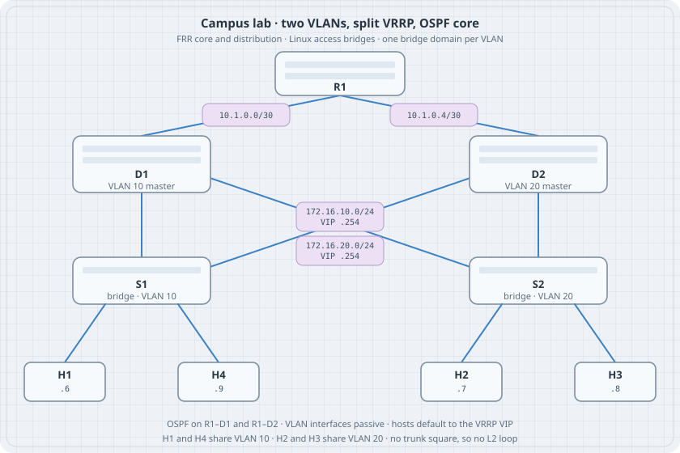

# Campus Design: Failure Domains and Verification

A redundant drawing is not yet a resilient network. A defensible campus design defines which traffic must survive each failure, what detects the fault, which control plane shifts forwarding, how long the outage lasts, and how you will prove it under load. This project extends the [campus VLAN, VRRP and OSPF lab](03b-campus-vlan-vrrp-ospf.md); use its addressing and topology as the baseline while comparing L2 access against routed access boundaries.



## L2 access versus Routed Access failure-domain boundaries

Where you place the Layer 2 / Layer 3 boundary determines the **blast radius** of broadcast storms, Spanning Tree (STP) topology changes, ARP/ND floods, and misconfigured trunks.

| Design dimension | Traditional L2 Access (L3 at Distribution) | Routed Access (L3 at Access Switch) |
|---|---|---|
| **L2 / Broadcast domain** | Spans access switches + distribution pair across trunks | Terminates on each access switch (single wiring closet) |
| **STP blast radius** | Entire distribution block (every VLAN trunked to D1/D2) | Eliminated on uplinks; only edge PortFast/BPDU Guard on host ports |
| **First-hop redundancy** | VRRP / HSRP / VARP across D1 and D2 | None required (access switch SVI is the sole default gateway) |
| **Uplink utilization** | STP blocks alternate uplinks unless MLAG/LACP is used | Active/active ECMP across all uplinks via OSPF or eBGP |
| **Subnet mobility** | Same VLAN can span multiple closets | Subnet is local to one access switch (unless EVPN-VXLAN overlay is added) |

In a classic **L2 access** block, a single rogue bridge sending superior BPDUs, a unidirectional fiber fault, or a broadcast storm on one access port can trigger TCN floods and MAC flushes across every switch sharing that VLAN. Bounding VLANs to a single access switch (**Routed Access**) shrinks the L2 failure domain to one closet and pushes all uplink recovery onto deterministic L3 ECMP routing.

## MLAG + VRRP/VARP versus ECMP L3 convergence budgets

Failover is a chain: **fault detection → control-plane signaling → RIB/FIB programming → L2 MAC/ARP convergence → application recovery**. Comparing an L2 distribution pair (MLAG + VRRP/VARP) against Routed Access (OSPF/BGP ECMP + BFD) clarifies where milliseconds go:

| Stage | MLAG + VRRP/VARP (L2 Access) | Routed Access (OSPF/eBGP ECMP + BFD) |
|---|---|---|
| **Link / peer detection** | LACP fast (`1 s` × 3 = `3 s`) or immediate physical LoS (`< 50 ms`) | Physical LoS (`< 50 ms`) or BFD (`50 ms` × 3 = `150 ms`) |
| **Gateway / path failover** | VRRP default (`3.6 s`), tuned (`~300–900 ms`); VARP active-active (`< 100 ms` local) | ECMP next-hop removal in hardware FIB (`< 50–150 ms`) |
| **L2 MAC / ARP impact** | Peer-link failure risks split-brain dual-active; GARP/MAC flush needed on VRRP transition | Zero STP reconvergence, zero peer-link state sync |
| **Control-plane coupling** | High: MLAG peer-link, heartbeat, and synced MAC/ARP tables share fate | Low: independent control planes per switch; single node upgrade hits only one ECMP path |

> [!IMPORTANT]
> VRRP by itself tracks only the virtual-router election between D1 and D2—not upstream reachability to R1. If D1 loses its core uplink while its access-facing SVI stays up, D1 remains VRRP Master and black-holes core-bound traffic unless D1 either has a viable L3 transit path via D2 or uses interface/route tracking to decrement VRRP priority below D2.

## Physical diversity and shared-fate dependencies

Duplicating switches on paper does not eliminate shared-fate failure points. In the baseline campus lab, R1 is a single core router and each VLAN has a single access switch; duplicating D1 and D2 does not make R1 or the access switch redundant. Audit every layer for hidden Single Points of Failure (SPOFs):

- **Power diversity:** Dual PSUs on D1 and D2 must land on separate PDUs fed by separate UPS circuits (A-side and B-side). Two PSUs plugged into the same power strip fail together.
- **Uplink and conduit diversity:** Uplinks from Access → D1 and Access → D2 should traverse physically separate fiber conduits and distinct line cards/optics.
- **Control and infrastructure dependencies:** Out-of-band (OOB) management, NTP, DNS, DHCP relays, and RADIUS/TACACS+ servers must remain reachable during a distribution or core failure. If AAA is unreachable and fallback local login is misconfigured, operators are locked out during the exact outage they need to fix.
- **Software and configuration fate:** Running identical software versions with simultaneous upgrades creates a correlated failure domain. Stagger upgrades (D1 first, verify traffic, then D2).

## Change-window checklist

Before executing maintenance or failover drills on a campus distribution or core layer, complete this operational checklist:

- [ ] **Baseline capture:** Record `show vrrp`, `show mlag`, `show ip ospf neighbor`, `show ip route summary`, interface error counters, and active client counts.
- [ ] **Verify OOB and console access:** Confirm direct console or OOB management reachability to D1, D2, and R1 independent of the in-band data plane.
- [ ] **Confirm asymmetric-path safety:** Verify that no stateful firewall sits asymmetrically across D1 and D2 without session synchronization; asymmetric return traffic through a stateful firewall drops active TCP flows.
- [ ] **Drain gracefully before reload:** Increase OSPF interface cost (`ip ospf cost 65535` or `max-metric router-lsa`), lower VRRP priority below the peer, and wait for traffic counters to drop to near zero before rebooting.
- [ ] **Rollback trigger defined:** Pre-write the exact rollback commands and set a hard time-box (for example, abort if post-change probes exceed 500 ms loss or fail to reconverge within 60 seconds).

## Campus failure-mode verification matrix

Test each failure mode in the isolated lab (or scheduled maintenance window) using timestamped, high-frequency probes (`ping -i 0.1` or `mtr`/iPerf3 UDP) across three explicit traffic pairs: **same-VLAN**, **inter-VLAN**, and **VLAN-to-core**. Remember that a 1-second ping interval cannot measure a 200 ms failover.

| Test ID | Injected fault | Expected forwarding behavior | Primary evidence to collect | Pass criterion |
|---|---|---|---|---|
| **F1** | **D1 whole-node failure** (power off / shutdown) | D2 assumes VRRP Master (or already forwards via VARP); R1 routes return traffic via D2 | VRRP state on D2, R1 OSPF RIB/FIB, host ARP/ND entry, probe loss window | Inter-VLAN & core flows recover within target budget (`< 1 s` tuned); no stale ARP black hole |
| **F2** | **D1–R1 uplink down** (D1 access ports stay up) | Either D1 reroutes to R1 via D2 (L3 transit link) or tracked VRRP preempts to D2 | D1/D2/R1 OSPF adjacencies, D1 FIB, VRRP priority/state, bidirectional probes | Zero permanent black hole; forward and return paths both valid |
| **F3** | **R1 core failure** (single-core baseline) | Core-bound flows fail; same-VLAN and local inter-VLAN flows survive | Endpoint probes per flow pair, D1/D2 local routes | Local campus traffic unaffected; core SPOF documented honestly |
| **F4** | **VRRP control-plane partition** (filter VRRP between D1 & D2) | Both D1 and D2 assert Master (split-brain); MAC flapping occurs on access switch | Packet capture on D1/D2, access switch MAC flap logs, probe jitter/drops | Detected by monitoring; confirms why MLAG peer-link + dual-active detection is required |
| **F5** | **VLAN pruned from D1 trunk** (physical link stays up) | Physical LACP/link remains UP while affected VLAN silently drops | `show vlan`, STP port state, per-VLAN probes | Caught by per-VLAN reachability probes (not just interface UP/DOWN traps) |
| **F6** | **D1 restoration / preemption** (bring D1 back online) | D1 converges OSPF **before** reclaiming VRRP Master (using preemption delay) | Preemption delay timer, OSPF `Full` timestamp vs VRRP `Master` timestamp | Zero black-hole window during restoration (avoids reclaiming VIP before FIB is ready) |

> [!TIP]
> Always configure **VRRP preemption delay** (for example, 30–60 seconds) longer than OSPF/BGP convergence and FIB programming time. Without preemption delay, a rebooting D1 reclaims the virtual gateway the instant its VLAN interface comes up—before OSPF has learned upstream routes—causing a second outage on recovery.

## Reference mitigation configs: tracked VRRP, VARP, and Routed Access

Comparing how an EOS/cEOS distribution switch hardens L2-access VRRP versus migrating to Routed Access makes the operational complexity difference concrete.

### Option A: L2 Access with VRRP uplink tracking and preemption delay (Arista EOS)

```text
! Track upstream core link on D1; decrement VRRP priority if uplink fails
track 10 interface Ethernet1 line-protocol

interface Vlan10
   description Users-VLAN-10
   ip address 10.10.10.2/24
   vrrp 10 ipv4 10.10.10.1
   vrrp 10 priority-level 120
   vrrp 10 timers advertise 1
   vrrp 10 preempt delay minimum 45
   vrrp 10 tracked-object 10 decrement 30
```

If `Ethernet1` (D1 → R1) drops, D1's effective VRRP priority falls from `120` to `90` (below D2's `100`), handing the virtual gateway cleanly to D2. When `Ethernet1` recovers, the 45-second preemption delay ensures OSPF has reached `FULL` and programmed the FIB before D1 reclaims Master.

### Option B: Routed Access with OSPF ECMP + BFD (Arista EOS)

```text
! Access switch uplinks become /31 routed links with fast BFD detection
interface Ethernet49
   description P2P-to-D1
   no switchport
   ip address 10.255.1.1/31
   ip ospf network point-to-point
   ip ospf area 0.0.0.0
   ip ospf bfd

interface Ethernet50
   description P2P-to-D2
   no switchport
   ip address 10.255.1.3/31
   ip ospf network point-to-point
   ip ospf area 0.0.0.0
   ip ospf bfd

router ospf 1
   router-id 10.255.0.11
   maximum-paths 2
   bfd default
```

With Routed Access, there is no VRRP state machine, no MLAG peer-link split-brain risk, and no STP blocking on `Ethernet49`/`Ethernet50`.

## Running a controlled failover probe

Measure actual data-plane interruption rather than trusting protocol log timestamps. Run a 100 ms probe from a host in VLAN 10 toward a core-side target (`10.200.0.10`) before, during, and after injecting fault `F1` or `F2`:

```bash
# Timestamped 100 ms ICMP probe (requires root/CAP_NET_RAW for -i 0.1)
ping -D -i 0.1 -c 300 10.200.0.10 | tee drill-f1-vlan10-to-core.log
```

Illustrative probe gap during a tuned VRRP + OSPF failover:

```text
[1731990102.104] 64 bytes from 10.200.0.10: icmp_seq=41 ttl=62 time=1.24 ms
[1731990102.205] 64 bytes from 10.200.0.10: icmp_seq=42 ttl=62 time=1.18 ms
[1731990102.812] 64 bytes from 10.200.0.10: icmp_seq=48 ttl=62 time=1.41 ms
[1731990102.912] 64 bytes from 10.200.0.10: icmp_seq=49 ttl=62 time=1.19 ms
```

Five consecutive sequence numbers (`43`–`47`) were lost, bounding the observed data-plane blackout to approximately `500–600 ms`. Correlate that window against `show vrrp` and `show ip ospf neighbor` logs on D2 and R1.

## Post-drill design review

After running the matrix, save a single timeline per drill containing: fault injection timestamp, detection timestamp, protocol state change, FIB update, last failed probe, first successful probe, and restoration behavior. Then answer five review questions:

1. Which components remain single points of failure, and is that risk accepted by the business?
2. Did any partial failure (uplink down, VLAN pruned, return route missing) leave VRRP Active while black-holing traffic?
3. Did restoration (`F6`) cause a secondary outage due to premature preemption?
4. Were stateful sessions (SSH, HTTPS, VoIP) preserved, or did asymmetric return paths break a firewall?
5. Do monitoring alerts fire on the actual failure mode (for example, OSPF neighbor drop or BFD down), not just physical interface down?

**References:** [VRRPv3, RFC 9568](https://www.rfc-editor.org/rfc/rfc9568.html), [BFD, RFC 5880](https://www.rfc-editor.org/rfc/rfc5880.html), and [Loop-free convergence framework, RFC 5715](https://www.rfc-editor.org/rfc/rfc5715.html).
