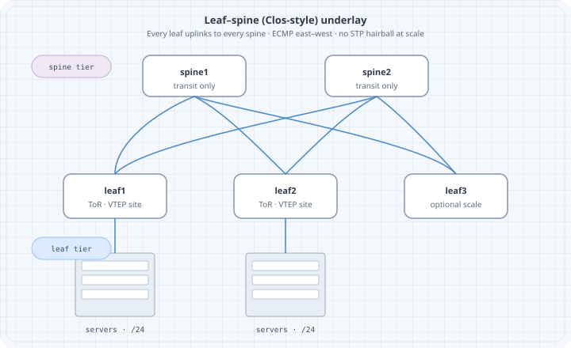

# Capstone C3: 2×2 Clos Leaf-Spine Fabric

This chapter is the worked implementation of **Capstone C3** from [Capstone Outline](03-capstone-outline.md): a 2-spine × 2-leaf IP Clos fabric built with **Containerlab + FRR + Alpine**, running an eBGP underlay with 2-way ECMP, an automated `verify.sh` smoke test, three controlled failure drills, and an optional VXLAN/EVPN overlay stretch once the underlay is rock solid.



## Learning goals

By the end of this chapter you can:

- Design a clean 2×2 Clos addressing, ASN, and loopback plan
- Deploy an eBGP leaf-spine underlay with `maximum-paths` ECMP in Containerlab
- Validate BGP sessions, multipath FIB programming, and host-to-host reachability via `verify.sh`
- Run and document three failure drills: leaf uplink loss, full spine loss, and asymmetric BGP policy
- Extend a verified underlay with a VXLAN/EVPN overlay without tangling underlay and overlay faults

## Topology and addressing plan

```text
         s1 (AS 65100)            s2 (AS 65100)
          lo 10.0.0.1              lo 10.0.0.2
          /        \               /        \
    eth1 /          \ eth2   eth1 /          \ eth2
        /            \           /            \
   eth1/              \   eth1  /              \eth2
   l1 (AS 65101)       \_______/         l2 (AS 65102)
   lo 10.0.0.11         eth2             lo 10.0.0.12
        |                                     |
       eth3                                  eth3
        |                                     |
   h1 (192.168.1.10/24)                  h2 (192.168.2.10/24)
```

| Node | Role | ASN | Loopback | Interfaces & Subnets |
|---|---|---|---|---|
| `s1` | Spine 1 | `65100` | `10.0.0.1/32` | `eth1`: `10.1.1.2/30` (to `l1`), `eth2`: `10.1.3.2/30` (to `l2`) |
| `s2` | Spine 2 | `65100` | `10.0.0.2/32` | `eth1`: `10.1.2.2/30` (to `l1`), `eth2`: `10.1.4.2/30` (to `l2`) |
| `l1` | Leaf 1 | `65101` | `10.0.0.11/32` | `eth1`: `10.1.1.1/30` (to `s1`), `eth2`: `10.1.2.1/30` (to `s2`), `eth3`: `192.168.1.1/24` |
| `l2` | Leaf 2 | `65102` | `10.0.0.12/32` | `eth1`: `10.1.3.1/30` (to `s1`), `eth2`: `10.1.4.1/30` (to `s2`), `eth3`: `192.168.2.1/24` |
| `h1` | Host 1 | — | — | `eth1`: `192.168.1.10/24`, default GW `192.168.1.1` |
| `h2` | Host 2 | — | — | `eth1`: `192.168.2.10/24`, default GW `192.168.2.1` |

> [!NOTE]
> Both spines share ASN `65100` while each leaf uses a unique ASN (`65101`, `65102`). Because spines never peer directly with each other, sharing an ASN on the spine tier simplifies templates and avoids AS-path loop rejection between leaves.

## Topology YAML (`topology.clab.yml`)

```yaml
name: closc3

topology:
  nodes:
    s1:
      kind: linux
      image: quay.io/frrouting/frr:10.2.1
      binds:
        - ./config/s1:/etc/frr
    s2:
      kind: linux
      image: quay.io/frrouting/frr:10.2.1
      binds:
        - ./config/s2:/etc/frr
    l1:
      kind: linux
      image: quay.io/frrouting/frr:10.2.1
      binds:
        - ./config/l1:/etc/frr
    l2:
      kind: linux
      image: quay.io/frrouting/frr:10.2.1
      binds:
        - ./config/l2:/etc/frr
    h1:
      kind: linux
      image: alpine:3.20
      exec:
        - apk add --no-cache iproute2 iputils curl
        - ip addr add 192.168.1.10/24 dev eth1
        - ip link set eth1 up
        - ip route add default via 192.168.1.1
    h2:
      kind: linux
      image: alpine:3.20
      exec:
        - apk add --no-cache iproute2 iputils curl
        - ip addr add 192.168.2.10/24 dev eth1
        - ip link set eth1 up
        - ip route add default via 192.168.2.1

  links:
    - endpoints: ["l1:eth1", "s1:eth1"]
    - endpoints: ["l1:eth2", "s2:eth1"]
    - endpoints: ["l2:eth1", "s1:eth2"]
    - endpoints: ["l2:eth2", "s2:eth2"]
    - endpoints: ["h1:eth1", "l1:eth3"]
    - endpoints: ["h2:eth1", "l2:eth3"]
```

## FRR underlay configurations

Place a `daemons` file in each of `config/s1/`, `config/s2/`, `config/l1/`, and `config/l2/`:

```text
zebra=yes
bgpd=yes
staticd=yes
```

### Spine `s1` (`config/s1/frr.conf`)

```text
frr version 10.2.1
frr defaults datacenter
hostname s1
!
interface lo
 ip address 10.0.0.1/32
!
interface eth1
 ip address 10.1.1.2/30
!
interface eth2
 ip address 10.1.3.2/30
!
ip prefix-list FABRIC-PREFIXES seq 10 permit 10.0.0.0/24 le 32
ip prefix-list FABRIC-PREFIXES seq 20 permit 192.168.0.0/16 le 24
!
route-map FABRIC-POLICY permit 10
 match ip address prefix-list FABRIC-PREFIXES
!
router bgp 65100
 bgp router-id 10.0.0.1
 bgp bestpath as-path multipath-relax
 neighbor LEAVES peer-group
 neighbor 10.1.1.1 peer-group LEAVES
 neighbor 10.1.1.1 remote-as 65101
 neighbor 10.1.3.1 peer-group LEAVES
 neighbor 10.1.3.1 remote-as 65102
 !
 address-family ipv4 unicast
  network 10.0.0.1/32
  neighbor LEAVES activate
  neighbor LEAVES route-map FABRIC-POLICY in
  neighbor LEAVES route-map FABRIC-POLICY out
  maximum-paths 4
 exit-address-family
!
line vty
```

For **`s2`** (`config/s2/frr.conf`), mirror `s1` with `hostname s2`, `lo 10.0.0.2/32`, `eth1 10.1.2.2/30`, `eth2 10.1.4.2/30`, `bgp router-id 10.0.0.2`, and neighbors `10.1.2.1` (`65101`) and `10.1.4.1` (`65102`).

### Leaf `l1` (`config/l1/frr.conf`)

```text
frr version 10.2.1
frr defaults datacenter
hostname l1
!
interface lo
 ip address 10.0.0.11/32
!
interface eth1
 ip address 10.1.1.1/30
!
interface eth2
 ip address 10.1.2.1/30
!
interface eth3
 ip address 192.168.1.1/24
!
ip prefix-list FABRIC-PREFIXES seq 10 permit 10.0.0.0/24 le 32
ip prefix-list FABRIC-PREFIXES seq 20 permit 192.168.0.0/16 le 24
!
route-map FABRIC-POLICY permit 10
 match ip address prefix-list FABRIC-PREFIXES
!
router bgp 65101
 bgp router-id 10.0.0.11
 bgp bestpath as-path multipath-relax
 neighbor SPINES peer-group
 neighbor SPINES remote-as 65100
 neighbor 10.1.1.2 peer-group SPINES
 neighbor 10.1.2.2 peer-group SPINES
 !
 address-family ipv4 unicast
  network 10.0.0.11/32
  network 192.168.1.0/24
  neighbor SPINES activate
  neighbor SPINES route-map FABRIC-POLICY in
  neighbor SPINES route-map FABRIC-POLICY out
  maximum-paths 4
 exit-address-family
!
line vty
```

For **`l2`** (`config/l2/frr.conf`), mirror `l1` with `hostname l2`, `router bgp 65102`, `lo 10.0.0.12/32`, `eth1 10.1.3.1/30`, `eth2 10.1.4.1/30`, `eth3 192.168.2.1/24`, neighbors `10.1.3.2` and `10.1.4.2`, and `network 192.168.2.0/24`.

## Deploy and baseline smoke test (`verify.sh`)

Deploy the fabric:

```bash
sudo containerlab deploy -t topology.clab.yml
```

Create `verify.sh` (`chmod +x verify.sh`) to assert BGP sessions, 2-way ECMP programming on both leaves, loopback reachability, and end-to-end host connectivity:

```bash
#!/usr/bin/env bash
set -euo pipefail

fail() { echo "FAIL: $*" >&2; exit 1; }

echo "[1/4] Checking BGP Established sessions (expect 2 per node)..."
for node in s1 s2 l1 l2; do
  est=$(docker exec "clab-closc3-${node}" vtysh -c "show bgp ipv4 unicast summary json" \
    | grep -c '"state":"Established"' || true)
  [ "$est" -eq 2 ] || fail "${node} has ${est} Established sessions (expected 2)"
done

echo "[2/4] Checking 2-way ECMP on l1 -> 192.168.2.0/24..."
nh_l1=$(docker exec clab-closc3-l1 ip route show 192.168.2.0/24 | grep -c "nexthop via" || true)
[ "$nh_l1" -eq 2 ] || fail "l1 expected 2 ECMP nexthops for 192.168.2.0/24, got ${nh_l1}"

echo "[3/4] Checking loopback-to-loopback reachability (l1 -> l2)..."
docker exec clab-closc3-l1 ping -c 2 -W 1 -I 10.0.0.11 10.0.0.12 >/dev/null \
  || fail "loopback ping l1->l2 failed"

echo "[4/4] Checking host-to-host reachability (h1 -> h2)..."
docker exec clab-closc3-h1 ping -c 3 -W 1 192.168.2.10 >/dev/null \
  || fail "host ping h1->h2 failed"

echo "PASS: 2x2 Clos fabric healthy with 2-way ECMP."
```

Run `./verify.sh` and confirm `PASS` before starting any failure drill.

## Failure drills

Record **Prediction → Observation → Recovery → Lesson** in `journals/drill-N.md` for each drill.

### Drill 1 — Single leaf uplink down (`l1:eth1`)

Simulate a failed fiber between `l1` and `s1`:

```bash
docker exec clab-closc3-l1 ip link set eth1 down
sleep 2
docker exec clab-closc3-l1 vtysh -c "show bgp summary"
docker exec clab-closc3-l1 ip route show 192.168.2.0/24
docker exec clab-closc3-h1 ping -c 5 192.168.2.10
docker exec clab-closc3-h1 traceroute -n 192.168.2.10
```

- **Predict:** `l1` withdraws the `10.1.1.2` nexthop immediately on link-down; `192.168.2.0/24` drops from 2 ECMP nexthops to 1 (`via 10.1.2.2 dev eth2`). `h1 → h2` stays up via `s2` (`10.1.2.2`).
- **Restore:** `docker exec clab-closc3-l1 ip link set eth1 up` and re-run `./verify.sh`.

### Drill 2 — Full spine outage (`s1` down)

Simulate a spine reload or power failure by pausing or shutting both interfaces on `s1`:

```bash
docker exec clab-closc3-s1 ip link set eth1 down
docker exec clab-closc3-s1 ip link set eth2 down
sleep 2
docker exec clab-closc3-l1 ip route show 192.168.2.0/24
docker exec clab-closc3-l2 ip route show 192.168.1.0/24
docker exec clab-closc3-h1 ping -c 10 192.168.2.10
```

- **Predict:** Both leaves drop to a single uplink (`s2`), halving fabric bisection bandwidth while keeping 100% host reachability. Notice how `10.0.0.1/32` disappears from both leaves' routing tables.
- **Restore:** Bring `s1:eth1` and `s1:eth2` back up and verify 2-way ECMP returns via `./verify.sh`.

### Drill 3 — Asymmetric BGP policy (route-map misconfiguration)

Inject a realistic policy bug: prepend AS `65101` twice on `l1` toward `s1` (`10.1.1.2`) only, breaking ECMP symmetry:

```bash
docker exec clab-closc3-l1 vtysh \
  -c "conf t" \
  -c "route-map PREPEND-S1 permit 10" \
  -c " match ip address prefix-list FABRIC-PREFIXES" \
  -c " set as-path prepend 65101 65101" \
  -c "router bgp 65101" \
  -c " address-family ipv4 unicast" \
  -c "  neighbor 10.1.1.2 route-map PREPEND-S1 out" \
  -c "end"
docker exec clab-closc3-l1 vtysh -c "clear bgp ipv4 unicast 10.1.1.2 soft out"
sleep 2
docker exec clab-closc3-l2 vtysh -c "show bgp ipv4 unicast 192.168.1.0/24"
docker exec clab-closc3-l2 ip route show 192.168.1.0/24
```

- **Predict:** `l2` receives `192.168.1.0/24` with AS-path `65100 65101` via `s2` and `65100 65101 65101 65101` via `s1`. Because the AS-path lengths differ, `l2` silently drops from 2-way ECMP to a single path (`s2`), while `l1 → l2` still uses both spines (asymmetric forwarding!).
- **Restore:** Re-apply `neighbor 10.1.1.2 route-map FABRIC-POLICY out`, soft-clear outbound, and confirm `./verify.sh` returns green.

## Optional stretch: VXLAN / EVPN overlay on leaves

Only attempt this **after** `./verify.sh` passes cleanly and all three underlay drills are complete:

1. Enable `address-family l2vpn evpn` on `s1`, `s2`, `l1`, `l2` (see [EVPN-VXLAN Fabric Design](../07-b-fabrics-multi-area/06-evpn-vxlan-fabric-design.md)).
2. On `l1` and `l2`, create a Linux bridge `br10` and VXLAN interface `vxlan10010` sourced from loopback `10.0.0.11` / `10.0.0.12` (`id 10010 dstport 4789 nolearning`).
3. Move `h1` and `h2` into the **same subnet** (`10.10.10.11/24` and `10.10.10.12/24`) bridged into `br10`.
4. Verify Type 3 (IMET) and Type 2 (MAC/IP) routes in `show bgp l2vpn evpn route` and ping `h1 → h2` across the stretched L2VNI.

## Definition of done

- [ ] `topology.clab.yml`, `config/`, `verify.sh`, and `Makefile` committed in git
- [ ] `./verify.sh` passes on a clean deploy
- [ ] All 3 failure drills executed and documented in `journals/drill-1.md` through `drill-3.md`
- [ ] Negative check added to `verify.sh` (e.g., asserting a rogue prefix `203.0.113.0/24` is rejected by `FABRIC-POLICY`)
- [ ] Short `RETRO.md` comparing numbered eBGP here against [BGP Unnumbered](../07-b-fabrics-multi-area/07-bgp-unnumbered-clos.md)
