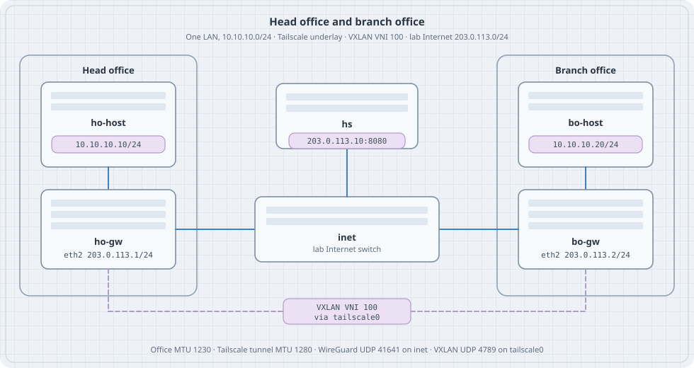

# Project: Zero-Trust Tailscale Mesh Onboarding & Policy Automation

Build a **Go CLI + OpenTofu/Terraform wrapper** and customer-ready reference architecture that connects multi-cloud Kubernetes services, a private GitOps server, and developer bastion hosts over a **WireGuard/Tailscale** zero-trust mesh—using ephemeral pre-auth keys, least-privilege ACL tags, subnet routers, and SSH session recording.



## Mesh Topology & Least-Privilege Policy

```text
Developer Laptops (tag:eng)
        |  Tailscale SSH (session recorded, short-lived OIDC)
        v
Private GitOps & K8s API (tag:prod-k8s, subnet router 10.42.0.0/16)
        ^
        |  Ephemeral K8s Pod / Bare-Metal Node (tag:ci-runner, auto-expires on exit)
```

## OpenTofu Tailscale ACL + Ephemeral Key Automation

```hcl
resource "tailscale_acl" "mesh" {
  acl = jsonencode({
    tagOwners = {
      "tag:prod-k8s"  = ["autogroup:admin"]
      "tag:ci-runner" = ["autogroup:admin"]
    }
    acls = [
      { action = "accept", src = ["tag:ci-runner"], dst = ["tag:prod-k8s:443,6443"] },
      { action = "accept", src = ["autogroup:member"], dst = ["tag:prod-k8s:22,443,6443"] }
    ]
    ssh = [
      { action = "check", src = ["autogroup:member"], dst = ["tag:prod-k8s"], users = ["ubuntu"] }
    ]
  })
}

resource "tailscale_tailnet_key" "ephemeral_runner" {
  reusable      = false
  ephemeral     = true
  preauthorized = true
  expiry        = 3600
  tags          = ["tag:ci-runner"]
}
```

## Subnet Router & Pod Onboarding Commands

```bash
# Advertise private Kubernetes Pod/Service CIDRs from a HA subnet router
tailscale up --authkey="${TS_AUTHKEY}" \
  --advertise-routes=10.42.0.0/16,10.43.0.0/16 \
  --advertise-tags=tag:prod-k8s --ssh

# Verify peer WireGuard handshake, DERP vs direct P2P path, and allowed routes
tailscale status
tailscale ping 100.64.0.12
```

## Acceptance Drills

- Onboard an ephemeral Kubernetes pod with an automated single-use auth key and confirm it can reach `tag:prod-k8s:6443` while `nc -zv <prod-k8s-ip> 22` is blocked by ACLs.
- Terminate the pod and verify its ephemeral node record is automatically purged from the tailnet within minutes.
- Connect via `tailscale ssh ubuntu@prod-k8s` and confirm session recording logs appear in the audit collector.
