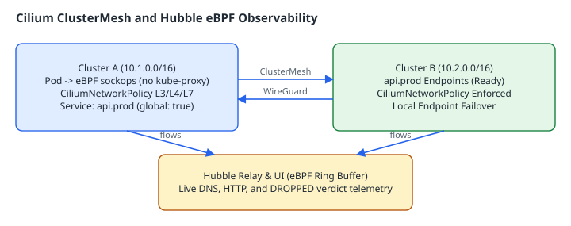

# Project: Multi-Cluster Kubernetes Fleet Simulator with Cilium ClusterMesh

Spin up 2–3 local `kind` / `k3s` clusters connected via **Cilium ClusterMesh** to practice cross-cluster service discovery, **CiliumNetworkPolicy** zero-trust enforcement, **Hubble eBPF** live flow observability, and federated ingress failover.



## Topology

```text
Cluster A (10.1.0.0/16, podCIDR 10.10.0.0/16)  <=== WireGuard / VXLAN ===>  Cluster B (10.2.0.0/16, podCIDR 10.20.0.0/16)
  ├── Global Service: api.prod (service.cilium.io/global: "true")
  ├── CiliumNetworkPolicy (L3/L4/L7 identity-based allowlist)
  └── Hubble UI / CLI (live DNS, HTTP, drop-reason eBPF flow telemetry)
```

## Step-by-Step ClusterMesh Bring-Up (`kind` + Cilium CLI)

```bash
# 1. Install Cilium on both clusters with distinct cluster IDs and non-overlapping Pod CIDRs
cilium install --context kind-cluster-a --set cluster.name=cluster-a --set cluster.id=1 \
  --set ipam.operator.clusterPoolIPv4PodCIDRList=10.10.0.0/16 --set encryption.enabled=true --set encryption.type=wireguard

cilium install --context kind-cluster-b --set cluster.name=cluster-b --set cluster.id=2 \
  --set ipam.operator.clusterPoolIPv4PodCIDRList=10.20.0.0/16 --set encryption.enabled=true --set encryption.type=wireguard

# 2. Enable ClusterMesh & Hubble, then connect both clusters
cilium clustermesh enable --context kind-cluster-a --service-type NodePort
cilium clustermesh enable --context kind-cluster-b --service-type NodePort
cilium clustermesh connect --context kind-cluster-a --destination-context kind-cluster-b
cilium hubble enable --context kind-cluster-a --ui
```

## Global Service + L7 `CiliumNetworkPolicy`

```yaml
apiVersion: v1
kind: Service
metadata:
  name: api-prod
  annotations:
    service.cilium.io/global: "true"
    service.cilium.io/affinity: "local"
spec:
  ports:
    - port: 80
      targetPort: 8080
  selector:
    app: api-prod
---
apiVersion: cilium.io/v2
kind: CiliumNetworkPolicy
metadata:
  name: allow-frontend-get-only
spec:
  endpointSelector:
    matchLabels:
      app: api-prod
  ingress:
    - fromEndpoints:
        - matchLabels:
            app: web-frontend
      toPorts:
        - ports:
            - port: "8080"
              protocol: TCP
          rules:
            http:
              - method: "GET"
                path: "/healthz|/v1/.*"
```

## Acceptance Drills

- Scale `api-prod` replicas in `cluster-a` to `0` and verify `curl http://api-prod` from `cluster-a` transparently routes across the WireGuard ClusterMesh tunnel to `cluster-b`.
- Send a `POST /admin` request from an untrusted pod and observe the real-time `DROPPED` verdict in `hubble observe --verdict DROPPED`.
