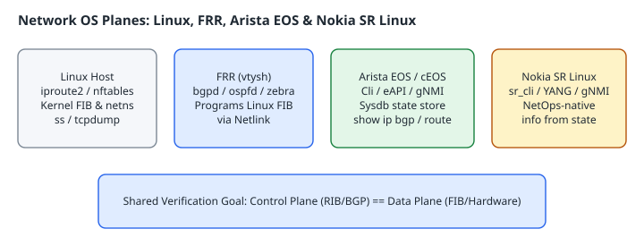

# Intro

**Command Reference** — Keep everyday CLI syntax close at hand with a master side-by-side NOS translation matrix and dedicated cheat sheets for FRR, Arista EOS/cEOS/vEOS, Nokia SR Linux, Containerlab/netlab/Linux, and Cisco/Junos.

## Which NOS Cheat Sheet Should I Open?

| Platform / Stack | Primary CLI / API | When to Use | Cheat Sheet |
|------------------|-------------------|-------------|-------------|
| **Cross-Vendor Matrix** | Side-by-side translation | Translating `show` / `ip` / `vtysh` commands across NOSes | [01. Lab & NOS Command Reference](01-commands.md) |
| **FRRouting (FRR)** | `vtysh` + Linux `iproute2` | Open-source BGP/OSPF/EVPN containers and Linux routers | [02. FRRouting Cheat Sheet](02-frr.md) |
| **Arista EOS / cEOS** | `Cli` / eAPI / gNMI | Campus/data-center leaf-spine, MLAG, and EVPN labs | [03. Arista EOS Cheat Sheet](03-arista-eos.md) |
| **Nokia SR Linux** | `sr_cli` / YANG / gNMI | Model-driven NetOps, streaming telemetry, and gRPC fabrics | [04. Nokia SR Linux Cheat Sheet](04-sr-linux.md) |
| **Lab Host & Linux** | `containerlab`, `netlab`, `ss`, `tcpdump` | Building, inspecting, and packet-capturing Containerlab topologies | [05. Lab Tools Cheat Sheet](05-lab-tools.md) |
| **Cisco & Juniper** | IOS-XE / NX-OS / Junos `cli` | Translating enterprise/ISP syntax into lab equivalents | [06. Cisco & Junos Quick Reference](06-cisco-junos-quickref.md) |

## Control Plane vs. Data Plane Verification Rule

Never stop at checking only the routing protocol (`show ip bgp summary`). Always verify both:
1. **Control plane (RIB/BGP/OSPF):** Did the route arrive and win best-path selection?
2. **Data plane (FIB/kernel/hardware):** Was the route programmed into the forwarding table (`ip route get`, `show ip cef`, `tcpdump`)?
