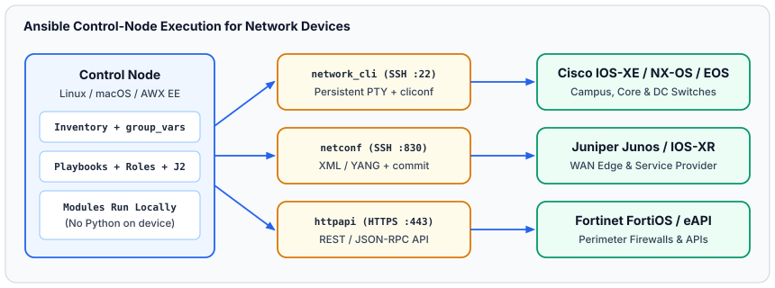

# Chapter 2 — Ansible in the Network Landscape

## How Ansible Works for Network Devices

Unlike server automation—where Ansible copies a Python script over SSH and executes it on the remote host—network automation uses **control-node execution**. Every network module runs locally on the Ansible control node and communicates with managed devices over persistent network transports (`network_cli`, `netconf`, or `httpapi`).



This architecture gives network teams three immediate advantages:

1. **Agentless operation:** No software packages, daemons, or open ports beyond standard SSH, NETCONF (TCP 830), or HTTPS are required on routers, switches, or firewalls.
2. **Human-readable intent:** Playbooks, inventories, and variable files are written in YAML, allowing engineers without a software engineering background to read, review, and contribute safely.
3. **Broad vendor ecosystem:** Red Hat, Cisco, Juniper, Arista, Fortinet, Palo Alto, and Nokia maintain certified Ansible collections with structured resource modules.

## Comparing the Network Automation Toolset

Ansible is not the only tool in modern NetOps. Understanding where it excels—and where another tool fits better—prevents forcing the wrong abstraction onto a problem.

| Tool | Language / Model | Execution Speed | Best Fit | Trade-Offs |
| :--- | :--- | :--- | :--- | :--- |
| **Ansible** | Declarative YAML + Jinja2 | Moderate (process-per-fork) | Multi-vendor config management, team adoption, AWX/AAP RBAC | Slower at 1,000+ devices; YAML logic gets clumsy for complex algorithms |
| **Nornir** | Pure Python framework | Very fast (multithreaded) | Complex data transformations, high-scale telemetry/validation | Requires solid Python skills; no built-in RBAC/UI |
| **Netmiko / Scrapli** | Python SSH libraries | Fast (especially Scrapli async) | Quick ad-hoc scripts, custom CLI scraping | Low-level; you build inventory, idempotency, and error handling yourself |
| **Terraform / OpenTofu** | Declarative HCL + state file | Fast (API-driven) | Cloud networking (VPCs, transit gateways), API-first SD-WAN/firewalls | Poor fit for CLI-only switches; state drift requires strict discipline |
| **Salt / Napalm** | Event-driven / Python | Fast | Event-driven remediation, proxy-minion architectures | Smaller vendor module ecosystem than Ansible |

> [!TIP]
> Many mature network teams run **Ansible + Python/NetBox** together: NetBox holds the Source of Truth, Ansible orchestrates multi-vendor configuration and compliance under AWX RBAC, and targeted Python scripts (or custom Ansible filter plugins) handle heavy data processing.

## Idempotency: The Core Design Contract

An operation is **idempotent** if running it once produces the desired state, and running it ten more times produces zero additional changes and zero side effects.

- **Non-idempotent:** Sending `ip route 10.20.0.0 255.255.0.0 192.0.2.1` blindly via raw SSH every night without checking if it already exists or if a stale route should be removed.
- **Idempotent:** Declaring the desired state with a resource module (e.g., `cisco.ios.ios_static_routes` with `state: merged` or `state: replaced`) so Ansible compares current device state against desired state and sends commands *only* when a delta exists.

## Check Mode and Diff Mode

Ansible supports two flags that are indispensable in network operations:

```bash
# Preview changes without modifying any device configuration
ansible-playbook -i inventory/prod.yml playbooks/ntp.yml --check --diff
```

- `--check` instructs modules to compute what *would* change without pushing commands.
- `--diff` prints a line-by-line before/after comparison of configuration blocks.

> [!WARNING]
> Not every module supports `--check` identically, and raw command modules (`cli_command`, `ios_command`) skip execution in check mode unless `check_mode: false` is explicitly set on read-only discovery tasks.

## When Not to Use Ansible

Avoid using Ansible for:
- **Sub-second telemetry collection:** Use gNMI streaming telemetry (Telegraf/gNMIc + Prometheus) instead of polling with Ansible playbooks.
- **Real-time packet-level event reaction:** Use event-driven telemetry pipelines or BGP BMP/IPFIX collectors.
- **Heavy algorithmic graph computation:** Write a Python library or Ansible filter plugin rather than twisting Jinja2 loops into a programming language.
