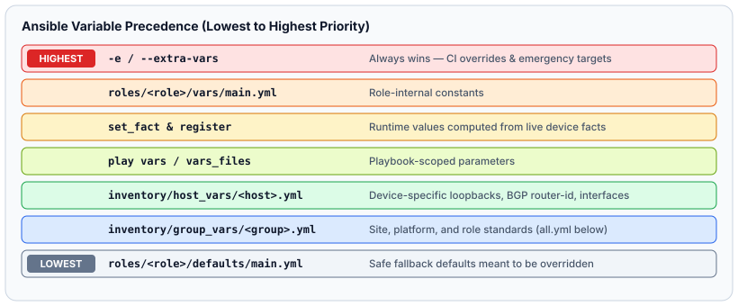

# Chapter 8 — Variables, Facts and Precedence

## Why Variable Design Makes or Breaks Automation

Hardcoding IP addresses, VLAN IDs, or ASN numbers inside playbooks turns Ansible into a glorified shell script. Clean automation separates **logic** (playbooks and roles) from **data** (variables in `group_vars/`, `host_vars/`, and external Sources of Truth).

## Variable Precedence (Lowest to Highest)

Ansible resolves variables across 22 precedence levels. In practice, network engineers rely on eight core layers:



| Priority (Low → High) | Location | Typical Network Use |
| :--- | :--- | :--- |
| 1 | `roles/<role>/defaults/main.yml` | Safe fallback defaults (e.g., `ntp_vrf: mgmt`) |
| 2 | `inventory/group_vars/all.yml` | Global enterprise standards (DNS, syslog, banners) |
| 3 | `inventory/group_vars/<group>.yml` | Site or role overrides (`site_london.yml`, `edge_routers.yml`) |
| 4 | `inventory/host_vars/<host>.yml` | Device-specific data (loopbacks, BGP router-id, local interfaces) |
| 5 | Play `vars:` and `vars_files:` | Play-scoped constants |
| 6 | `set_fact` and `register` | Runtime values computed from device state |
| 7 | `roles/<role>/vars/main.yml` | Role-internal constants not meant to be overridden |
| 8 | Extra vars (`-e "target_vlan=40"`) | Highest precedence; always wins for emergency or CI overrides |

> [!WARNING]
> When a host belongs to two sibling groups at the same depth (e.g., `site_london` and `edge_routers`) and both define the same variable, Ansible merges them **alphabetically by group name**—so `site_london` beats `edge_routers`. Avoid sibling collisions by keeping site data and role data in distinct namespaces, or use `ansible_group_priority`.

## Gathering and Using Network Facts

Network facts give your playbooks live awareness of hardware models, OS versions, serial numbers, and interfaces:

```yaml
---
- name: Gather IOS-XE facts and inspect version
  hosts: ios
  gather_facts: false

  tasks:
    - name: Collect hardware, config, and interface facts
      cisco.ios.ios_facts:
        gather_subset:
          - min
          - hardware
        gather_network_resources:
          - interfaces
          - vlans

    - name: Show structured facts
      ansible.builtin.debug:
        msg: "{{ ansible_net_hostname }} runs {{ ansible_net_version }} (S/N: {{ ansible_net_serialnum }})"
```

## Runtime Variables: `register` and `set_fact`

- `register:` captures the entire JSON return dictionary of a task (`changed`, `stdout`, `stdout_lines`, `before`, `after`, `commands`).
- `ansible.builtin.set_fact:` creates or transforms a host-scoped variable that persists for the rest of the playbook run—even across subsequent plays.

```yaml
- name: Compute BGP ASN from site prefix
  ansible.builtin.set_fact:
    local_asn: "{{ 65100 if site_code == 'LON' else 65200 }}"
```

## Built-In Magic Variables

| Magic Variable | Value |
| :--- | :--- |
| `inventory_hostname` | Device name as defined in inventory |
| `group_names` | List of all groups the current host belongs to |
| `groups` | Dictionary mapping every group name to its list of hostnames |
| `hostvars` | Dictionary of all variables and facts for *every* host in the play (enables peer-to-peer config generation, e.g., `hostvars['rtr-edge-02']['loopback0_ip']`) |
| `ansible_check_mode` | Boolean `true` when invoked with `--check` |
