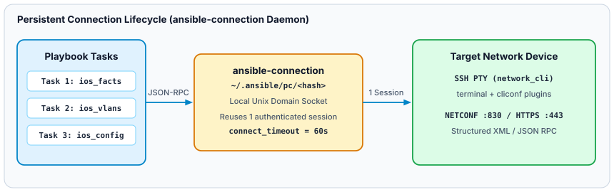

# Chapter 12 — Connection Plugins Demystified

## Persistent Connections vs. Legacy Local Connections

Every network connection plugin in `ansible.netcommon` runs through a persistent background process (`ansible-connection`) on the control node. Instead of opening and tearing down a brand-new SSH session for every single task, Ansible keeps a local Unix domain socket open per target device for the lifetime of the play (controlled by `connect_timeout`), reusing the authenticated session across tasks.



## The Three Core Network Connection Plugins

| Plugin (`ansible_connection`) | Wire Protocol | Typical Platforms | Strengths & Caveats |
| :--- | :--- | :--- | :--- |
| **`ansible.netcommon.network_cli`** | SSH (TCP 22) interactive PTY | Cisco IOS/IOS-XE/NX-OS/ASA, Arista EOS, Juniper CLI | Universal; works everywhere SSH exists. Relies on prompt regexes (`terminal` plugin); sensitive to custom banners or prompts |
| **`ansible.netcommon.netconf`** | NETCONF over SSH (TCP 830) | Juniper Junos, Cisco IOS-XE/IOS-XR/NX-OS | Structured XML/YANG, atomic candidate datastore, commit-confirmed rollback. Requires `ncclient` and NETCONF enabled on device |
| **`ansible.netcommon.httpapi`** | HTTPS REST / JSON-RPC (TCP 443) | Fortinet FortiOS, Arista eAPI, Cisco NX-API / FTD / Meraki | Fast, structured JSON, no screen-scraping. Requires HTTPS management API enabled and TLS certificate hygiene |

## How `network_cli` Works Under the Hood

When a task executes over `network_cli`:
1. Ansible spawns `ansible-connection`, which opens an SSH channel via `libssh` (`ansible-pylibssh`, recommended) or `paramiko`.
2. It loads the vendor's **terminal plugin** (e.g., `cisco.ios.ios`), disables paging (`terminal length 0`, `terminal width 512`), and tracks the device's prompt (`#`, `>`, `(config)#`).
3. It loads the vendor's **cliconf plugin**, which translates high-level calls (`get_config`, `edit_config`) into platform CLI syntax.

## Tuning Timeouts and SSH Backend

Large `show running-config` dumps or slow firmware checks frequently trigger default 30-second timeouts. Tune timeouts explicitly in `ansible.cfg` or per-host in `group_vars/`:

```ini
[persistent_connection]
connect_timeout = 60
command_timeout = 120
connect_retry_timeout = 30
ssh_type = libssh
```

```yaml
# Override timeout for a single slow task (e.g., crypto key generate or archive)
- name: Run full tech-support capture
  cisco.ios.ios_command:
    commands:
      - show tech-support
  vars:
    ansible_command_timeout: 300
```

> [!TIP]
> Install `ansible-pylibssh` and set `ssh_type = libssh`. It respects `~/.ssh/config` (including `ProxyJump` and FIPS-compliant ciphers) far more reliably than legacy `paramiko`.
