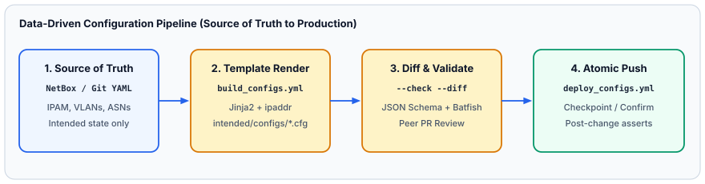

# Chapter 19 — Source of Truth

## The Problem with Spreadsheets and Scattered Variables

If your VLAN list lives in Excel, your IP allocations live in an outdated IPAM, your BGP ASNs live in a wiki, and your Ansible `host_vars/` are edited by hand during outages, you have **four conflicting versions of reality**. A **Source of Truth (SoT)** establishes a single authoritative system of record for intended network state.



## Two Proven Source of Truth Models

| Model | Examples | Strengths | Ideal Team Size |
| :--- | :--- | :--- | :--- |
| **Git-as-SoT (YAML)** | Structured `group_vars/` + JSON Schema validation in Git | Zero external infrastructure, native Git PR diffs and branches, easy to start | Small–medium teams (10–200 devices) |
| **Dedicated Network SoT** | **NetBox** or **Nautobot** | Built-in IPAM, DCIM, cable/rack modeling, REST/GraphQL APIs, dynamic Ansible inventory | Medium–large enterprises (100–10,000+ devices) |

## Integrating NetBox as a Dynamic Ansible Inventory

Install the `netbox.netbox` collection and create `inventory/netbox.yml`:

```yaml
---
plugin: netbox.netbox.nb_inventory
api_endpoint: https://netbox.corp.example
token: "{{ lookup('env', 'NETBOX_TOKEN') }}"
validate_certs: true
config_context: true
interfaces: true
group_by:
  - device_roles
  - sites
  - platforms
query_filters:
  - status: active
compose:
  ansible_host: primary_ip4.address | ansible.utils.ipaddr('address')
  ansible_network_os: platform.slug
```

Test the live dynamic inventory immediately:

```bash
export NETBOX_TOKEN="0123456789abcdef..."
ansible-inventory -i inventory/netbox.yml --graph
```

## Querying NetBox Data Inside Playbooks

Beyond inventory, fetch prefixes, VLANs, or custom config contexts dynamically via `netbox.netbox.nb_lookup` or GraphQL:

```yaml
- name: Query active VLANs for this device's site from NetBox
  ansible.builtin.set_fact:
    site_vlans: "{{ query('netbox.netbox.nb_lookup', 'vlans', api_filter='site=' ~ sites[0] ~ ' status=active', api_endpoint=netbox_url, token=netbox_token) }}"
```

## SoT Discipline: Intended State vs. Observed State

Never blindly overwrite your Source of Truth with whatever is currently running on a router—that turns your SoT into a mirror of drift. Instead:
- **Intended state** lives in the SoT (NetBox / Git).
- **Observed state** lives on the live network devices.
- **Automation** continuously reconciles Observed → Intended, and flags unauthorized manual changes as drift.
