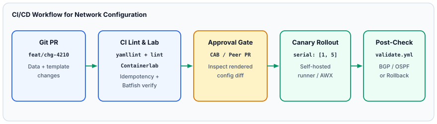

# Chapter 31 — CI/CD for Network Configuration

## Continuous Integration vs. Continuous Delivery in NetOps

In network engineering, **CI** (automatically linting, rendering configs, and testing every pull request in a virtual lab) should run on 100% of commits. **CD** (pushing to production) should almost always include a **manual approval gate** tied to your change ticket—turning "continuous deployment" into **controlled, one-click continuous delivery**.



## Example GitHub Actions Pipeline (`.github/workflows/netops-ci.yml`)

```yaml
name: Network Automation CI/CD

on:
  pull_request:
    branches: [main]
  push:
    branches: [main]

jobs:
  lint-and-render:
    runs-on: ubuntu-latest
    steps:
      - uses: actions/checkout@v4
      - uses: actions/setup-python@v5
        with:
          python-version: "3.12"
      - name: Install Ansible and linters
        run: |
          pip install ansible-core yamllint ansible-lint netaddr jsonschema
          ansible-galaxy collection install -r collections/requirements.yml
      - name: Static checks (yamllint + ansible-lint + syntax)
        run: |
          yamllint .
          ansible-lint
          ansible-playbook playbooks/site.yml --syntax-check
      - name: Render intended configurations
        run: ansible-playbook playbooks/build_configs.yml
      - name: Upload rendered configs as PR artifact
        uses: actions/upload-artifact@v4
        with:
          name: intended-configs
          path: intended/configs/

  deploy-production:
    needs: lint-and-render
    if: github.ref == 'refs/heads/main' && github.event_name == 'push'
    runs-on: [self-hosted, netops-runner]
    environment: production   # Enforces required human approval gate
    steps:
      - uses: actions/checkout@v4
      - name: Pre-change validation
        run: ansible-playbook playbooks/validate.yml --tags pre
      - name: Canary and rolling deployment
        run: ansible-playbook playbooks/deploy_configs.yml --diff
      - name: Post-change validation
        run: ansible-playbook playbooks/validate.yml --tags post
```

## Self-Hosted Runners and Network Reachability

Cloud-hosted CI runners (GitHub/GitLab SaaS) cannot—and should not—reach your internal out-of-band management network. Run your deployment jobs on a hardened **self-hosted runner** inside the management VRF/VLAN (or have CI trigger a job template on **AWX/AAP** via its REST API).
