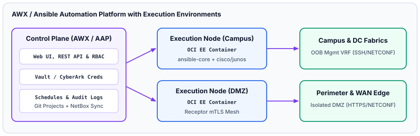

# Chapter 32 — AWX and Ansible Automation Platform

## Why CLI-Only Ansible Hits a Wall at Team Scale

Running `ansible-playbook` from laptops works for one or two engineers. Across a 15-person network and operations organization, you immediately need:
- **Role-Based Access Control (RBAC):** Let NOC engineers run read-only triage and port-bounce job templates without ever seeing SSH private keys or editing BGP playbooks.
- **Centralized audit trails:** Every job run is logged with who clicked launch, exact Git commit SHA, extra vars, and full stdout/diff output.
- **Scheduled jobs:** Nightly config backups, weekly compliance audits, and inventory syncs from NetBox without fragile `cron` jobs on jump hosts.
- **Self-service surveys:** Web forms with dropdown validation (e.g., "Select Building → Select Switch → Select Port → Select VLAN") that safely invoke playbooks.

## AWX / AAP Architecture and Execution Environments



Modern AWX (open-source upstream) and Red Hat Ansible Automation Platform (AAP, enterprise supported) decouple the web/API control plane from **Execution Environments (EEs)**—OCI container images containing `ansible-core`, Python dependencies, and pinned network collections—distributed over an encrypted **Receptor mesh** into isolated DMZ or regional management segments.

## Building a Custom Network Execution Environment (`execution-environment.yml`)

Use `ansible-builder` to package your exact network collections and Python libraries into an immutable container image:

```yaml
---
version: 3
images:
  base_image:
    name: quay.io/ansible/ansible-runner:latest

dependencies:
  galaxy: collections/requirements.yml
  python: requirements.txt
  system:
    - openssh-clients [platform:rpm]
    - gcc [platform:rpm]
    - libssh-devel [platform:rpm]
```

```bash
ansible-builder build -t registry.corp.example/netops/ansible-ee:1.4.0
```

## Workflow Job Templates: Chaining Multi-Stage Operations

AWX **Workflow Templates** visually chain individual Job Templates with conditional branching on success or failure:

```text
[ Sync NetBox Inventory ]
           │ (on success)
           ▼
[ Pre-Change Validation ] ──(on failure)──► [ Notify Slack & Abort ]
           │ (on success)
           ▼
[ Approval Node (CAB) ]
           │ (on approval)
           ▼
[ Deploy Configs ] ─────────(on failure)──► [ Automatic Rollback Job ]
           │ (on success)
           ▼
[ Post-Change Validation ]
```
