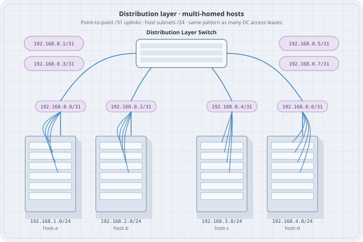

# Networking

Learn networking from first principles to NetOps by designing, building, breaking, and verifying networks. Containerlab and netlab support labs using freely available images, including FRR, Arista cEOS, and Nokia SR Linux.

## Learning path

1. [Lab platform](content/01-lab-platform/index.md) and a first topology on macOS or Linux.
2. [Networking foundations](content/02-networking-foundations/index.md) and packet capture.
3. [Layer 2](content/03-layer-2/index.md): switching, VLANs, loops, aggregation, and enterprise Wi-Fi.
4. [IP routing](content/04-ip-routing-services/index.md) and [network services](content/04-network-services/index.md): static routes, DNS, DHCP, NAT, redundancy, and MTU.
5. [Dynamic routing](content/05-dynamic-routing/index.md): OSPF, IS-IS, BGP, policy, Segment Routing, and convergence.
6. [Policy, QoS, and hardening](content/06-policy-qos-hardening/index.md) and [security operations / NetOps](content/06-security-operations/index.md): automation, Source of Truth, Batfish/Suzieq, and streaming telemetry.
7. [Overlays and tunnels](content/07-a-overlays-tunnels/index.md), [fabrics and multi-area](content/07-b-fabrics-multi-area/index.md), [cloud and Kubernetes networking](content/07-c-cloud-kubernetes-networking/index.md), and [programmable dataplanes and traffic delivery](content/07-d-dataplanes-and-traffic-delivery/index.md).
8. Optional advanced tracks: [BGP security](content/08-bgp-security/index.md), [network forensics](content/08-network-forensics/index.md), and [transport, TLS/PKI, and HTTP/proxies](content/08-transport-and-applications/index.md).
9. [Lab workbook](content/09-lab-workbook/index.md) (55+ multi-NOS exercises) and worked [capstone projects](content/09-projects/index.md) (C1–C4).
10. [Command reference](content/10-command-reference/index.md): side-by-side NOS translation matrix and cheat sheets for FRR, Arista EOS/cEOS/vEOS, Nokia SR Linux, Containerlab/netlab/Linux, and Cisco/Junos.

Use the [workbook guide and learning paths](content/09-lab-workbook/00-workbook-guide.md) to choose exercises and prerequisites. Use each diagram to predict the path, build the lab, verify the control and data planes, then introduce a failure and explain what changed. The workbook includes optional cEOS exercises that require an independently obtained image; consult the image provider for access and licensing. The workbook complements the core chapters: choose labs that match your topic and available images. Cisco and Juniper labs may be added as optional tracks later.

Every serious lab should include a topology and addressing plan, verification, and a failure scenario. Topology diagrams follow the shared illustrated light and dark SVG standard; conceptual diagrams explain the behavior being tested.
