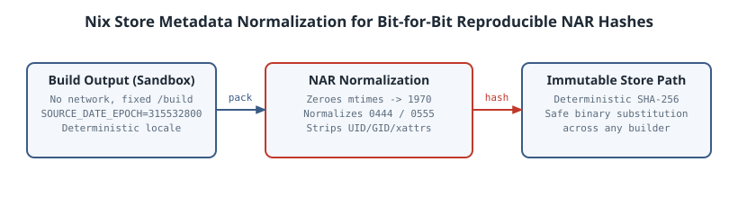

# How Nix Normalizes Metadata for Reproducibility

## Thesis

Two machines evaluating the same flake should compute the **same store paths**. Nix gets there by **normalizing inputs** — including timestamps and other filesystem metadata — so "whatever my laptop's `stat` said" does not leak into hashes.

## Mental model

```text
  source tree → Nix hasher
       │
       ├─ file contents  (primary)
       └─ normalized metadata
            timestamps → fixed / ignored per algorithm
            permissions → canonicalised where required
```

Content-addressed derivations go further (hash of result), but even input-addressed builds need stable inputs.

## Worked example

`nix` is **not installed** on this box; the following is from Nix manuals / reproducible-builds practice.

```bash
# On a Nix-enabled host:
nix flake metadata .          # locked inputs, lastModified
nix hash path ./src           # path hash with Nix's nar serialization
```

NAR (Nix ARchive) serialization is the stable fingerprint: directory entries sorted, executable bit preserved, timestamps zeroed in the NAR model historically used for `nix-hash` / `hashPath`. Flake lockfiles pin `lastModified` and `narHash` for Git inputs so re-evaluation does not depend on `git clone` time.

## Trap

**Embedding `builtins.currentTime` or unpinned `fetchTarball` without a hash.** You reintroduce wall-clock and CDN drift. Likewise, tooling that packs `mtime` into tarballs outside NAR rules will disagree across machines.

## Boring rule

Pin flakes (`flake.lock`), hash fixed-output derivations, and treat NAR hashing as the source of truth for "same tree". Do not chase `mtime` equality on the raw checkout.

## Try this

1. `nix flake metadata` before/after touching a file without content change — path hashes should follow content, not touch time, when going through Nix hashing.
2. Read the NAR format notes in the Nix manual.
3. Compare `nix hash path` vs `sha256sum` on a single file (different!) vs a NAR dump.

## Sources

- Nix manual: reproducible builds / `nix hash` / flakes locking
- [reproducible-builds.org](https://reproducible-builds.org/) (broader context)
- Nix NAR discussion in Nixpkgs / Nix internals docs
## Normalization Pipeline Diagram & NAR Determinism Lab



Confirm that two directories with identical file contents but different modification timestamps produce the exact same Nix NAR hash:

```bash
mkdir -p /tmp/nar-a /tmp/nar-b
echo "deterministic" > /tmp/nar-a/file.txt
echo "deterministic" > /tmp/nar-b/file.txt
touch -t 202001010000 /tmp/nar-a/file.txt
touch -t 202601010000 /tmp/nar-b/file.txt

# Both directories yield identical NAR hashes if nix is installed
nix hash path /tmp/nar-a 2>/dev/null && nix hash path /tmp/nar-b 2>/dev/null || echo "Run on a host with Nix CLI"
rm -rf /tmp/nar-a /tmp/nar-b
```
