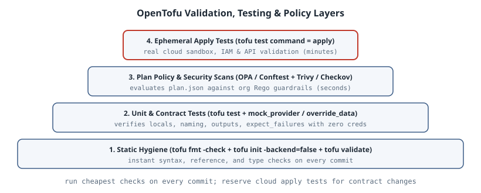

# Testing, Validation, Formatting, and Policy Enforcement

A plan a human reads is the most important test. The commands in this chapter exist so that human never has to spend the review on indentation, a missing variable, or a security group open to the world. Sentinel is not one of those commands on OpenTofu.



## Learning goals

- Run `tofu fmt` and `tofu validate` as a gate, not as a suggestion
- Write a `tofu test` that fails when the pet length drifts
- Put policy in Open Policy Agent, not in Sentinel
- Scan configuration with Checkov or Trivy before the plan is the first time someone notices

## Formatting and Linting: tofu fmt, tofu validate, and Custom Rules

`tofu fmt -recursive` rewrites files to the canonical layout. `tofu fmt -check -recursive` exits non-zero when it would have changed something. The check belongs in the pipeline. The rewrite belongs in a pre-commit hook so the pipeline almost never sees a format failure.

`tofu validate` loads the configuration, checks syntax, and checks that references and types line up. It does not call providers. A directory that has not been initialised can validate only partway. In CI, init with `-backend=false` so validate can see the providers without needing state credentials, then validate.

```bash
tofu fmt -check -recursive
tofu init -backend=false
tofu validate
```

Custom rules beyond the language are policy, covered below. A linter that reimplements the type system is redundant with validate. A linter that encodes "buckets must have versioning" is policy and should live where policy lives.

OpenTofu 1.13 includes early built-in lint work. Treat it as an extra signal in this series, and keep fmt and validate as the gates you require. Do not fail a production pipeline on an experimental lint until you have read what it considers an error.

## Pre-commit Hooks: Catching Errors Before They Reach the Repository

A pre-commit hook runs fmt and validate on the directories the commit touches. Keep the hook fast. Provider downloads inside a hook are how people start skipping the hook.

The hook is a convenience. The pipeline runs the same commands. A skipped hook must not be the only place a check existed. Document the hook as a one-line install in the repository README, and make the CI job the authority.

Useful extra checks in the same hook: reject a commit that adds `terraform.tfstate`, reject `*.tfplan`, and reject a file that looks like a cloud access key. Those are secret checks, not format checks. Chapter 12 lists the patterns.

## Testing Strategies: Unit Tests, Integration Tests, and Plan Validation

Three layers, cheapest first.

**Static.** fmt, validate, policy, and a scanner. No credentials. Every pull request.

**Plan tests.** `tofu test` with `command = plan` asserts on values the plan can know: names, counts, policy documents built from locals. The `random` provider is enough for the pet module. No cloud account.

**Apply tests.** `command = apply` creates real objects and destroys them at the end of the test. Run these in an account built for tests, with a budget and a janitor. They do not run on every keystroke. They run on the module when its contract changes, and nightly if you can afford the time.

A plan a reviewer reads is still required for production roots. Tests do not replace that review. They make the review about the infrastructure change rather than about a typo.

## OpenTofu Test Framework: Built-in Testing Capabilities

Tests are files named `*.tftest.hcl`. A run block executes plan or apply and asserts.

```hcl
# tests/pet.tftest.hcl
run "two_words" {
  command = plan

  variables {
    pet_length = 2
  }

  assert {
    condition     = random_pet.service.length == 2
    error_message = "The pet resource did not receive length 2."
  }
}
```

`tofu test` from the module directory runs every file. A failing assert fails the command. Variables in the run override defaults. Mocking providers is available when a test would otherwise need a cloud API. Prefer a module boundary you can test with `random` or with pure locals over a large mock that restates the provider.

Test the contract: given this length, the resource is configured with this length, and the output is not null after an apply test. Do not test the provider's implementation. HashiCorp's and the provider's own tests already do that, and a copy of them in your module fails for reasons you cannot fix.

`tofu test` is not a policy engine. An assert that "no security group allows 0.0.0.0/0" is policy that belongs on every repository, not only on modules that remembered to copy the test.

## Policy as Code: Sentinel, OPA, and openpolicyagent Integration

Sentinel is HashiCorp's policy language, enforced in their commercial Terraform platform. OpenTofu does not run Sentinel. A `.sentinel` policy pack will not gate `tofu apply`. If a migration guide tells you to point Sentinel at OpenTofu, it is describing the other product.

Open Policy Agent is the policy tool that fits. You evaluate a plan JSON or a configuration JSON with a Rego policy. Conftest is a small runner around that. The usual place is CI, after `tofu plan -out=tfplan` and `tofu show -json tfplan > plan.json`.

```bash
tofu plan -out=tfplan
tofu show -json tfplan > plan.json
conftest test plan.json --policy policy/
```

A policy that denies `0.0.0.0/0` on a security group, or denies a resource type the team has banned, fails the job before apply. Write Rego against the plan JSON's resource changes, not against a cloud API. The plan is what you are about to do.

Keep policies in a repository the infrastructure repositories consume at a pinned version. A policy copied into each repo will be edited in one of them during an incident and will never return. An exception is a reviewed waiver with an expiry, the same shape as any other break-glass.

## Security Scanning: Detecting Misconfigurations with tfsec, checkov, and Trivy

tfsec was a Terraform scanner. Its maintainers folded that work into Trivy. New pipelines should run Trivy or Checkov, not a frozen tfsec binary. The syllabus name is the history. The command you install is one of the living tools.

Both read configuration and look for misconfigurations: public buckets, open security groups, unencrypted disks. They do not replace policy you wrote, and they do not know your naming rules. Run one of them in CI so a well-known mistake fails without a custom Rego rule.

```bash
trivy config .
```

or:

```bash
checkov -d . --framework terraform
```

Checkov still says "terraform" for the framework name because the file format is the same. Point it at OpenTofu files. It does not need the Terraform binary.

Triage the first run. A hundred historical findings are not a gate. Turn the gate on for severity you will actually fix, and file the rest. A scanner that fails every build teaches people to ignore scanners. Pin the scanner version the same way you pin OpenTofu, so a rule change is a commit.

## Concrete OPA Rego guardrail for plan JSON

Save this policy in `policy/guardrails.rego` to block any plan that deletes more than 5 resources without an explicit waiver or exposes SSH (`port 22`) to `0.0.0.0/0`:

```rego
package main

import rego.v1

# Block overly destructive plans
deny contains msg if {
  deletes := [rc | some rc in input.resource_changes; "delete" in rc.change.actions]
  count(deletes) > 5
  msg := sprintf("Plan deletes %d resources (max 5 without break-glass waiver)", [count(deletes)])
}

# Block public SSH ingress rules on AWS security groups
deny contains msg if {
  some rc in input.resource_changes
  rc.type == "aws_security_group"
  some rule in rc.change.after.ingress
  rule.from_port <= 22
  rule.to_port >= 22
  "0.0.0.0/0" in rule.cidr_blocks
  msg := sprintf("%s opens SSH (port 22) to 0.0.0.0/0", [rc.address])
}
```

## Hands-on lab: run `tofu fmt`, `tofu validate`, `tofu test`, and OPA plan checks locally

### Step 1: Create a testable module (`main.tf`) and test file (`tests/pet.tftest.hcl`)

```hcl
# main.tf
terraform {
  required_version = "~> 1.13.0"
  required_providers {
    random = { source = "hashicorp/random", version = "~> 3.7" }
  }
}

variable "pet_length" {
  type    = number
  default = 2
  validation {
    condition     = var.pet_length >= 1 && var.pet_length <= 4
    error_message = "pet_length must be between 1 and 4."
  }
}

resource "random_pet" "service" {
  length = var.pet_length
}

output "name" {
  value = random_pet.service.id
}
```

```hcl
# tests/pet.tftest.hcl
run "valid_length_plan" {
  command = plan
  variables { pet_length = 3 }
  assert {
    condition     = random_pet.service.length == 3
    error_message = "Expected pet length 3."
  }
}

run "reject_invalid_length" {
  command         = plan
  variables       { pet_length = 9 }
  expect_failures = [var.pet_length]
}
```

### Step 2: Execute the full static + test + plan-JSON check

```bash
mkdir -p ~/tofu-labs/11-testing/tests && cd ~/tofu-labs/11-testing
tofu fmt -check -recursive
tofu init -backend=false
tofu validate
tofu test
tofu plan -out=tfplan && tofu show -json tfplan > plan.json
```

If `conftest` is installed, evaluate `plan.json` against `policy/guardrails.rego`:

```bash
conftest test plan.json --policy policy/
```

## Summary

- `tofu fmt -check` and `tofu validate` run in CI after `tofu init -backend=false`.
- `tofu test` verifies module contracts and `expect_failures` with zero cloud credentials.
- Sentinel does not run on OpenTofu; pair **OPA / Conftest** (org Rego rules on `plan.json`) with **Trivy** or **Checkov** (known cloud misconfigurations).
