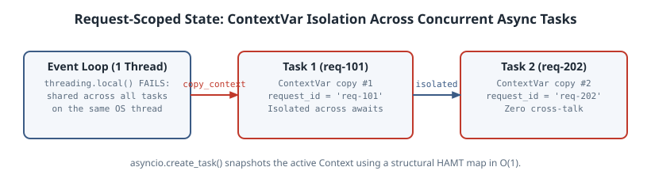

# ContextVar for Request-Scoped State

## Thesis

In concurrent Python, a **global** is a lie: the next `await` lets another task mutate it. **`contextvars.ContextVar`** copies values along with the task context so each request keeps its own id, auth, or trace span. This chapter races five asyncio tasks with a global versus a `ContextVar` and shows the contamination.

## Mental model

```text
  ContextVar.set(v) → token
  await …            (other tasks may run)
  ContextVar.get()   → still v for this task
  ContextVar.reset(token)
```

## Worked examples

Verified with **CPython 3.15.0**.

```python
import asyncio, contextvars

req_id = contextvars.ContextVar("req_id", default="-")

async def handle(i):
    token = req_id.set(f"req-{i}")
    try:
        await asyncio.sleep(0.01)
        return req_id.get()
    finally:
        req_id.reset(token)

async def naive_shared():
    global GID
    async def h(i):
        global GID
        GID = f"req-{i}"
        await asyncio.sleep(0.01)
        return GID
    return await asyncio.gather(*[h(i) for i in range(5)])

async def main():
    good = await asyncio.gather(*[handle(i) for i in range(5)])
    print("ContextVar results:", good)
    bad = await naive_shared()
    print("global mutation results:", bad)

asyncio.run(main())
```

Output:

```
3.15.0 (main, Oct  9 2026, 15:24:40) [Clang 22.1.3 ]
ContextVar results: ['req-0', 'req-1', 'req-2', 'req-3', 'req-4']
global mutation results: ['req-4', 'req-4', 'req-4', 'req-4', 'req-4']
```

## Trap

**Setting a ContextVar in middleware but forgetting `reset`.** Leaks the value into the next task that reuses the context. Prefer `token` + `try/finally`, or a context manager wrapper.

## Boring rule

Request ids, tenants, and trace context go in `ContextVar`s (or structured context objects), never in module globals. Middleware must reset.

## Try this

1. Plug a `ContextVar` into `logging.Filter` via `LoggerAdapter` / filter.
2. Show that threads need `copy_context().run(...)` explicitly.
3. Read PEP 567.

## Sources

- [contextvars — Python 3.15 docs](https://docs.python.org/3.15/library/contextvars.html)
- PEP 567
## Architecture Diagram & Concurrent Task Isolation Lab



Prove that two interleaved coroutines on the same event-loop thread keep their `request_id` isolated without passing it through helper function signatures:

```python
import asyncio
from contextvars import ContextVar

request_id: ContextVar[str] = ContextVar("request_id", default="none")

async def log_step(step: str) -> None:
    await asyncio.sleep(0.01)
    print(f"[{request_id.get()}] {step}")

async def handle_request(rid: str) -> None:
    token = request_id.set(rid)
    try:
        await log_step("auth")
        await log_step("query")
    finally:
        request_id.reset(token)

async def main() -> None:
    await asyncio.gather(handle_request("req-101"), handle_request("req-202"))

asyncio.run(main())
```
