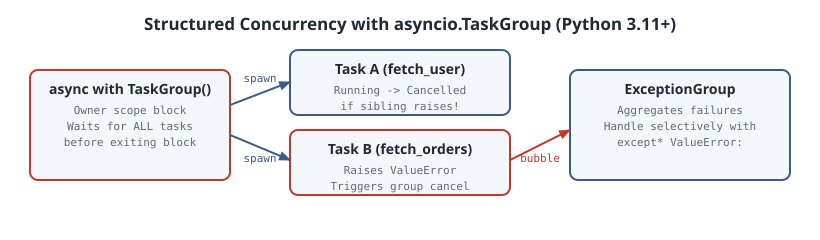

# TaskGroup Structured Concurrency

## Thesis

**`asyncio.TaskGroup`** (3.11+) is structured concurrency for asyncio: tasks spawned in the group are awaited together; the first unhandled exception cancels siblings and re-raises as `ExceptionGroup`. Lifetimes nest with the `async with` block.

## Mental model

```text
  async with asyncio.TaskGroup() as tg:
      tg.create_task(work(1))
      tg.create_task(work(2))
  # all done or cancelled; exceptions bundled
```

Contrast: bare `create_task` without a supervisor leaks failures into "Task exception was never retrieved".

## Worked example

```python
# taskgroup_demo.py
import asyncio

async def ok(n):
    await asyncio.sleep(0.05)
    return n * 2

async def boom():
    await asyncio.sleep(0.01)
    raise RuntimeError("boom")

async def main_ok():
    async with asyncio.TaskGroup() as tg:
        t1 = tg.create_task(ok(1))
        t2 = tg.create_task(ok(2))
    print("results", t1.result(), t2.result())

async def main_fail():
    try:
        async with asyncio.TaskGroup() as tg:
            tg.create_task(ok(1))
            tg.create_task(boom())
    except* RuntimeError as eg:
        print("caught", type(eg).__name__, [repr(e) for e in eg.exceptions])

asyncio.run(main_ok())
asyncio.run(main_fail())
```

```text
results 4 9
ExceptionGroup: ExceptionGroup ['boom-1']
```

## Trap

**Swallowing the `ExceptionGroup` without inspecting `.exceptions`.** Also: spawning tasks that outlive the group on purpose — that is the opposite of structured concurrency; use an explicit long-lived supervisor if you must.

## Boring rule

Prefer `TaskGroup` (or Trio nurseries) whenever several async jobs share a scope. Use `except*` to unwrap typed failures.

## Try this

1. Add a third task that ignores `CancelledError` incorrectly and observe shutdown.
2. Nest TaskGroups and cancel the outer scope.
3. Compare with `asyncio.gather(..., return_exceptions=True)`.

## Sources

- [Python docs: TaskGroup](https://docs.python.org/3/library/asyncio-task.html#asyncio.TaskGroup)
- [PEP 654](https://peps.python.org/pep-0654/) — Exception Groups
- [PEP 678](https://peps.python.org/pep-0678/) — Exception Notes
## Architecture Diagram & Structured Cancellation Lab



Verify how a failing sibling task cancels peers automatically and surfaces failures as an `ExceptionGroup` handled with `except*`:

```python
import asyncio

async def worker(name: str, delay: float, fail: bool = False) -> str:
    try:
        await asyncio.sleep(delay)
        if fail:
            raise ValueError(f"{name} failed")
        return f"{name} ok"
    except asyncio.CancelledError:
        print(f"{name} was cancelled cleanly")
        raise

async def main() -> None:
    try:
        async with asyncio.TaskGroup() as tg:
            tg.create_task(worker("slow-peer", 2.0))
            tg.create_task(worker("fast-boom", 0.05, fail=True))
    except* ValueError as eg:
        print("Caught ExceptionGroup errors:", [str(e) for e in eg.exceptions])

asyncio.run(main())
```
