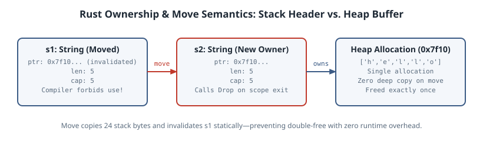

# Stack vs. Heap Memory and Move Semantics in Rust

Memory safety without a garbage collector starts with how Rust divides data between the **stack** and the **heap**, and how **move semantics** guarantee that every heap allocation has exactly one owner responsible for freeing it.



## Stack Frames vs. Heap Allocations

- **The Stack (LIFO, fixed-size):** Fast bump-pointer allocation and deallocation tied directly to function calls. Types with a compile-time known size (`i64`, `bool`, `[u8; 32]`, and the 24-byte header of a `String`) live on the stack.
- **The Heap (allocator-managed, dynamic):** Used when data has an unknown size at compile time or must outlive the current stack frame (`String` character buffers, `Vec<T>` elements, `Box<T>` payloads). Allocating asks the system allocator (or `jemalloc`/`mimalloc`) for a block and returns a pointer stored on the stack.

## Copy vs. Move Semantics

When you assign `let y = x;` in Rust, the compiler performs a shallow bitwise copy of the stack bytes—never an implicit deep heap copy:

| Trait | Behavior on `let y = x;` | Examples |
| :--- | :--- | :--- |
| **`Copy`** | Bitwise stack copy; `x` remains valid | `i32`, `f64`, `bool`, `char`, `&T`, tuples of `Copy` types |
| **Non-`Copy` (Move)** | Bitwise stack copy of header; `x` is statically invalidated | `String`, `Vec<T>`, `File`, `Box<T>` |

Because a `String` owns a heap pointer, allowing both `s1` and `s2` to remain valid after `let s2 = s1;` would trigger a **double-free** when both variables leave scope. Invalidating `s1` at compile time eliminates double-free and use-after-free bugs with zero runtime cost.

```rust
fn main() {
    let s1 = String::from("hello");
    let s2 = s1; // Move: s1's 24-byte header moves to s2; s1 is now invalid

    // println!("{s1}"); // Compile error E0382: borrow of moved value: `s1`
    println!("s2 owns: {s2} (len={}, cap={})", s2.len(), s2.capacity());

    // Explicit deep heap copy when two independent owners are actually needed
    let s3 = s2.clone();
    println!("s2={s2} at {:p}, s3={s3} at {:p}", s2.as_ptr(), s3.as_ptr());
}
```

## Deterministic Cleanup with `Drop` (RAII)

When an owner goes out of scope, Rust automatically injects a call to `Drop::drop(&mut self)` in reverse declaration order. That mechanism governs not only heap memory, but file descriptors, TCP sockets, and mutex guards.

> [!TIP]
> You cannot call `x.drop()` directly because Rust would still emit an automatic drop at the end of the scope. To release a resource early (such as a `MutexGuard` or `File`), pass it by value to `std::mem::drop(x)`.

## Hands-On Lab: Inspect Stack Addresses, Heap Pointers, and Drop Order

Run this program with `rustc` or `cargo run` to observe move semantics, distinct heap addresses after `.clone()`, and LIFO `Drop` order:

```rust
use std::mem;

struct Resource(&'static str);

impl Drop for Resource {
    fn drop(&mut self) {
        println!("Dropping {}", self.0);
    }
}

fn main() {
    println!("size_of::<String>() = {} bytes", mem::size_of::<String>());
    println!("size_of::<&str>()   = {} bytes", mem::size_of::<&str>());

    let _first = Resource("first");
    let _second = Resource("second");
    println!("Leaving main() -> watch LIFO drop order:");
}
```
