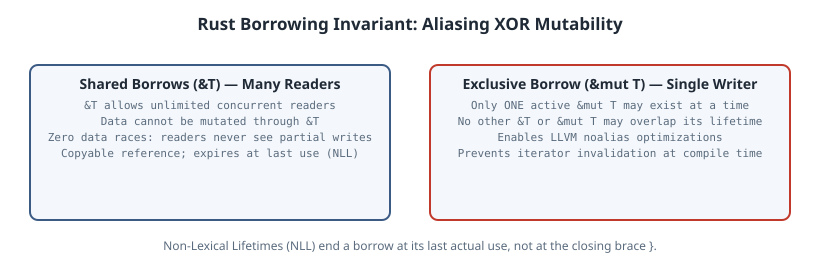

# The Borrowing Rules Demystified

Moving ownership into every helper function and returning it back would make real programs unreadable. **Borrowing** lets functions temporarily access data via references (`&T` and `&mut T`) while enforcing one core compile-time invariant: **Aliasing XOR Mutability**.



## The Two Invariants

At any point in a program's control-flow graph, a value may have either:

1. **Any number of shared (immutable) references (`&T`)**, OR
2. **Exactly one exclusive (mutable) reference (`&mut T`)**—and no active `&T` at the same time.

Additionally, every reference must always point to valid, initialized memory (no dangling pointers).

### Why Aliasing XOR Mutability Prevents Real Bugs

In C++ or Java, mutating a `Vec` while holding a pointer or iterator into its elements causes **iterator invalidation**: if `push()` reallocates the heap buffer to a new address, the existing reference silently becomes a dangling pointer. Rust's borrow checker catches that exact bug at compile time:

```rust
fn main() {
    let mut scores = vec![10, 20, 30];
    let first = &scores[0]; // Shared borrow starts here

    // scores.push(40);     // Compile error E0502: cannot borrow `scores` as mutable
                            // because it is also borrowed as immutable
    println!("First score: {first}"); // Last use of `first` (NLL ends borrow here)

    scores.push(40);        // Valid! No active shared borrow remains
    println!("Updated scores: {scores:?}");
}
```

## Non-Lexical Lifetimes (NLL) and Split Borrows

Modern Rust uses **Non-Lexical Lifetimes**: a borrow ends immediately after its **last actual use**, not at the closing curly brace `}`. The borrow checker also understands **disjoint struct fields**—you can hold `&mut cfg.host` and `&cfg.port` simultaneously because the compiler proves they reference non-overlapping memory.

For slices, `slice::split_at_mut(mid)` safely yields two non-overlapping `&mut [T]` halves from a single slice:

```rust
fn swap_halves(data: &mut [i32]) {
    let mid = data.len() / 2;
    let (left, right) = data.split_at_mut(mid);
    for (a, b) in left.iter_mut().zip(right.iter_mut()) {
        std::mem::swap(a, b);
    }
}
```

> [!NOTE]
> Because `&mut T` guarantees uniqueness (no other pointer aliases the same memory), `rustc` emits LLVM's `noalias` attribute on mutable references—unlocking register caching and vectorization optimizations that C compilers often cannot prove safe.

## Hands-On Lab: Fix a Borrow-Checker Conflict Three Ways

Compile and experiment with three idiomatic ways to resolve overlapping borrows in `rustc`:

```rust
fn main() {
    let mut values = vec![1, 2, 3, 4];

    // Pattern 1: Copy a small Copy value before mutating
    let first_val = values[0];
    values.push(first_val * 10);

    // Pattern 2: Shorten borrow scope via NLL
    let sum: i32 = values.iter().sum();
    values.push(sum);

    // Pattern 3: Mutate disjoint halves with split_at_mut
    let mid = values.len() / 2;
    let (lo, hi) = values.split_at_mut(mid);
    lo[0] += hi[0];

    println!("{values:?}");
}
```
