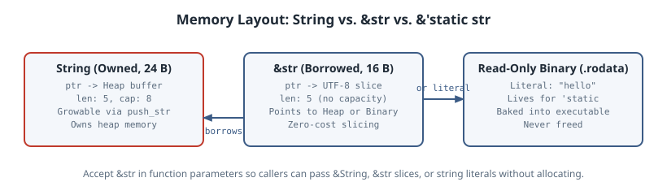

# `String` vs. `&str` Deep Dive

Rust's two primary string types confuse almost every newcomer until you look at their memory layouts. Both guarantee **valid UTF-8** at all times, but they differ in ownership, size on the stack, and mutability.



## Comparing Rust's String Family

| Type | Ownership | Stack Size (64-bit) | Growable? | Common Use Case |
| :--- | :--- | :--- | :--- | :--- |
| `String` | Owned heap buffer | 24 bytes (`ptr`, `len`, `cap`) | Yes | Building, mutating, or storing owned text in structs |
| `&str` | Borrowed UTF-8 view | 16 bytes (`ptr`, `len`) | No | Function parameters, zero-copy parsing slices |
| `&'static str` | Borrowed from binary `.rodata` | 16 bytes (`ptr`, `len`) | No | String literals baked into the executable |
| `Box<str>` | Owned fixed-size heap slice | 16 bytes (`ptr`, `len`) | No | Immutable keys/caches saving 8 bytes per entry |
| `Cow<'_, str>` | Borrowed *or* owned on demand | 24 bytes (enum) | On write | Returning input untouched in the fast path, allocating only when escaping/normalizing |

## Why Functions Should Accept `&str` (Deref Coercion)

`String` implements `Deref<Target = str>`. When a function accepts `name: &str`, callers can pass a `&String`, a slice `&s[0..4]`, or a string literal `"alice"` without allocating a single byte:

```rust
use std::borrow::Cow;

fn normalize_whitespace(input: &str) -> Cow<'_, str> {
    if !input.contains('\t') {
        Cow::Borrowed(input) // Zero allocations on the fast path
    } else {
        Cow::Owned(input.replace('\t', "    "))
    }
}

fn main() {
    let owned = String::from("clean text");
    assert!(matches!(normalize_whitespace(&owned), Cow::Borrowed(_)));
    assert!(matches!(normalize_whitespace("a\tb"), Cow::Owned(_)));
}
```

## UTF-8 Indexing: Bytes vs. Unicode Scalar Values

Because UTF-8 encodes characters in 1 to 4 bytes, Rust forbids integer indexing like `s[0]`—an $O(1)$ byte offset might slice straight through the middle of a multi-byte character and corrupt UTF-8. Always choose your level of granularity explicitly:

- `.bytes()` — raw `u8` bytes (ASCII protocols, hashing)
- `.chars()` — Unicode scalar values (`char`, 4 bytes each)
- `.char_indices()` — `(byte_offset, char)` pairs for safe slicing

> [!WARNING]
> Slicing with `&s[0..1]` panics at runtime if byte index `1` is not a valid UTF-8 character boundary. Use `s.get(0..1)` when slicing untrusted indices to receive an `Option<&str>` instead of panicking.

## Hands-On Lab: Measure Byte Length vs. Scalar Count on Multi-Byte UTF-8

```rust
fn main() {
    let samples = ["Rust", "café", "नमस्ते", "🦀"];
    for s in samples {
        println!(
            "{s:<8} | bytes: {:<2} | chars: {:<2} | char_indices: {:?}",
            s.len(),
            s.chars().count(),
            s.char_indices().collect::<Vec<_>>()
        );
    }
}
```
