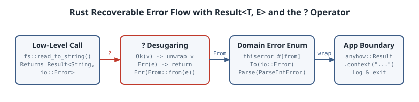

# Recoverable Errors with `Result` and the `?` Operator

Rust has no exceptions and no hidden control-flow unwinding for expected failures. Instead, fallible operations return `Result<T, E>`, forcing callers to handle or explicitly propagate failure paths at compile time.



## How the `?` Operator Works Under the Hood

The `?` operator is syntactic sugar for early return paired with automatic error conversion via the `From` trait:

```rust
// Writing:
let text = std::fs::read_to_string(path)?;

// Desugars conceptually to:
let text = match std::fs::read_to_string(path) {
    Ok(val) => val,
    Err(err) => return Err(From::from(err)),
};
```

Because `?` invokes `From::from(err)`, a function returning `Result<Config, AppError>` can seamlessly propagate `io::Error`, `ParseIntError`, and custom validation errors as long as `AppError` implements `From` for each underlying error type.

## Designing Typed Domain Errors Without Boilerplate

In libraries, callers need to match on structured error variants (using `thiserror` or manual `Display + Error + From`). In application binaries, callers mostly need rich context chains and backtraces (`anyhow`).

```rust
use std::fmt;
use std::fs;
use std::num::ParseIntError;

#[derive(Debug)]
enum ConfigError {
    Io(std::io::Error),
    Parse(ParseIntError),
    InvalidPort(u16),
}

impl fmt::Display for ConfigError {
    fn fmt(&self, f: &mut fmt::Formatter<'_>) -> fmt::Result {
        match self {
            ConfigError::Io(e) => write!(f, "failed to read config: {e}"),
            ConfigError::Parse(e) => write!(f, "invalid integer in config: {e}"),
            ConfigError::InvalidPort(p) => write!(f, "port {p} must be >= 1024"),
        }
    }
}

impl std::error::Error for ConfigError {}
impl From<std::io::Error> for ConfigError {
    fn from(e: std::io::Error) -> Self { Self::Io(e) }
}
impl From<ParseIntError> for ConfigError {
    fn from(e: ParseIntError) -> Self { Self::Parse(e) }
}

fn load_port(path: &str) -> Result<u16, ConfigError> {
    let raw = fs::read_to_string(path)?; // io::Error -> ConfigError::Io
    let port: u16 = raw.trim().parse()?; // ParseIntError -> ConfigError::Parse
    if port < 1024 {
        return Err(ConfigError::InvalidPort(port));
    }
    Ok(port)
}
```

> [!TIP]
> Reserve `.unwrap()` and `.expect("invariant reason")` for tests, prototypes, or provably unreachable states (such as parsing a compile-time constant regex). In production paths, propagate with `?` or recover with combinators like `.unwrap_or_else(...)`.

## Hands-On Lab: Exercise All Three Error Paths

Add this `main()` to the `ConfigError` program above and run it against a missing file, a non-numeric file, and a privileged port:

```rust
fn main() {
    let cases = [
        ("/tmp/missing-port.txt", None),
        ("/tmp/bad-port.txt", Some("not-a-number")),
        ("/tmp/low-port.txt", Some("80")),
        ("/tmp/ok-port.txt", Some("8080")),
    ];

    for (path, content) in cases {
        if let Some(c) = content {
            std::fs::write(path, c).unwrap();
        }
        match load_port(path) {
            Ok(port) => println!("{path}: loaded port {port}"),
            Err(e) => println!("{path}: error -> {e}"),
        }
    }
}
```
