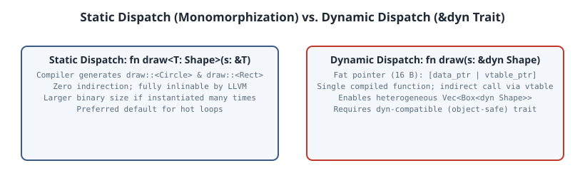

# Defining and Implementing Traits

Traits are Rust's single mechanism for shared behavior, operator overloading, generic bounds, and runtime polymorphism. Unlike inheritance hierarchies in object-oriented languages, traits compose cleanly across unrelated types and let you choose explicitly between **static dispatch** (zero-cost monomorphization) and **dynamic dispatch** (vtable fat pointers).



## Static Dispatch vs. Dynamic Dispatch

| Mechanism | Syntax | Runtime Cost | Binary Size | Heterogeneous Collections? |
| :--- | :--- | :--- | :--- | :--- |
| **Static dispatch** | `fn render<T: Shape>(s: &T)` or `s: &impl Shape` | Zero (inlined direct calls) | Larger (one copy per concrete type) | No |
| **Dynamic dispatch** | `fn render(s: &dyn Shape)` | 1 vtable pointer indirection | Small (single function body) | Yes (`Vec<Box<dyn Shape>>`) |

### The Orphan Rule (Coherence)

You may implement a trait `T` for a type `U` **only if either `T` or `U` is defined in your current crate**. This prevents two independent crates from supplying conflicting `impl Display for Vec<i32>` definitions when linked together. When you genuinely need to implement a foreign trait on a foreign type, wrap the type in a zero-cost **newtype** tuple struct (`struct Wrapper(Vec<i32>);`).

## Complete Example: Static and Dynamic Dispatch Side by Side

```rust
trait Metric {
    fn name(&self) -> &str;
    fn sample(&self) -> f64;
    fn format_line(&self) -> String {
        format!("{}={:.2}", self.name(), self.sample())
    }
}

struct CpuLoad(f64);
struct MemoryPct(f64);

impl Metric for CpuLoad {
    fn name(&self) -> &str { "cpu_load" }
    fn sample(&self) -> f64 { self.0 }
}

impl Metric for MemoryPct {
    fn name(&self) -> &str { "mem_pct" }
    fn sample(&self) -> f64 { self.0 }
}

// Static dispatch: monomorphized per concrete type
fn report_static(m: &impl Metric) {
    println!("[static]  {}", m.format_line());
}

// Dynamic dispatch: single function taking a fat pointer (&dyn Metric)
fn report_all(metrics: &[Box<dyn Metric>]) {
    for m in metrics {
        println!("[dynamic] {}", m.format_line());
    }
}

fn main() {
    let cpu = CpuLoad(0.72);
    report_static(&cpu);

    let list: Vec<Box<dyn Metric>> = vec![Box::new(cpu), Box::new(MemoryPct(64.5))];
    report_all(&list);
}
```

## Hands-On Lab: Verify Fat-Pointer Size vs. Thin-Pointer Size

```rust
use std::mem::size_of;

trait Speak { fn say(&self) -> &str; }
struct Bot;
impl Speak for Bot { fn say(&self) -> &str { "beep" } }

fn main() {
    println!("&Bot       = {} bytes (thin pointer)", size_of::<&Bot>());
    println!("&dyn Speak = {} bytes (data ptr + vtable ptr)", size_of::<&dyn Speak>());
}
```
