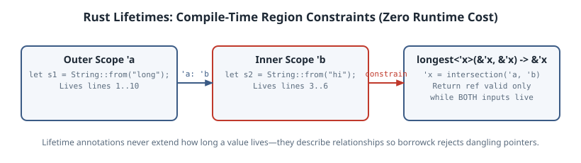

# What Lifetimes Are and Are Not

Every reference in Rust has a **lifetime**—the span of the program during which that reference is guaranteed to point to valid, initialized memory. Lifetimes are one of the most misunderstood features in Rust because people assume annotations change runtime behavior. In reality, **lifetime annotations never extend how long a value lives** and emit zero runtime instructions; they simply describe relationships between input and output borrows so the borrow checker can prove safety.



## Why Function Signatures Sometimes Need `'a`

When a function takes two references and returns one reference, the compiler cannot guess which input the output borrows from by looking at the signature alone:

```rust
// Both inputs and the return value share at least the overlapping region 'a
fn longest<'a>(x: &'a str, y: &'a str) -> &'a str {
    if x.len() >= y.len() { x } else { y }
}
```

Notice what `'a` means mathematically: `'a` is the **intersection** (shorter) of the two callers' lifetimes. The returned `&'a str` is valid only while *both* `x` and `y` remain alive.

## The Three Lifetime Elision Rules

You rarely write `'a` manually because `rustc` applies three deterministic elision rules in order:

1. Each elided input reference parameter gets its own distinct lifetime (`fn f(x: &str, y: &str)` → `fn f<'a, 'b>(x: &'a str, y: &'b str)`).
2. If there is **exactly one** input lifetime, that lifetime is assigned to all output references (`fn first_word(s: &str) -> &str`).
3. If one parameter is `&self` or `&mut self`, the lifetime of `self` is assigned to all output references.

## Structs Holding References and the `'static` Misconception

When a struct stores a borrowed slice (for zero-copy parsing), the struct itself must declare a lifetime parameter proving it cannot outlive the underlying buffer:

```rust
struct HeaderView<'a> {
    key: &'a str,
    value: &'a str,
}

fn parse_header(line: &str) -> Option<HeaderView<'_>> {
    let (k, v) = line.split_once(':')?;
    Some(HeaderView { key: k.trim(), value: v.trim() })
}
```

> [!IMPORTANT]
> `T: 'static` as a **trait bound** (such as on `std::thread::spawn`) does **not** mean "the value must be a compile-time constant." It means "`T` contains no non-`'static` borrowed references"—so owned types like `String`, `Vec<u8>`, and `Arc<Config>` all satisfy `T: 'static`!

## Hands-On Lab: Zero-Copy Line Parser Without Allocations

```rust
struct Entry<'a> {
    level: &'a str,
    msg: &'a str,
}

fn parse_log<'a>(line: &'a str) -> Option<Entry<'a>> {
    let (level, msg) = line.split_once(' ')?;
    Some(Entry { level, msg })
}

fn main() {
    let owned_line = String::from("WARN disk_usage=92%");
    let entry = parse_log(&owned_line).unwrap();
    println!("[{}] {}", entry.level, entry.msg);
    // Try moving `drop(owned_line);` above `println!` and inspect error E0505!
}
```
