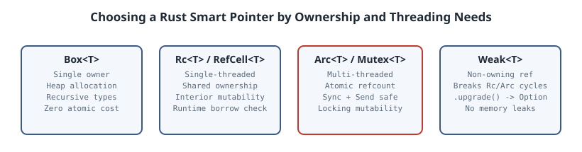

# Reference Counting with `Rc`, `Arc`, and Interior Mutability

Rust's default rule—every value has a single owner—covers 95% of systems code. When you build graphs, caches, ASTs, or shared configuration read by multiple threads, you need **shared ownership**. Rust expresses shared ownership explicitly through smart pointers that carry exact thread-safety and mutability guarantees in their types.



## Choosing the Right Smart Pointer Combination

| Combination | Thread-Safe? | Mutability | Overhead | Typical Use |
| :--- | :--- | :--- | :--- | :--- |
| `Box<T>` | If `T: Send` | Normal (`&mut Box<T>`) | Zero beyond heap alloc | Recursive types, large stack-avoidance, `dyn Trait` |
| `Rc<T>` | **No** (`!Send`, `!Sync`) | Immutable | Non-atomic counter increment | Shared read-only data on one thread (GUI trees, ASTs) |
| `Rc<RefCell<T>>` | **No** | Runtime borrow-checked | Counter + borrow flag | Single-threaded graphs/observers needing interior mutation |
| `Arc<T>` | **Yes** (`Send + Sync` if `T` is) | Immutable | Atomic `fetch_add`/`fetch_sub` | Shared read-only config/caches across worker threads |
| `Arc<Mutex<T>>` / `Arc<RwLock<T>>` | **Yes** | Synchronized locking | Atomic refcount + OS lock | Shared mutable state across threads |
| `Weak<T>` | Matches `Rc`/`Arc` | Read via `.upgrade()` | Weak counter | Parent back-pointers that break reference cycles |

## Breaking Reference Cycles with `Weak<T>`

Reference counting cannot collect cycles: if node A holds an `Rc` to node B and node B holds an `Rc` to node A, both strong counts stay at `1` forever and leak memory. Store child pointers as `Rc<Node>` and parent back-pointers as `Weak<Node>`, calling `.upgrade()` to get an `Option<Rc<Node>>` only when needed.

```rust
use std::cell::RefCell;
use std::rc::{Rc, Weak};

struct Node {
    name: &'static str,
    parent: RefCell<Weak<Node>>,
    children: RefCell<Vec<Rc<Node>>>,
}

fn main() {
    let root = Rc::new(Node {
        name: "root",
        parent: RefCell::new(Weak::new()),
        children: RefCell::new(vec![]),
    });

    let child = Rc::new(Node {
        name: "child",
        parent: RefCell::new(Rc::downgrade(&root)),
        children: RefCell::new(vec![]),
    });

    root.children.borrow_mut().push(Rc::clone(&child));

    println!(
        "root strong={}, weak={}",
        Rc::strong_count(&root),
        Rc::weak_count(&root)
    );
    if let Some(p) = child.parent.borrow().upgrade() {
        println!("child's parent is: {}", p.name);
    }
}
```

> [!WARNING]
> `RefCell::borrow_mut()` enforces Rust's borrowing rules at **runtime** rather than compile time. Holding two simultaneous `borrow_mut()` guards on the same `RefCell` will panic immediately—keep `RefCell` borrow guards scoped to the smallest possible block.

## Hands-On Lab: Share Read-Only State Across Threads with `Arc<T>`

```rust
use std::sync::Arc;
use std::thread;

fn main() {
    let config = Arc::new(vec!["node-a", "node-b", "node-c"]);
    let mut handles = Vec::new();

    for worker_id in 0..3 {
        let cfg = Arc::clone(&config);
        handles.push(thread::spawn(move || {
            println!("worker {worker_id} sees {} nodes", cfg.len());
        }));
    }

    for h in handles {
        h.join().unwrap();
    }
    println!("final strong count: {}", Arc::strong_count(&config));
}
```
