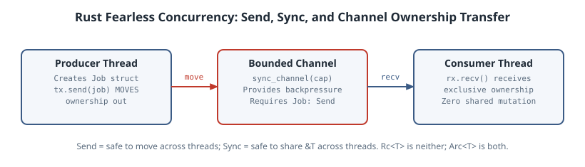

# Message Passing with Channels and Scoped Threads

Data races happen when two threads access the same memory simultaneously without synchronization and at least one access is a write. Rust eliminates data races at compile time through two marker traits—`Send` and `Sync`—and makes **ownership-transferring channels** (`std::sync::mpsc`) a natural default for coordinating worker threads.



## `Send` and `Sync` in One Minute

- **`T: Send`**: It is safe to **move** ownership of `T` from one thread to another (`String`, `Vec<T>`, `Box<T>`, `Arc<T>` are `Send`; `Rc<T>` is `!Send`).
- **`T: Sync`**: It is safe for multiple threads to hold shared references `&T` simultaneously (`T` is `Sync` if and only if `&T` is `Send`; `Mutex<T>` and `AtomicUsize` are `Sync`; `Cell<T>` and `RefCell<T>` are `!Sync`).

Because `mpsc::Sender::send(val)` takes `val` **by value**, the producer statically loses access to `val` the instant it enters the channel. Neither thread can mutate the same payload concurrently.

## Bounded Backpressure with `sync_channel`

`mpsc::channel()` creates an **unbounded** queue: if producers outpace consumers, memory grows without bound until the OOM killer terminates the process. In production pipelines, prefer `mpsc::sync_channel(bound)` so fast producers block automatically when the ring buffer fills:

```rust
use std::sync::mpsc;
use std::thread;

fn main() {
    // Bounded channel holding at most 4 in-flight jobs (automatic backpressure)
    let (tx, rx) = mpsc::sync_channel::<String>(4);

    let producer = thread::spawn(move || {
        for i in 1..=6 {
            let job = format!("job-{i}");
            tx.send(job).unwrap(); // Ownership moves into channel
        }
        // Dropping `tx` signals clean EOF to the consumer iterator
    });

    for job in rx {
        println!("processed {job}");
    }
    producer.join().unwrap();
}
```

## Borrowing Local Stack Data Safely with `std::thread::scope`

Classic `thread::spawn` requires closures to be `'static` because the spawned thread could outlive the spawning stack frame. `std::thread::scope` guarantees all scoped threads join before the scope returns—letting worker threads borrow local slices directly without `Arc`:

```rust
use std::thread;

fn main() {
    let data = vec![10, 20, 30, 40, 50, 60];
    let (left, right) = data.split_at(data.len() / 2);

    let total = thread::scope(|s| {
        let h1 = s.spawn(|| left.iter().sum::<i32>());
        let h2 = s.spawn(|| right.iter().sum::<i32>());
        h1.join().unwrap() + h2.join().unwrap()
    });

    println!("parallel sum = {total}");
}
```

> [!TIP]
> For multi-producer, multi-consumer (MPMC) work queues or `select!` across multiple channels, reach for `crossbeam-channel` or `flume`—both are drop-in replacements for `std::sync::mpsc` with higher throughput and non-blocking `select!` support.

## Hands-On Lab: Fan-In Aggregation Across Multiple Producers

Compile and run a multi-producer fan-in worker pool where 3 threads clone `tx`, compute partial results, and cleanly close the channel when every `Sender` drops:

```rust
use std::sync::mpsc;
use std::thread;

fn main() {
    let (tx, rx) = mpsc::sync_channel(8);

    for worker in 0..3 {
        let tx_clone = tx.clone();
        thread::spawn(move || {
            let partial: u64 = (1..=100).map(|n| n + worker * 100).sum();
            tx_clone.send((worker, partial)).unwrap();
        });
    }
    drop(tx); // Crucial: drop original sender so `rx` terminates after workers finish

    let mut grand_total = 0;
    for (worker, partial) in rx {
        println!("worker {worker} -> {partial}");
        grand_total += partial;
    }
    println!("grand_total = {grand_total}");
}
```
