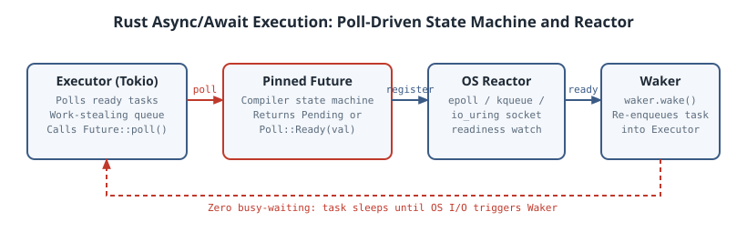

# The `Future` Trait and Async Basics

Unlike Go goroutines or JavaScript Promises, Rust `async` functions do **nothing** until an executor polls them. Every `async fn` compiles down to an anonymous zero-allocation state machine enum implementing `std::future::Future`, allowing millions of concurrent I/O tasks to multiplex onto a handful of OS threads without per-task heap stacks.



## Anatomy of `std::future::Future`

```rust
use std::pin::Pin;
use std::task::{Context, Poll};

pub trait Future {
    type Output;
    fn poll(self: Pin<&mut Self>, cx: &mut Context<'_>) -> Poll<Self::Output>;
}
```

Every part of this signature exists for a concrete systems reason:

- **`Poll::Pending` vs. `Poll::Ready(T)`:** Polling is pull-based. If a socket has no bytes ready yet, `poll` registers the task's `Waker` with the OS reactor (`epoll`/`kqueue`/`io_uring`) and immediately returns `Poll::Pending`.
- **`Pin<&mut Self>`:** An `async fn` state machine often stores local variables alongside references pointing into those same local variables across `.await` points (a self-referential struct). Pinning guarantees the future's memory address will not move once polling begins.
- **`Context` / `Waker`:** When the kernel signals socket readiness, the reactor invokes `waker.wake()`, placing the task back into the executor's run queue—eliminating busy-waiting.

## Why You Must Never Block Inside an `async fn`

Async executors (like Tokio's multi-threaded runtime) run a fixed pool of worker threads equal to your CPU core count. Calling `std::thread::sleep`, `std::fs::read`, or heavy CPU hashing directly inside an `async fn` monopolizes a worker thread and starves every other task scheduled on that thread.

> [!IMPORTANT]
> Offload blocking I/O or CPU-bound work to a dedicated blocking pool via `tokio::task::spawn_blocking`, or run CPU work on a separate `rayon` thread pool and send results back over a `tokio::sync::oneshot` channel.

## Hands-On Lab: Implement a Minimal Countdown `Future` by Hand

Write a custom `Future` without any external crates to see how `poll`, `Pin`, and `Waker` drive progress:

```rust
use std::future::Future;
use std::pin::Pin;
use std::task::{Context, Poll, RawWaker, RawWakerVTable, Waker};

struct Countdown(u8);

impl Future for Countdown {
    type Output = &'static str;

    fn poll(mut self: Pin<&mut Self>, cx: &mut Context<'_>) -> Poll<Self::Output> {
        if self.0 == 0 {
            Poll::Ready("liftoff!")
        } else {
            println!("tick: {}", self.0);
            self.0 -= 1;
            cx.waker().wake_by_ref(); // Signal readiness for next poll
            Poll::Pending
        }
    }
}

fn noop_waker() -> Waker {
    unsafe fn clone(_: *const ()) -> RawWaker { RawWaker::new(std::ptr::null(), &VTABLE) }
    unsafe fn noop(_: *const ()) {}
    static VTABLE: RawWakerVTable = RawWakerVTable::new(clone, noop, noop, noop);
    unsafe { Waker::from_raw(RawWaker::new(std::ptr::null(), &VTABLE)) }
}

fn main() {
    let mut fut = Box::pin(Countdown(3));
    let waker = noop_waker();
    let mut cx = Context::from_waker(&waker);

    loop {
        if let Poll::Ready(msg) = fut.as_mut().poll(&mut cx) {
            println!("Result: {msg}");
            break;
        }
    }
}
```
